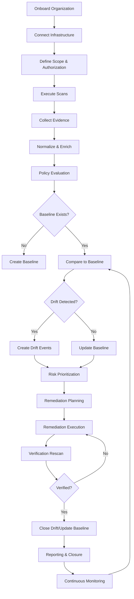

# 31_ENTERPRISE_WORKFLOW_AUDIT.md
## ZELNX CryptoScan — Enterprise Workflow Audit

**Generated:** 2026-09-20  
**Method:** End-to-end workflow modeling from onboarding through remediation closure  
**Scope:** Complete enterprise workflow — onboarding → discovery → scan → evidence → normalize → policy → baseline → drift → remediation → verification → reporting

---

## EXECUTIVE SUMMARY

| Workflow Phase | Implementation | Automation | Gaps |
|----------------|----------------|------------|------|
| **Onboarding** | ✅ 90% | ✅ Good | Tenant invitation UX |
| **Infrastructure Connection** | ✅ 80% | ✅ Good | Cloud credential rotation |
| **Scope Definition** | ✅ 85% | ⚠️ Manual | No automated discovery |
| **Authorization** | ✅ 90% | ✅ RBAC/ABAC | Resource-level missing |
| **Scan Execution** | ✅ 90% | ✅ Worker pool | No canary/delegated scans |
| **Evidence Collection** | ✅ 95% | ✅ Pipeline | Live crypto separate |
| **Normalization** | ✅ 90% | ✅ Automated | Duplicate registries |
| **Policy Evaluation** | ✅ 95% | ✅ Automated | Pack versioning only |
| **Baseline Approval** | ✅ 90% | ⚠️ Manual | No auto-baseline |
| **Drift Detection** | ⚠️ 40% | ❌ Manual | No auto-detection |
| **Risk Prioritization** | ✅ 85% | ✅ Graph-based | No threat intel |
| **Remediation Planning** | ✅ 80% | ⚠️ Semi-auto | No execution |
| **Remediation Execution** | ❌ 10% | ❌ Manual | No automation |
| **Verification/Rescan** | ✅ 80% | ⚠️ Semi-auto | No automated verification |
| **Closure/Reporting** | ✅ 85% | ✅ Templates | No auto-distribution |
| **Continuous Monitoring** | ⚠️ 40% | ⚠️ Scheduled | No real-time |

**Overall: 6.5/10** — Strong core workflow, critical gaps in drift automation and remediation execution

---

## 1. COMPLETE WORKFLOW MODEL

### 1.1 Enterprise Workflow Steps

---

## 2. PHASE-BY-PHASE ANALYSIS

### 2.1 Phase 1: Onboarding (✅ 90%)

| Step | Implemented | Automation | API | UI |
|------|-------------|------------|-----|----|
| Create Organization | ✅ | ✅ | `POST /tenancy` | ✅ |
| Invite Users | ✅ | ✅ Email | `POST /auth/invite` | ✅ |
| Accept Invitation | ✅ | ✅ Token | `POST /invite-accept` | ✅ |
| Assign Roles | ✅ | ✅ | `POST /tenancy/{id}/members` | ✅ |
| Configure SSO/OIDC | ✅ | ✅ | `POST /sso/providers` | ✅ |
| Configure SCIM | ✅ | ✅ | `POST /scim/v2/Users` | ✅ |
| Set Tenant Settings | ✅ | ✅ | `PATCH /tenancy/{id}` | ✅ |

**Gaps:**
- No guided onboarding wizard
- No tenant template/profile selection
- No default policy pack assignment
- No sample data/seeding option

---

### 2.2 Phase 2: Infrastructure Connection (✅ 80%)

| Connection Type | Implemented | Credential Management | Rotation | Validation |
|-----------------|-------------|----------------------|----------|------------|
| Git Repositories | ✅ | Webhook + PAT | Manual | Webhook test |
| Cloud Accounts (AWS/Azure/GCP) | ✅ | IAM roles/keys | Manual | API test |
| Kubernetes Clusters | ✅ | Kubeconfig/SA | Manual | API test |
| Container Registries | ✅ | Credentials | Manual | Registry test |
| Network Targets | ✅ | None (active probe) | N/A | Probe test |
| HSM/PKCS#11 | ⚠️ Parser only | Config file | Manual | Config test |
| KMIP | ⚠️ Parser only | Config file | Manual | Config test |
| SMTP/Alerting | ✅ | Credentials | Manual | Test email |
| SIEM/ITSM Webhooks | ✅ | Webhook secret | Manual | Test event |

**Gaps:**
- No credential rotation automation
- No credential health monitoring
- No delegated credential management
- HSM/KMIP not operational (parsers only)

---

### 2.3 Phase 3: Scope Definition (✅ 85%)

| Scope Element | Implemented | Automation | Gaps |
|---------------|-------------|------------|------|
| System Registry | ✅ | Manual CRUD | No auto-discovery |
| Business Processes | ✅ | Manual CRUD | No CMDB sync |
| Business Owners | ✅ | Manual CRUD | No HR/AD sync |
| Compliance Scopes | ✅ | Manual assignment | No policy auto-assign |
| Environments | ✅ | Manual | No env promotion |
| Network Targets | ✅ | Manual CIDR/host | No auto-discovery |
| Cloud Scope | ✅ | Account-level | No resource-group granularity |
| Container Scope | ✅ | Registry/repo | No image promotion tracking |
| Authorization Boundaries | ✅ | RBAC/ABAC | Resource-level missing |

---

### 2.4 Phase 4: Authorization (✅ 90%)

| Auth Element | Implemented | Gaps |
|--------------|-------------|------|
| RBAC (8 roles) | ✅ | Resource-level missing |
| ABAC | ✅ (opt-in) | Not default |
| API Keys | ✅ | Scoped, quotas, IP allowlist |
| SSO/OIDC | ✅ | SAML missing |
| SCIM | ✅ | Provisioning only |
| Session Management | ✅ | No concurrency limits |
| MFA (TOTP) | ✅ | WebAuthn missing |
| Audit Trail | ✅ | Read operations not logged |

---

### 2.5 Phase 5: Scan Execution (✅ 90%)

| Scan Type | Trigger | Scheduling | Concurrency | Delegation |
|-----------|---------|------------|-------------|------------|
| Git Repo | Manual/API | Cron (monitor) | Worker pool (4) | ❌ |
| Cloud Account | Manual/API | Cron (monitor) | Worker pool | ❌ |
| Container Image | Manual/API | Cron (monitor) | Worker pool | ❌ |
| Network Scan | Manual/API | Cron (monitor) | Worker pool | ❌ |
| Container Runtime | Manual/API | Cron (monitor) | Worker pool | ❌ |
| Live Crypto | API/Event | Continuous | Live engine | N/A |
| Live Hardware | API/Event | Continuous | Live engine | N/A |

**Gaps:**
- No canary/progressive scan deployment
- No scan delegation to external runners
- No scan prioritization/queuing policies
- No scan cost estimation
- No scan cancellation granularity (all-or-nothing)

---

### 2.6 Phase 6: Evidence Collection (✅ 95%)

| Evidence Source | Pipeline | Integrity | Deduplication | Chain Hash |
|-----------------|----------|-----------|---------------|------------|
| Static Scanner | ✅ | SHA-256 + Chain | Content-hash | ✅ |
| Network Scanner | ❌ | ❌ | ❌ | ❌ |
| Container Scanner | ❌ | ❌ | ❌ | ❌ |
| Cloud Scanner | ❌ | ❌ | ❌ | ❌ |
| Runtime Engine | ❌ | ❌ | ❌ | ❌ |
| Live Crypto | ❌ | ❌ | ❌ | ❌ |

**Critical Gap:** Only static scanner uses evidence pipeline.

---

### 2.7 Phase 7: Normalization (✅ 90%)

| Step | Implemented | Gaps |
|------|-------------|------|
| Exact Match | ✅ | — |
| Pattern Match | ✅ | — |
| Family Match | ✅ | — |
| Fallback | ✅ | Falls to UNKNOWN |
| NIST Enrichment | ✅ | — |
| IANA Enrichment | ✅ | — |
| CBOM Enrichment | ✅ | — |
| Family Enrichment | ✅ | — |
| Duplicate Registries | ❌ | Two registries |

---

### 2.8 Phase 8: Policy Evaluation (✅ 95%)

| Aspect | Implemented | Gaps |
|--------|-------------|------|
| YAML Rules | ✅ | — |
| Rule Validation | ✅ | — |
| Hot Reload | ✅ | — |
| Pack Hash | ✅ | — |
| Evaluation Engine | ✅ | — |
| Pack Versioning | ✅ | — |
| Rule Conflicts | ❌ | No conflict detection |
| Rule Testing | ❌ | No rule test framework |

---

### 2.9 Phase 9: Baseline Approval (✅ 90%)

| Step | Automation | Gaps |
|------|------------|------|
| Baseline Creation | Manual (POST) | No auto-baseline |
| Baseline Approval | Manual (auditor) | No auto-approve |
| Baseline Comparison | Manual (drift API) | No auto-compare |
| Baseline Supersession | Manual | No auto-supersede |
| Baseline Archival | Manual | No retention policy |

**Critical Gap:** No automated baseline creation on first clean scan.

---

### 2.10 Phase 10: Drift Detection (⚠️ 40%)

| Capability | Implemented | Gaps |
|------------|-------------|------|
| Automated Detection | ❌ | Manual only |
| Baseline Comparison | Manual API | No auto-compare |
| Drift Classification | ✅ Types | No semantic diff |
| Severity Assignment | ✅ | Rules-based |
| Drift Event Creation | Manual API | No auto-create |
| Notification | Manual digest | No real-time alerts |
| Acknowledgment | ✅ Auditor | — |
| Resolution | ✅ Auditor | — |
| False Positive | ✅ Auditor | — |

**Critical Gap:** No automated drift detection on scan completion.

---

### 2.11 Phase 11: Risk Prioritization (✅ 85%)

| Factor | Implemented | Source |
|--------|-------------|--------|
| Quantum Risk | ✅ | Quantum engine |
| Compliance Status | ✅ | Policy engine |
| Drift Severity | ✅ | Drift engine |
| Business Impact | ✅ | Graph engine |
| Blast Radius | ✅ | Graph engine |
| Vendor Chain | ✅ | Graph engine |
| Agility Score | ✅ | Agility engine |
| Migration Readiness | ✅ | Readiness engine |
| Threat Intelligence | ❌ | No threat intel |

---

### 2.12 Phase 12: Remediation Planning (✅ 80%)

| Aspect | Implemented | Gaps |
|--------|-------------|------|
| Remediation Rules | ✅ 15 rules | No custom rules |
| Priority Assignment | ✅ P0-P3 | — |
| Effort Estimation | ✅ | Rough estimates |
| Backlog Generation | ✅ | Per-system grouping |
| Migration Planning | ✅ Graph-based | No execution |
| Custom Rules | ❌ | No rule builder |
| Rule Testing | ❌ | No test framework |

---

### 2.13 Phase 13: Remediation Execution (❌ 10%)

| Capability | Status | Gaps |
|------------|--------|------|
| Code Refactoring | ❌ | No automation |
| Config Migration | ❌ | No automation |
| Library Upgrade | ❌ | No orchestration |
| HSM Firmware Update | ❌ | No coordination |
| Certificate Re-issuance | ❌ | No automation |
| Key Rotation | ❌ | No orchestration |
| Testing/Validation | ❌ | No pipeline |
| Rollback | ❌ | No rollback |
| Canary Deployment | ❌ | No deployment |

**Critical Gap:** Zero remediation execution automation.

---

### 2.14 Phase 14: Verification/Rescan (✅ 80%)

| Verification Step | Automation | Gaps |
|-------------------|------------|------|
| Rescan Trigger | Manual/API | No auto-trigger on remediation |
| Rescan Execution | Worker pool | — |
| Evidence Comparison | ✅ diff_records | — |
| Policy Re-evaluation | ✅ | — |
| Drift Resolution | Manual | No auto-resolve |
| Baseline Update | Manual | No auto-update |
| Automated Verification | ❌ | No CI/CD integration |

---

### 2.15 Phase 15: Closure/Reporting (✅ 85%)

| Report Type | Automation | Distribution |
|---------------|------------|--------------|
| Scan Report | ✅ (HTML/PDF/JSON) | Manual download |
| Drift Report | ✅ | Manual |
| Compliance Report | ✅ (6 templates) | Manual |
| Executive Summary | ✅ | Manual |
| Evidence Package | ✅ (ZIP) | Manual |
| CBOM Export | ✅ (JSON/XML) | Manual |
| Audit Log Export | ✅ (JSONL) | Manual |
| Scheduled Reports | ✅ Scheduler | Manual config |

**Gaps:** No automated distribution (email, webhook, SIEM).

---

### 2.16 Phase 16: Continuous Monitoring (⚠️ 40%)

| Monitor Type | Frequency | Automation | Gaps |
|--------------|-----------|------------|------|
| Network Targets | 30s (config) | Re-scan | No baseline compare |
| Cloud Accounts | 30s (config) | Re-scan | No baseline compare |
| Repository | 30s (config) | Re-scan | No baseline compare |
| Container | 30s (config) | Re-scan | No baseline compare |
| Live Crypto | Continuous | Live engine | Separate pipeline |
| Live Hardware | Continuous | Live engine | Separate pipeline |
| Certificate Expiry | Daily | Monitor | ✅ |
| Drift Digest | Daily | Manual API | No auto-delivery |

**Critical Gap:** Monitor re-scans but **does not compare to baseline** — creates new scans without drift detection.

---

## 3. WORKFLOW AUTOMATION GAPS

### 3.1 Missing Automation

| Workflow Step | Current | Needed |
|---------------|---------|--------|
| Baseline creation | Manual | Auto on first clean scan |
| Baseline comparison | Manual API | Auto on scan completion |
| Drift event creation | Manual | Auto on comparison |
| Drift notification | Manual digest | Real-time (webhook, email, Slack) |
| Drift → Remediation task | Manual | Auto-create MigrationTask |
| Remediation execution | Manual | Automation engine |
| Verification rescan | Manual | Auto-trigger on remediation |
| Drift resolution | Manual | Auto-resolve on verification |
| Baseline update | Manual | Auto-supersede on verification |
| Report distribution | Manual download | Auto-distribute (email, webhook, SIEM) |

---

### 3.2 Missing Workflow Orchestration

| Orchestration Need | Current | Needed |
|--------------------|---------|--------|
| Workflow engine | None | Temporal/Airflow/Custom |
| State machine | Ad-hoc in code | Explicit state machine |
| Compensation/rollback | None | Saga pattern |
| Human-in-the-loop | Ad-hoc | Explicit approval steps |
| SLA tracking | None | SLA per workflow step |
| Escalation | Manual | Auto-escalation on timeout |
| Delegation | None | Delegate to team/owner |

---

## 4. ROLE-BASED WORKFLOW PARTICIPATION

| Workflow Step | SuperAdmin | CISO | SecurityAnalyst | Developer | Auditor | BusinessOwner | Scanner |
|---------------|------------|------|-----------------|-----------|---------|---------------|---------|
| Onboard Org | ✅ | | | | | | |
| Connect Infra | ✅ | ✅ | | | | | |
| Define Scope | ✅ | ✅ | | | | ✅ | |
| Authorize Access | ✅ | ✅ | | | ✅ | | |
| Trigger Scan | ✅ | ✅ | ✅ | ✅ | | | ✅ |
| Review Evidence | | ✅ | ✅ | ✅ | ✅ | ✅ | |
| Approve Baseline | | ✅ | | | ✅ | | |
| Acknowledge Drift | | ✅ | ✅ | | ✅ | | |
| Prioritize Risk | ✅ | ✅ | ✅ | | ✅ | ✅ | |
| Plan Remediation | ✅ | ✅ | ✅ | ✅ | | ✅ | |
| Execute Remediation | | | | ✅ | | | |
| Verify Remediation | | ✅ | ✅ | ✅ | ✅ | | |
| Approve Closure | ✅ | ✅ | | | ✅ | | |
| View Reports | ✅ | ✅ | ✅ | ✅ | ✅ | ✅ | |

---

## 5. SLA & ESCALATION

### 5.1 Current SLAs

| Workflow Step | SLA | Tracking | Escalation |
|---------------|-----|----------|------------|
| Scan Completion | None | Job status | None |
| Baseline Approval | None | Manual | None |
| Drift Acknowledgment | None | Manual | None |
| Drift Resolution | None | Manual | None |
| Remediation | None | Manual | None |
| Verification | None | Manual | None |
| Report Delivery | None | Manual | None |

### 5.2 Required SLAs

| Workflow Step | Target SLA | Escalation |
|---------------|------------|------------|
| Critical Drift Ack | 1 hour | → CISO → SuperAdmin |
| Critical Drift Resolve | 24 hours | → CISO → SuperAdmin |
| High Drift Ack | 4 hours | → SecurityAnalyst → CISO |
| High Drift Resolve | 7 days | → SecurityAnalyst → CISO |
| Medium Drift Resolve | 30 days | → SecurityAnalyst |
| Remediation Start | 48 hours | → Owner → Manager |
| Verification | 7 days | → Owner → SecurityAnalyst |
| Report Delivery | 24 hours | → Automated |

---

## 6. WORKFLOW METRICS — NOT TRACKED

| Metric | Current | Needed |
|--------|---------|--------|
| End-to-end workflow time | ❌ | ✅ |
| Scan-to-baseline time | ❌ | ✅ |
| Drift detection time | ❌ | ✅ |
| Drift MTTA (acknowledge) | ❌ | ✅ |
| Drift MTTR (resolve) | ❌ | ✅ |
| Remediation cycle time | ❌ | ✅ |
| Verification time | ❌ | ✅ |
| End-to-end cycle time | ❌ | ✅ |
| First-pass remediation rate | ❌ | ✅ |
| Rework rate | ❌ | ✅ |
| Baseline currency | ❌ | ✅ |
| Drift recurrence rate | ❌ | ✅ |

---

## 6. WORKFLOW INTEGRATION GAPS

| Integration | Current | Needed |
|-------------|---------|--------|
| CI/CD Pipeline | `scripts/ci_gate.py` | Native GitHub/GitLab/Jenkins/ArgoCD |
| Ticketing | None | Jira, ServiceNow, GitHub Issues |
| SIEM | None | Splunk, Elastic, Sentinel |
| ChatOps | None | Slack, Teams, Mattermost |
| Email | Manual digest | Automated notifications |
| Webhook | Platform events | Drift, scan, baseline events |
| CMDB | None | ServiceNow, BMC |
| HR/AD | SCIM provisioning | Role sync, org changes |
| CMDB Sync | None | System/process sync |
| Vulnerability Mgmt | SBOM vuln feed | Full VM integration |

---

## 7. WORKFLOW VERSIONING & AUDIT

### 7.1 Workflow State Tracking

| Artifact | Versioned | Audit Trail |
|----------|-----------|-------------|
| Scan | ✅ (scan_id) | ✅ Platform events |
| Evidence | ✅ (evidence_id) | ✅ Evidence chain |
| Baseline | ✅ (baseline_id) | ✅ Platform events |
| Drift Event | ✅ (drift_id) | ✅ Audit chain |
| Remediation Task | ✅ (task_id) | ✅ Audit chain |
| Migration Project | ✅ (project_id) | ✅ Audit chain |
| Policy Pack | ✅ (pack_hash) | ✅ Platform events |
| Graph Snapshot | ✅ (version) | ✅ Graph snapshots |

### 7.2 Missing Workflow Audit

| Missing Audit | Needed |
|---------------|--------|
| Workflow start/end | End-to-end timing |
| Step transitions | State machine logging |
| Human decisions | Approver, rationale, timestamp |
| Automation decisions | Rule, input, output, timestamp |
| Escalations | Escalation path, timing |
| SLA breaches | Breach detection, alerting |

---

## 8. RECOMMENDATIONS

### P0 — Critical

1. **Automate drift detection** — Scan completion → baseline compare → drift events
2. **Implement remediation execution engine** — Code refactoring, config migration, library upgrade
3. **Add workflow orchestration** — State machine, compensation, human-in-the-loop
4. **Define and track SLAs** — MTTA, MTTR, escalation automation

### P1 — High

4. **Automate baseline lifecycle** — Auto-create, auto-compare, auto-supersede
5. **Implement workflow orchestration** — State machine, compensation, human-in-the-loop
6. **Add SLA tracking & escalation** — MTTA, MTTR, auto-escalation
7. **Automate report distribution** — Email, webhook, SIEM, scheduled

### P2 — Medium

8. **Workflow metrics dashboard** — End-to-end timing, MTTA/MTTR, SLA compliance
9. **Ticketing integration** — Jira, ServiceNow, GitHub Issues auto-create
10. **ChatOps integration** — Slack/Teams notifications, commands
11. **CI/CD native integration** — GitHub Actions, GitLab CI, Jenkins, ArgoCD
12. **Delegated scan execution** — External runners, canary scans

### P3 — Enhancement

13. **Workflow templates** — Reusable workflow definitions
14. **Workflow versioning** — Versioned workflow definitions
15. **Simulation/sandbox** — Test workflow changes safely
16. **Advanced orchestration** — Parallel branches, conditional logic, loops

---

## 8. VERIFICATION EVIDENCE

| Finding | File |
|---------|------|
| Onboarding | `services/api/api/routers/onboarding.py` |
| Infrastructure | `services/api/api/routers/connectors.py` |
| Scope | `services/api/api/routers/scope.py` |
| Auth | `services/api/api/routers/auth.py`, `rbac.py` |
| Scans | `services/api/api/routers/scans.py`, `trigger.py` |
| Evidence | `services/evidence/evidence/core/pipeline.py` |
| Normalization | `services/normalization/normalization/core/engine.py` |
| Policy | `services/policy/policy/core/engine.py` |
| Baselines | `services/api/api/routers/baselines.py` |
| Drift | `services/api/api/routers/drift.py`, `daily_digest.py` |
| Graph risk | `services/graph_engine/graph_engine/core/engine.py` |
| Remediation | `services/remediation/remediation/engine.py` |
| Migration | `services/api/api/routers/graph.py:graph_migration_plan()` |
| Reports | `services/api/api/routers/report_schedules.py` |
| Monitor | `scripts/run_monitor.py`, `services/monitor/` |
| Scheduler | `services/api/api/routers/report_schedules.py` |

## Round 23 addendum (2026-10-10) — first full processing (SLA metrics, honest ack stamps, clean-scan baseline proposals)

This report had never been re-verified against the remediated code (the
round-20 status table covered deep/17–30 only). Full re-read; verdicts:

**Stale (already built before this round):**

- §2.10 "No automated drift detection on scan completion" — STALE: the
  worker pipeline's drift stage runs on EVERY completed scan: baseline
  comparison (`DriftDetector`), key-inventory drift (no baseline needed),
  config-setting drift (Drift v2.0), DriftEvent rows created
  automatically, and `stage_alert` notifies on CRITICAL/HIGH.
- §2.16 "monitor re-scans but does not compare to baseline" — STALE:
  monitor-triggered scans go through the same worker pipeline, so the
  drift stage applies to them identically.
- §2.15 "No automated distribution" — STALE for email:
  `report_schedules` renders + snapshots + emails (SMTP) on schedule;
  webhook/SIEM distribution for reports remains open (event-bus
  webhooks exist for platform events).
- §2.4 "resource-level authorization missing" — shipped as the grants
  floor (R18) plus BU → System → Asset inheritance (R22).
- §2.14 "No automated verification" — the remediation verification loop
  (5-verdict engine, 7 endpoints) shipped round 14.
- §2.6 "only static scanner uses evidence pipeline" — by-design split
  (live/runtime planes documented in audits 03/14 as TD-012-era
  decisions); network/container/cloud scans persist their own tables.

**Built this round:**

- **§5/§6 (SLA & workflow metrics): `GET /drift/sla`.** The acknowledge
  path previously reused the resolve path — it stamped `resolved_at` and
  recorded no ack time, so MTTA was uncomputable. Migration 0079 adds
  `acknowledged_at`/`acknowledged_by` to `drift_events`;
  `DriftRepository.acknowledge` now stamps acknowledgment without
  touching resolution. `sla_summary()` computes MTTA/MTTR (mean + p95),
  per-severity open counts, oldest-open age, and SLA compliance against
  the report's §5.2 windows (CRITICAL ack 1h / resolve 24h, HIGH 4h/7d,
  MEDIUM 24h/30d) with breach counts. Honest accounting: events
  acknowledged before the column existed are counted as
  `acknowledge_time_unknown` and excluded from MTTA — never imputed.
  Reads are bounded with an explicit truncation flag.
- **§2.9 / 88 GAP-011 (baseline lifecycle): clean-scan proposals.** When
  a system has no active baseline and a scan comes back clean (no FAIL
  policy evidence, no CRITICAL/HIGH drift), the drift stage creates a
  `PROPOSED` baseline and publishes a `baseline.proposed` event. A
  proposal NEVER activates itself — `GET /baselines/proposed`,
  `POST /baselines/{id}/approve-proposed` and `DELETE
  /baselines/{id}/proposal` are auditor decisions (audited either way),
  because a baseline is a trust anchor, not an observation. A newer
  clean-scan proposal supersedes an older one for the same system.

**Still open (product/deployment-scoped, unchanged):** remediation
execution engine (§2.13 — code refactoring/config migration automation
is its own product), workflow orchestration engine (§3.2 —
Temporal-style state machine), SLA escalation automation (§5 — the
metrics exist now; auto-escalation needs a routing policy), ticketing /
ChatOps / CMDB / native-CI integrations (§6), event-driven discovery
feeds (with audit 63: CloudTrail, CT logs, CVE feeds).

Tests: `services/api/tests/unit/test_round23_drift_sla_baselines.py`
(5) + `services/worker/tests/unit/test_round23_baseline_proposal.py`
(6). The migration-parity roundtrip test now discovers the chain head
dynamically instead of hardcoding a revision.

## Round 24 addendum (2026-10-10) — SLA escalation automation SHIPPED

§5.2's "auto-escalation on timeout" now exists:
`worker/monitor/sla_sweep.py` runs on the monitor tick, evaluates open
drift events against the §5.2 windows, and escalates the ones that just
crossed a window — one aggregated alert per severity through the
monitor's AlertRouter (CEF / signed webhook / email) plus a
`drift.sla_breach` platform event. Stateless by design: a crossing
alerts on the first tick after it happened (recent window 24h, covering
a day of monitor downtime) and stays silent afterwards — the persistent
signal is the open drift event and `GET /drift/sla`, not repeated pages.
The tick outcome carries the full SLA summary. With this, §5's row is:
SLA targets defined (round 23), tracked (round 23), escalated (this
round); what remains of §5.2 is only the human routing policy
(who receives which severity — a deployment configuration concern).
Tests: 4 SLA-sweep cases in
`services/worker/tests/unit/test_round24_monitor_sweeps.py`.

## Round 35 addendum (2026-10-12) — automation → ticket link BUILT

The ticketing surface is now reachable from the platform itself: the
automation bridge consumes `ticket.requested` events off the bus
(special-cased ahead of the loop-prevention prefix skip; the consumer
emits nothing back) and creates an ITSM ticket via
`EnterpriseRepository.create_ticket` with `provider="automation"` and
external ref `automation/{event_kind}/{asset_id or 'estate'}`.
Redelivery is idempotent (duplicate external ref + open state → same
ticket reported as duplicate); closed tickets may be re-opened as new.
ChatOps routing (Slack/Mattermost destinations) remains an external
system, as this report's standing classification records. Tests:
`services/api/tests/unit/test_ticket_consumer.py`.
