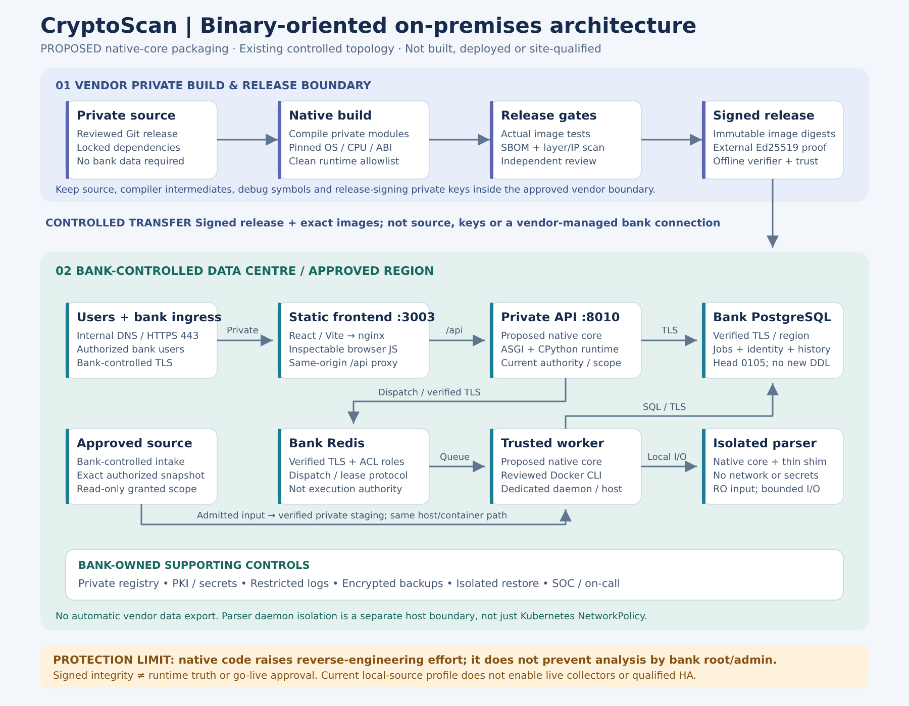
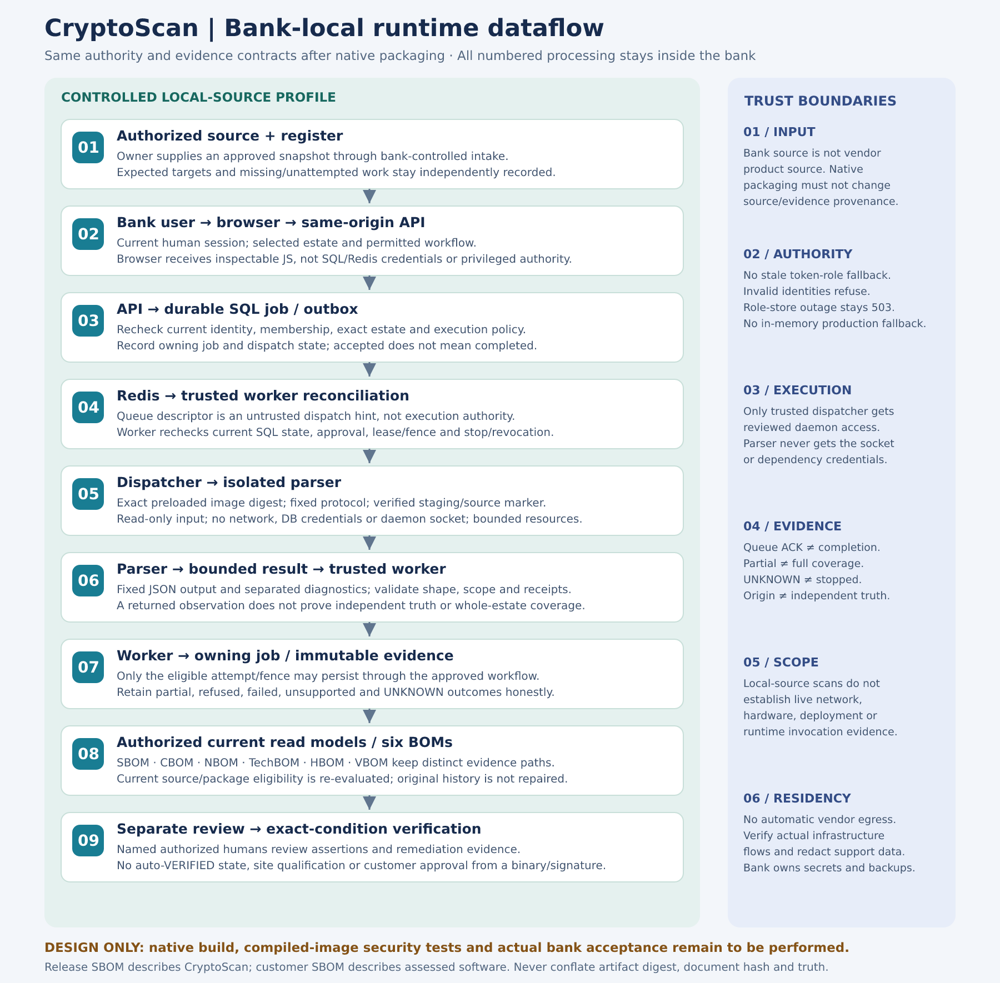

# Binary-oriented on-premises delivery for CryptoScan

**Prepared:** 2026-10-22 UTC

**Reviewed application source:** `2fd8fc8f`; documentation follow-up `86d406e3`.

**Status:** proposed packaging/build design and acceptance plan. **Not implemented, compiled, benchmarked, signed, deployed or bank-qualified by this document.** No new product features, live collectors, licensing service or deployment profile are introduced.

[Documentation index](README.md) · [Existing bank installation guide](BANK-ON-PREMISES-DEPLOYMENT.md) · [Authoritative operator procedure](runbooks/operator-install-upgrade-recover.md)

## 1. The direct answer

You can deliver CryptoScan to a bank **without delivering your proprietary Python source tree**. Build proprietary modules into native machine-code artifacts in your private build environment, put only the approved runtime artifacts into coordinated container images, and deliver a signed, digest-pinned offline release package. The bank operates those images inside its own approved infrastructure.

However, **you cannot guarantee that a bank with administrator/root access cannot reverse engineer the product**. Native code can be disassembled, strings and embedded rules recovered, and running processes inspected. A browser receives JavaScript and can inspect it. Container images can be extracted. Encryption with a locally available decryption key does not remove this limitation.

The realistic goal is **raise the cost of recovering proprietary implementation, avoid accidental source disclosure, verify release integrity, and keep bank data on premises**—not “impossible to reverse engineer.” Separate commercial confidentiality, technical IP protection, operational security and data residency.

### Recommended decision for this repository

1. **First:** native-compile proprietary Python modules, retaining reviewed thin Python launchers where the current runtime needs them. Cython is a candidate for this approach, subject to compatibility testing.
2. **Then, if worthwhile:** evaluate Nuitka standalone builds of individual service entrypoints. Treat these as a separately tested packaging variant, not a replacement for the complete deployment.
3. Keep React/Vite as a static browser bundle; put no secrets or confidential decision authority in it. Do not promise a secret or native-binary browser frontend.
4. Keep the current Kubernetes + regional PostgreSQL + verified-TLS Redis + dedicated dispatcher + networkless parser topology. Binary packaging does not justify a single unrestricted executable or a development Compose deployment.
5. Use the existing signed operator-package boundary, independent review and bank change approval. Do not add a new cloud dependency, phone-home requirement, remote kill switch or licensing service just to adopt native packaging.

## 2. What exists today versus what must change

| Area | Repository today | Proposed packaging work, not yet done |
|---|---|---|
| API | FastAPI/Uvicorn, `api.main:app`; `.docker/api/Dockerfile` copies `shared`, `services`, `scripts`, `config` into the final image | Compile selected proprietary modules and ship the tested native runtime closure, approved configuration and explicit operational exceptions |
| Worker | Python `-m worker.main`; stock worker image copies source | Thin compatible launcher + compiled core; retain signal handling, queue behavior, SQL authority, fences and recoverability |
| Dedicated dispatcher runtime | Derived worker image gains a reviewed Docker CLI through `.docker/worker-runtime/Dockerfile` | Build this from the native-core worker image and approved CLI digest; do not accidentally ship the source-based parent image |
| Isolated parser | Worker explicitly overrides its command to `python -I -m scanner.isolated`; `.docker/scanner/Dockerfile` copies source | Preserve a thin Python adapter + compiled private parser core initially; standalone parser executable would require a coordinated, reviewed launcher/protocol change |
| Frontend | React + Vite build, served by nginx on 3003; same-origin proxy to `api:8010` | Ship reviewed static assets only; no TypeScript tree, development server, public source maps or frontend secrets |
| Database | PostgreSQL, migration head 0105 | Same supported schema contract; native packaging itself adds no migration |
| Release tooling | Existing operator build/verify/preflight and detached external Ed25519 attestation | Bind the new artifacts/digests, compatibility manifest, SBOM and runbooks into the reviewed release process |

The current Dockerfiles **do not meet a no-proprietary-source delivery objective**. Renaming an image, deleting files from a later Docker layer, or calling it an “appliance” does not change that.

## 3. Architecture image



[Editable SVG / full-size architecture](architecture/binary-on-premises-architecture.svg)

**Read the boundary correctly:** the top lane is the vendor's private release environment; the lower lane is the bank. Only approved release artifacts cross into the bank. Bank source, scan results, operational evidence and credentials do not automatically cross back. The native-core boxes are a **proposal**, not a description of a build already produced.

## 4. Binary choices: what each actually protects

| Technique | What is delivered | Practical value | Limit / recommendation |
|---|---|---|---|
| Docker/OCI only | Files and filesystem layers | Repeatable deployment and dependency packaging | Not IP confidentiality; existing images contain source |
| `.pyc` / zipapp | Python bytecode or an archive | Loading/distribution convenience | Readily inspectable/decompilable; not sufficient IP protection |
| PyInstaller | Executable plus bundled interpreter/bytecode/dependencies | Application distribution convenience | Do not treat bundling as native compilation or strong source protection |
| Cython native extensions | CPython-compatible `.so` modules on Linux | Raises effort to recover compiled implementation; supports incremental conversion | Python/C API, exposed names, strings, rules and behavior can remain visible; compile and test the actual module closure |
| Nuitka standalone | Native-compiled application plus required runtime/dependency files | Candidate for per-service standalone delivery | Not automatically one static, dependency-free file; dynamic imports, resources, native libs and entrypoints need real testing |
| Rewrite a core in Rust/Go/C++ | Native libraries/executables | Potential long-term control over a genuinely sensitive core | Large correctness/review cost; not required for the first packaging increment and not recommended as a whole-product rewrite |
| Minification / obfuscation | Harder-to-read browser or runtime artifacts | Modest additional friction | Not a trust boundary; can hurt diagnostics and cannot hide browser-delivered logic |
| Local encrypted package | Ciphertext plus a way to run it locally | Protection at rest under a defined key-custody model | A privileged running host may recover plaintext/key material; not a reverse-engineering guarantee |

A trusted-execution/confidential-computing design would be a different infrastructure and attestation project, not a small binary-build flag. Do not claim it from ordinary containers, TLS, TPM presence or disk encryption.

## 5. Define the delivery contract before compiling

Agree and record:

- Exact Linux distribution/base-image digest, CPU architecture, CPython ABI where retained, libc/native library compatibility, compiler and build-tool versions. Build separate approved artifacts for `linux/amd64` and `linux/arm64` only if both are required and actually tested. Avoid accidentally building for only the build host's CPU features.
- The inventory of **proprietary modules/resources that must not appear in plaintext**, plus explicit allowed public launchers, operator/migration tooling and third-party files. Rules, model files, templates and lookup tables are IP too; native code does not automatically conceal them.
- Supported service entrypoints, module names, settings/environment variables, ports, health contracts, parser request/result schema, timeouts, exit codes, signals and filesystem paths.
- Which scripts, schemas and migration files the bank must inspect. Operational transparency is compatible with compiled proprietary algorithms; never hide necessary operator procedures merely to achieve “zero `.py` files.”
- Third-party licenses/notices, required source offers or redistribution duties. Have qualified legal review check actual dependencies and contracts; do not remove notices or assume every dependency can be closed-source redistributed.
- The bank's requirements for vulnerability assessment, software inventory, source escrow, forensic access, patch support and independent review. A no-source delivery policy must be agreed, not used to block legitimate bank security assessment. Contract restrictions are subject to applicable law.

Define measurable acceptance as “no unapproved proprietary source/bytecode/debug artifacts in shipped layers and bundles,” **not** “no skilled person can reconstruct any algorithm.”

## 6. End-to-end build pipeline

### Step 1 — Freeze a reviewed release

Select a reviewed commit and exact dependency/base-image locks. Record source identity separately from image digest, package hash and signature identity. Never use a Git SHA where an OCI digest is required. Keep the existing quality corrections and negative tests; do not loosen authority or evidence contracts to make compilation work.

Create the native-build toolchain lock in the private build process after evaluation. Record compiler, Cython/Nuitka and linker versions, build flags, OS packages and tool hashes. Native build tools are **not installed or pinned by this guide**.

### Step 2 — Inventory runtime imports and resources

Map API, worker, parser and shared packages. Include lazy/dynamic imports, decorators, Pydantic validation, SQLAlchemy mappings, serializable types, multiprocessing/subprocess behavior, policy/rule resources, templates, TLS resources, migration tools and path-based loaders. Test on a clean runtime without the source checkout or a developer `PYTHONPATH`.

The current Dockerfiles register service/shared package directories through a `.pth` file. A new artifact layout must deliberately preserve or replace that import contract; copying a single compiled API module is not sufficient.

### Step 3 — Prove one small native-core slice first

Choose a deterministic proprietary helper with controlled inputs/outputs. Compile it as a native module, install only its output into a clean test runtime, and run the same positive, negative and malformed-input vectors against source and compiled builds. Compare values, refusal semantics, types, serialization and evidence hashes where determinism is contractual. Measure startup time, CPU, memory, artifact size and diagnostic quality; do not assume a performance gain.

Only after this passes, expand module coverage. Generated C/C++, object files, intermediate archives and debug artifacts remain private. Stripping optional symbols is additional friction, not secrecy, and must preserve required dynamic exports/runtime metadata.

For orientation, a **disposable single-module Cython experiment** can use the following command after provisioning an approved, pinned Cython/setuptools/compiler toolchain. `private_core.py` is an illustrative prototype filename, **not an existing repository file or a production build recipe**. This command is shown, not executed:

```bash
# Run only in a private disposable prototype directory, not the product checkout.
cythonize -i -3 private_core.py
```

On the selected CPython/Linux target this produces a platform-specific extension such as `private_core.cpython-311-x86_64-linux-gnu.so`, alongside private build intermediates. Import the extension in a separate clean test runtime containing **no `private_core.py`**, assert its loaded `__file__` is the native artifact, and compare the same approved input/output vectors against the source baseline. The actual product needs an explicit, version-controlled module/resource build specification, native toolchain lock and image pipeline—not a recursive blind application of this command to every `.py` file.

### Step 4 — Preserve the service launch contracts

- **API:** keep `api.main:app` importable by the actual Uvicorn process; check FastAPI route registration, dependency injection, introspection and error handling against compiled modules.
- **Worker:** preserve a deliberately thin `worker.main` module if using `python -m`. A native extension is not automatically runnable with `-m`. Preserve signal handling, graceful stop, leases, fencing, retries and refused/UNKNOWN outcomes.
- **Parser:** the worker constructs `--entrypoint=python ... -I -m scanner.isolated`, regardless of the scanner image's default entrypoint. Merely replacing the image's ENTRYPOINT with a binary **will not work**. First preserve this adapter and compile its internal implementation. If later adopting a standalone parser executable, change and requalify the worker/parser contract together, including fixed-input JSON, stdout/stderr separation, deadline, source marker, runtime checks and bounded output.
- **Resources:** inspect `__file__`/path assumptions and shared data files. Keep approved read-only paths and required data separate from private compiler intermediates.

Thin launchers must contain no confidential business rules. Making them genuinely thin is implementation work; today's `worker.main` and `scanner.isolated` are not already just wrappers.

### Step 5 — Build separate multi-stage runtime images

**Build pattern specification, not a working replacement Dockerfile:**

```text
PRIVATE BUILD STAGE
  pinned builder base + locked compiler/build tools
  source checkout + locked dependencies
  compile proprietary modules; run native-build compatibility tests
  assemble explicit runtime artifact allowlist
             |
             | copy approved artifacts only, never entire source stage
             v
CLEAN RUNTIME STAGE
  pinned supported runtime base + required native libraries
  native private modules + allowed launchers/resources/dependencies
  approved configuration/schema/operational exceptions + license notices
  no source checkout, generated C/C++, compiler cache or debug maps
  non-root user; tested read-only root and bounded writable paths
```

Use a clean final stage with **no source-bearing ancestor layer** in the distributed image. Do not `COPY services /app/services` and later delete it. Do not ship the builder image, build cache, intermediate image exports, credentials or generated source. Scan all distributed image layers/config/history and the complete offline bundle, not just the merged running filesystem. Control registry permissions so private builder artifacts are not available to the customer.

Retain required runtime tools explicitly. In this profile the trusted dispatcher needs its reviewed Docker CLI/daemon access; the untrusted parser must never receive either. A generic shell-free/distroless choice is not automatically compatible with the current Python launcher, TLS trust setup, health probes or operator tooling. Removing a shell also does not prevent a privileged host from reading binaries.

### Step 6 — Build the frontend normally, keep authority in the backend

Use the committed Node/npm engine policy and lock with `npm ci`, then typecheck/test/build. Ship only approved static output and nginx configuration. Verify the published output and web server do not expose `.map` files, source archives, development/debug routes, `.env` files or secrets. Do not publish private source maps through a registry artifact or support bundle either; retain protected debug maps internally if needed.

Every user can download the JavaScript/CSS their browser receives. Minification is not source secrecy. Current API permissions, durable authority and exact-condition decisions must remain server-enforced. Never place keys, authority checks or confidential algorithms in frontend code as a protection measure.

### Step 7 — Test the actual compiled images

Run the existing tests where applicable against the compiled modules, then integration/security tests **using the actual candidate runtime images and no source checkout**. Source-build green results alone do not qualify a native image.

| Gate | Required observations |
|---|---|
| Import/startup/API | Complete route/dependency registration, settings validation, health/readiness, TLS trust, serialization and no missing native libraries |
| Current authority | Fresh durable roles; disabled/deleted/missing-production authority refuses; role-store failure remains 503, not stale-token fallback |
| Scope and evidence | Exact estate/CAS/immutable history; invalid current source proof remains 409; unresolved package versions never become exact paths |
| Parser sandbox | Real network denial, read-only input/root, no secrets/socket, UID/capability/process/memory/time/output bounds, same host staging path and marker proof |
| Job lifecycle | Real interruption, duplicate delivery, revocation/stop, daemon loss, fence/orphan handling and UNKNOWN reconciliation; record actual outcomes, do not infer success |
| Database | Approved actual PostgreSQL/TLS, 0105 migration/preflight and isolated restore; a skipped local disposable fixture does not satisfy this |
| Frontend | Real bank browser, relative API proxy, no unexpected egress, fallback fonts and no public source maps/secrets |
| Native packaging | No-source clean runtime, import/resource closure, ABI/CPU compatibility, signals, stack diagnostics, malformed input and resource exhaustion |
| IP exposure | No unapproved proprietary source/bytecode/intermediates/debug data across image layers, exported archives, package/scripts and browser assets |
| Independent review | Native attack surface, vulnerability scan, secret scan, third-party license review, appropriately scoped external assessment and bank acceptance |

No new compiled-image test results exist yet. Existing source test evidence in the [implementation ledger](product-improvement/IMPLEMENTATION-STATUS.md) retains its original scope and cannot be relabeled as binary-build evidence.

### Step 8 — Inventory, sign and transfer the complete release

Generate an accurate **release SBOM** for OS packages, native/runtime libraries, Python/JavaScript dependencies and proprietary component identities. Track compiler/build-tool provenance separately from runtime components. Native compilation can hide package metadata from simple scanners; retain the resolved build-time dependency evidence and map it to runtime contents. Assess new native-library vulnerabilities too.

Build and record coordinated immutable API, worker-runtime, parser and frontend images. Freeze all manifests, compatibility data, runbooks and verifier files before signing. The existing operator package inventories content and uses a **detached external Ed25519 attestation over the exact `release-image-lock.json` bytes**, whose file hashes bind the package. The public-key fingerprint needs an independent trusted channel. Do not substitute an invented license signature or assume an adjacent key is trusted.

Image-level signing/provenance can supplement this when the bank approves the tooling and trust model; it does not replace the existing package contract. Offline verification material must be sufficient without requiring public internet access.

Use the exact existing [build/sign/verify procedure](runbooks/operator-install-upgrade-recover.md#3-build-sign-externally-and-verify-the-complete-package) and [air-gap procedure](runbooks/operator-install-upgrade-recover.md#4-air-gap-procedure). Package creation does not sign anything automatically. Keep actual signatures/trust keys outside the package inventory as required; do not insert reports after signing. All distributed companion image archives must match the locked digests, and any additional content needs an approved integrity/verification contract—do not silently append files to a signed package.

## 7. What the bank receives

The following is a **logical delivery inventory**, not a new accepted on-disk package schema:

```text
Bank-approved delivery set
  Immutable application images / approved offline image transfer
    API, dedicated worker-runtime, isolated parser, static frontend
  Existing operator package
    release-image-lock.json, reviewed manifests, compatibility/runbook/verifier files
    approved inventories included before signing under the accepted package schema
  Detached release attestation + independently trusted public-key material
  Separately approved verifier runtime/dependencies for offline use
  Applicable third-party notices / required source offers
  Installation, operations, incident, upgrade and recovery instructions
  Support terms, known limitations and actual acceptance records
```

Do not ship private Git history, proprietary Python/TypeScript source trees, build caches/intermediates, private source maps/symbols, signing private keys, production secrets or bank credentials. Approved transparent operational scripts and legally required third-party material are explicit exceptions—not a false claim of “no source anywhere.”

An inventory is not a license waiver. If the current packager cannot represent a desired inventory/attachment, review that schema/process change before release rather than bypass its extra-file checks.

## 8. End-to-end bank-side installation

1. **Agree scope and responsibilities:** one bank-controlled instance under `kubernetes-external-services/local-source-v1`; approved region, named owners/reviewers, retention and support process. Define confidentiality/security-assessment terms and source-escrow expectations.
2. **Provision dependencies:** approved Kubernetes and dedicated worker/daemon host, regional PostgreSQL, verified-TLS Redis/ACLs, private registry, bank PKI, restricted approved-source storage, secret manager, monitoring and isolated backup/restore facilities. The daemon is a privileged boundary; no hostile shared-tenant worker node.
3. **Approve network flows:** user → ingress HTTPS 443; frontend 3003 → private API 8010; API/worker → approved SQL and Redis services over verified TLS; dedicated dispatcher → local approved daemon; parser has no network. Dependency ports follow actual bank service configuration, not internet exposure. Registry/trust provisioning uses controlled infrastructure flows.
4. **Receive and verify:** use a trusted verifier installation and independent trust anchor; verify exact package signature, file inventory and image digests before executing package contents. Import to the approved private registry/preload parser digest and re-verify digest consistency. No automatic parser pull at execution time.
5. **Provision secrets/configuration separately:** preserve bank custody of auth, TLS, database and Redis secrets. Supply the exact profile, estate/region/source policy, reviewed CA mounts, `TRUSTED_HOSTS` and exact HTTPS `CORS_ORIGINS`. Do not put secrets in the signed delivery bundle.
6. **Stage and preflight:** follow the existing operator runbook using the exact native candidate images, dedicated runtime socket permissions and matching host/container staging path. Its reference manifest intentionally contains invalid placeholders; never apply it unchanged.
7. **Backup and migrate:** obtain verified backups/isolated restore evidence; run only approved migration procedure to current head 0105 using separately controlled migration authority. Native packaging alone has no schema migration. Coordinate API/worker/parser/frontend versions.
8. **Witness acceptance:** execute native-image, authority, source-isolation, DB/TLS, browser, failure/recovery and IP-exposure checks. Record original outputs, exceptions, remaining gaps and independent human decisions. Signed integrity is not permission to mark the site ready.
9. **Operate:** bank internal users visit the internal HTTPS URL. No vendor SaaS is required for the proposed runtime. Validate actual egress including infrastructure/DNS/telemetry; a diagram or binary build does not prove no data leaves.
10. **Support and upgrade:** use the bank's SOC/on-call process for urgent incidents and an agreed weekly vendor review for nonurgent maintenance. Send only approved redacted diagnostics with release/build IDs, safe error categories and timestamps—not source, keys, SQL connection strings or raw dumps. Rebuild/sign/retest/reapprove each update; no unattended vendor push into the bank. Restore or roll back only under the reviewed schema/history compatibility plan.

The reviewed profile is **not** a qualified HA/active-active topology or a guarantee of uptime, staffing, response time or whole-bank collection. See [on-premises operations](BANK-24X7-OPERATIONS-AND-WEEKLY-SUPPORT.md).

## 9. Runtime dataflow image



[Editable SVG / full-size dataflow](architecture/binary-on-premises-dataflow.svg)

### Example: bank application release assessment

1. The application owner supplies an authorized source snapshot through the bank's controlled transfer process; the expected-target register remains independent of findings.
2. An authorized operator signs in and requests permitted local-source work under the selected estate. The browser sends relative same-origin API requests; it never connects directly to SQL/Redis or a vendor cloud.
3. API checks durable identity, current membership/roles, exact estate and execution policy. It records owning job/outbox state. Acceptance/queue acknowledgement does not mean a scan completed.
4. Redis carries approved dispatch notifications; worker treats descriptors as untrusted hints, reconciles authoritative SQL state and rechecks current execution authority. No stale token or in-memory production fallback supplies authority.
5. Trusted dispatcher stages only the admitted snapshot at the verified host/container path. It runs the exact preloaded parser digest under the existing fixed protocol and isolation constraints.
6. Parser reads permitted input, emits bounded protocol results to the trusted worker and has no SQL/Redis credentials, daemon socket or network. Logs and result fields are bounded/sanitized under the existing contract.
7. Worker validates receipts and owning attempt/fence before persistence through the approved job/evidence workflow. Failed, partial, unsupported, refused or UNKNOWN states remain visible; a parser response is not independently verified truth.
8. Current permitted views reconcile exact package/target/relationship eligibility with retained history. Existing **SBOM, CBOM, NBOM, TechBOM, HBOM and VBOM** retain separate meanings and evidence paths. This local-source scan does **not** automatically create verified network, hardware, runtime, deployment or vendor evidence.
9. Separate authorized humans review eligible assertions and remediation evidence under exact conditions. History stays immutable; no binary-build or signature automatically grants VERIFIED/customer acceptance.

The **release SBOM describing CryptoScan's shipped software** is distinct from a **customer SBOM imported or assessed by CryptoScan**. Native packaging must preserve both identities and avoid conflating document hash, artifact digest, provenance and factual truth.

## 10. IP protection and bank trust together

| Protection | Use it for | Do not promise |
|---|---|---|
| Native-compiled proprietary modules | Reduce plaintext implementation disclosure and increase analysis effort | Unrecoverable algorithms or hidden strings/rules |
| Multi-stage clean images + distributed-artifact scanning | Prevent accidental source/build/debug leakage | A container is an encryption boundary against bank root |
| Detached release signature + pinned images | Origin/integrity under independently trusted keys | Absence of vulnerabilities, truth of all findings or runtime tamper immunity |
| Bank-controlled RBAC, TLS, encryption/backups | Protect actual bank access/data under its controls | Physical residency/isolation is proven by configuration strings |
| Commercial confidentiality/escrow/support terms | Define permitted use, assurance access and continuity obligations | A technical prevention of reverse engineering or universal legal enforceability |
| Protected private symbols/source maps/build records | Diagnose reviewed builds without distributing private implementation | Safe transmission of raw memory/core dumps containing bank data |

Keep release-signing private keys in controlled vendor custody; keep bank operational secrets in bank custody. If offline licensing is independently required later, design it separately with bank-approved continuity/recovery semantics. A public verification key is not a secret; embedding a universal private/license/decryption key in an executable is unsafe. Do not make a production bank service fail merely because it cannot reach a vendor endpoint.

## 11. Practical implementation order and definition of done

| Increment | Bounded deliverable | Exit gate |
|---|---|---|
| A — Contract/inventory | Target OS/CPU/ABI; proprietary/allowed-file list; entrypoint/resource map; bank acceptance/security requirements | Engineering, security and operator agreement; no unsupported guarantee |
| B — Small native slice | One compiled core and clean test runtime | Source/native equivalence, negative tests, measured runtime costs and no source fallback |
| C — Coordinated native-core images | API, worker-runtime, parser and frontend, with preserved launch/protocol contracts | Actual image tests, layer/bundle IP scan, all relevant authority/evidence/isolation regressions |
| D — Release candidate | Accurate runtime inventory/SBOM, provenance, compatibility data, externally signed package and offline verification material | Independent package/security/legal review; offline verification on clean bank-like staging |
| E — Bank staging | Exact candidate site deployment and witnessed DB/TLS/browser/fault/restore/recovery exercises | Named technical acceptance, explicit unresolved issues and separate customer go-live approval |
| F — Maintained operation | Bank on-call monitoring, agreed support, reproducible rebuild procedure and approved patch process | Tested incident/backup/rotation/upgrade procedures; no invented SLA or automatic vendor update |

Do not distribute build artifacts or claim the above gates passed until actually executed. No binaries have been built in this documentation change. The next implementation decision is **which proprietary module to compile first and which exact Linux/CPU target to qualify**, not how to conceal the whole application in a single file.

## 12. Repository authorities and next reading

- [Current published implementation and retained tests](product-improvement/IMPLEMENTATION-STATUS.md)
- [Current quality-source upgrade consequences](runbooks/evidence-assurance-upgrade.md#current-quality-source-handoff-2fd8fc8f)
- [Existing operator build/sign/verify/install/recovery contract](runbooks/operator-install-upgrade-recover.md)
- [Actual isolated parser/runtime constraints](dev/scanner-isolation.md)
- [Bank deployment and responsibility matrix](BANK-ON-PREMISES-DEPLOYMENT.md)
- [Bank 24/7 operation and weekly support](BANK-24X7-OPERATIONS-AND-WEEKLY-SUPPORT.md)
- [All six BOM correctness/evidence boundaries](product-improvement/02-correctness-and-six-bom-quality.md)
- Current source-distributing image recipes: [API](../.docker/api/Dockerfile), [worker](../.docker/worker/Dockerfile), [parser](../.docker/scanner/Dockerfile).
- Current build-only/static frontend image recipe: [frontend](../.docker/frontend/Dockerfile).
- Fixed parser launcher to preserve/requalify: [worker isolation adapter](../services/worker/worker/core/static_scan_isolation.py).
