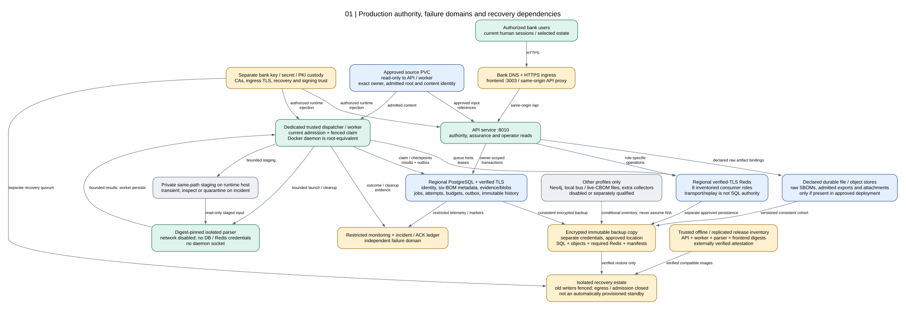

# 01 — Architecture, trust boundaries and recovery dependencies

[Pack index](README.md) · [Next: inventory](02-data-inventory-and-consistency-groups.md)

## 1. Architecture map

[Full-resolution SVG](diagrams/01-system-architecture.svg) ·
[Editable DOT](diagrams/01-system-architecture.dot)

Blue nodes identify durable/authoritative data, green operational controls,
amber bank-provisioned dependencies or approval gates, gray conditional/derived
components, and red stop/unsafe states. Colors do not certify implementation or
site qualification. Each arrow is explained below; recovery/vault arrows describe
required operating design, not an automatic backup integration.

## 2. Supported production execution path

1. A bank user reaches the approved HTTPS console through bank-controlled DNS,
   ingress and TLS. The frontend uses its same-origin `/api` proxy to Service
   `api:8010`; frontend container port is 3003 in the reference template.
2. The API verifies current durable identity, session/role/membership and selected
   estate. NULL/platform scope is distinct from every named tenant. A stale token
   or restored username is not permission to read another estate.
3. Regional PostgreSQL over hostname-verified TLS holds durable business and
   assurance state: scans/findings, identity, memberships, ownership, policies,
   approvals, jobs, attempts, budgets, outbox, evidence/blobs and revision history.
4. An admitted controlled job and its outbox record use SQL authority. Redis
   transports delivery/replay state; it is not a replacement for those SQL records.
5. A dedicated trusted dispatcher rechecks authority, claims eligible QUEUED work,
   stages only admitted local-source content and starts the digest-pinned parser.
6. The parser is networkless and receives neither SQL/Redis credentials nor the
   daemon socket. The dispatcher owns runtime launch, bounded exchange, cleanup,
   checkpoints and durable result handling. Daemon access is root-equivalent;
   this node is not a hostile shared-tenant isolation boundary.
7. A later approved rescan can support a narrowly scoped remediation proof.
   Reviewed package/deployment relationships do not independently establish runtime
   invocation. Withdrawn evidence must make current proof ineligible.

Source references: [site input template](../../deploy/operator-profile/site.example.yaml),
[operator package procedure](../runbooks/operator-install-upgrade-recover.md),
[execution SQL models](../../services/database/db/models/execution_control.py),
[assurance models](../../services/database/db/models/assurance.py),
[source-proof eligibility](../../services/api/api/assurance/remediation.py).

## 3. Physical and logical recovery boundaries

| Boundary | Failure being separated | Site-required controls and verification |
|---|---|---|
| User/edge versus application | Stale DNS, expired certificate, routing compromise, browser replay | Bank-owned DNS/PKI recovery; exact host/origin allowlists; trusted HTTPS; current reauthentication; same-origin proxy checks. |
| Application versus regional SQL | Pod/node loss must not imply data loss | Verified TLS, least-privilege runtime role, separate migration/restore role, supported database storage/backup and actual recovery drills. |
| Application versus Redis roles | Transport loss must not silently become execution permission | Verified-TLS role ACLs, persistence policy, pre-fault ACK evidence and exact role/keyspace inventory. |
| Dispatcher versus parser | Hostile source or orphaned parser must not reach authority stores | Dedicated daemon node, correct socket GID, private same-absolute-path staging, no parser network/socket/credentials, external process-stop evidence. |
| Primary data versus backup custody | Host loss or ransomware must not destroy every copy | Independent approved storage/failure domain, restricted encryption keys, immutable/offline copy and separate deletion authority. |
| Production versus recovery estate | Restoring data must not trigger live work | No production collector/notification egress, closed admission, suspended schedules and no shared broker/database endpoints. |
| Recovery keys versus backup data | A stolen backup must not reveal evidence; a lost key must not make every copy unusable | Separate key custody/quorum, tested decryptability and independently distributed public trust fingerprints. |
| Runtime versus audit/incident ledger | Compromise or time rollback must not erase acknowledgement/revocation evidence | Independently retained markers, key events, object-copy receipts and privileged action logs. |

A different namespace is not necessarily a different failure domain. Record the
actual host/rack/zone/region/provider, account, storage administrator and key
administrator. A second bucket with the same unrestricted delete principal is
not independent ransomware protection.

## 4. What the reference template does not provision

The [reference YAML](../../deploy/operator-profile/site.example.yaml) is input
with `REPLACE_*` values, **not an apply-ready site**. It declares API/worker/frontend,
CA mounts, the approved-source PVC reference, daemon socket and private staging.
It does not itself create a production SQL/Redis service, a complete persistent
artifact-storage plan, vault, WAL archive, key escrow, DR cluster or tested failover.

In particular, map every actual runtime artifact directory to reviewed persistent
storage or explicitly classify it as unsupported/ephemeral. Do not assume that
mounting `/approved-source` also protects SBOM files, exports or every container
filesystem. The bank must supply matching recovery mounts and ownership/ACLs.

## 5. All six BOMs — retain distinct authority

| BOM | Recovery must retain | What restored presence does not prove |
|---|---|---|
| **SBOM** | Original document bytes/hash, exact release artifact digest, resolved/unresolved components, binding lifecycle and owner. | Actual deployment, invocation, or resolution of a build variable/range. |
| **CBOM** | Original cryptographic observations, content/chain/scan identities, policy context, snapshots and applicable signing/verification material. | Correct security purpose, complete source coverage or independent runtime use. |
| **NBOM** | Actual retained endpoint/phase receipts and job/result identities, endpoint/SNI/STARTTLS parameters, timestamps and failures. | That an endpoint is still reachable/current or that a completed collector observed success on every host. |
| **TechBOM** | System/application/deployment/artifact identities, exact typed relationships, lifecycle history and captured graph/snapshot provenance. | A declared dependency is a measured runtime dependency. |
| **HBOM** | Hardware/product/firmware/mode metadata and the original evidence/source of each field. | Module attestation/certification from a product name. |
| **VBOM** | Vendor/product/build identity, original supplier payload, signer/revocation/expiry/quarantine history and review. | Independent factual truth just because the origin signature verifies. |

Restore both original records and their limitations. An old green count,
export, cached page or VERIFIED label cannot override current evidence eligibility.

## 6. Other profiles and optional services

- **Neo4j:** disabled/not qualified in the controlled profile. Where a separately
  accepted deployment uses it, inventory graph data, identity/provenance and
  indexes. Prove reconstruction from retained authorities before calling it
  rebuildable; a population script alone is not proof of full reconstruction.
- **Local event-bus and live-CBOM files:** development/other-profile durable stores
  exist and must be separately captured if used. They are not covered by a SQL
  dump or by saying “Redis recovered.”
- **Live TLS/SSH/cloud/vendor collectors:** not made available in controlled
  production by this plan. Retained/imported qualified metadata and separately
  approved acquisition are different operating boundaries.
- **Search, cache, telemetry, SIEM, ITSM/webhooks, registry and external connectors:**
  inventory actual use. Distinguish rebuildable views, irreversible deliveries,
  authoritative remote records and external operator responsibilities.
- **SQLite/stock Compose/HA overlays:** useful for named local or historical
  exercises; not interchangeable with the controlled bank production profile.

## 7. Dependency order and cold-start traps

Recover trust and minimum management access → isolate network/admission → provision
compatible SQL and declared storage → recover keys/CA and matched data → prepare
Redis safely → reconcile identity and execution effects → start restricted API/UI
→ verify current authority and proof → admit selected work → observe → approve
failback separately.

Resolve circular dependencies beforehand: the secret manager must not require the
failed application to recover its own keys; the registry cannot be the only copy
of the signed release; SSO cannot be the sole route to recover a failed IdP; and
a backup catalog must be accessible without the lost primary database. Break-glass
access needs its own approved, audited, time-limited recovery path.
