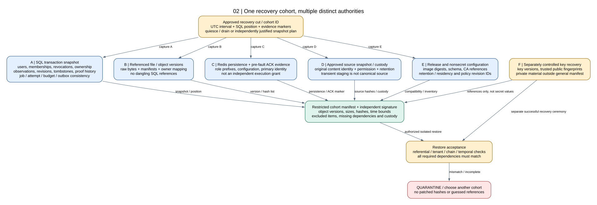

# 02 — Complete inventory and consistent recovery cohorts

[Pack index](README.md) · [Previous](01-architecture-and-recovery-boundaries.md) ·
[Next: backup](03-backup-policy-and-end-to-end-dataflow.md)

## 1. One cohort, several independent stores

[Full-resolution SVG](diagrams/02-consistency-groups.svg) ·
[Editable DOT](diagrams/02-consistency-groups.dot)

A **recovery cohort** is the approved set of compatible database state, referenced
file versions, required Redis persistence, source identities, release/configuration
and separately recoverable keys. A timestamp alone does not prove consistency.

## 2. Asset-by-asset recovery register

For each row record: actual location/provider/region, exact estate or platform
scope, owner/backup person, capture method, key ID, frequency, retention/legal
hold, recovery order, verification, dependencies and last accepted drill.
Mark unused items **N/A with justification**, never silently omit them.

| ID | Asset and authority | Recovery disposition / validation |
|---|---|---|
| D01 | PostgreSQL application database and schema | Restore complete compatible data/schema; migration head at this baseline is 0105. Validate actual candidate revision, constraints, sequences, indexes, extensions and database settings. |
| D02 | Database roles/grants, cluster settings, TLS and provider metadata | Separately export/recreate through the bank DB process. An application `pg_dump` is not a cluster-global roles/configuration backup. Use no-secret references in the general catalog. |
| D03 | Users, password hashes, sessions, API keys/policies, tenant memberships and federation configuration | Sensitive SQL/config state; reconcile post-backup revocation/deletion/role changes before access. Reissue sessions or revoke restored credentials according to approved incident policy. |
| D04 | Systems/assets/deployments/package bindings, vendor and hardware identities | Preserve IDs, owner/scope, lifecycle revision/state/expiry and exact artifact associations. Never merge tenants by name. |
| D05 | Scans, evidence records, original finding data, content/chain hashes and manifests | Preserve original bytes/records including tombstones. Verify stored scans/chains and referential integrity; do not filter withdrawals from integrity history. |
| D06 | Assurance revisions and SQL evidence blobs | These blobs are inside SQL, not necessarily object storage. Preserve payload hashes, previous links, actor/proposal/review/proof history, supplier state and qualification metadata. |
| D07 | Source targets, admitted source snapshots and custody/permission records | Preserve actual permitted original content identity if reproduction is required. The read-only PVC is a mount, not a backup. Record licensing, sensitive-source retention and whether bytes are unavailable. |
| D08 | External raw SBOMs/artifact manifests and admitted file-backed evidence | Capture exact bytes, versions, storage IDs and ownership with SQL bindings. [Artifact storage](../../services/devsecops/devsecops/artifact_store.py) uses `SBOM_STORAGE_DIR`, default `/var/lib/cryptoscan/sboms`; actual site mapping must be recorded. |
| D09 | CBOM SQL snapshots, exported signed documents and external live-CBOM store if used | Separate SQL-held snapshots from file-backed history. Retain historical verification key versions. [Stream storage](../../services/api/api/routers/stream.py) uses `CBOM_STORE_DIR` when configured. |
| D10 | Jobs, typed enqueue provenance, policies, approvals, allowance and expiry | SQL authority; do not repin legacy jobs or replace the principal with the restore operator. Re-evaluate current authority and permitted source after recovery. |
| D11 | Execution attempts, private fences, budgets and control events | Recover with jobs/outbox in the same SQL consistency unit. UNKNOWN retains provider/estate reservations; counters are not repaired by setting them to zero. |
| D12 | SQL execution outbox and delivery bookkeeping | Restore transactionally with jobs; separately reconcile missing/duplicate Redis hints. A PUBLISHED row is not proof of a retained queue item or completed work. |
| D13 | Redis's eight consumer roles | Separate persistence/configuration/ACL/epoch/retention plan per role. Same deployment does not mean same authority or safe reset policy. See file 05. |
| D14 | Local event-bus JSONL/replay state in other profiles | Identify actual configured path, format and durability. SQL backup does not include it. Restore/reconcile only under the accepted non-controlled topology. |
| D15 | Neo4j or other accepted graph/projection stores | Conditional only; disabled in the primary profile. Back up or prove complete rebuild with owner/provenance/count checks; record version/index compatibility. |
| D16 | Approved nonsecret configuration and policy references | Release/site manifest, runtime settings, trust paths, source roots, destination/region bindings, network policies and resource limits. Compare to current approved policy, not merely the restored copy. |
| D17 | Authentication, encryption, CBOM/signing and integration secrets | Separate protected recovery custody, versions, key availability and compromise policy. General backup manifests contain identifiers only. |
| D18 | CA bundles, ingress/server certificates, mTLS/SSH trust and DNS/routing | Recover through bank PKI/network administration; check expiration, revocation, hostname trust and overlap. Do not disable verification. |
| D19 | Immutable images and signed operator release | API, dispatcher/worker, parser, frontend and any approved sidecars; source/release hash, schema compatibility, attestation and independently trusted public fingerprint. No mutable tags. |
| D20 | Audit logs, externally anchored hashes, SIEM records and independent ACK/incident ledgers | Retain independently of the failed or compromised runtime; reconcile missing privileged actions and external effects. Log retention is not application-data completeness. |
| D21 | Report/export/detection/monitor/notification state used by an accepted topology | Classify each as authoritative, derivable or external effect. Record schedules, deduplication markers and retry permissions; do not blindly redeliver. |
| D22 | Dedicated runtime host, daemon/container inventory and temporary staging | Rebuild clean runtime configuration. Normally do not restore transient workspaces as executable jobs. Preserve/quarantine suspected artifacts under incident custody and confirm old work stopped. |
| D23 | Backup catalog, copy receipts, vault policy, retention/hold and key references | Recover independently of the app. Include object versions, immutable-retention evidence, encrypted sizes, checksums and separate signature/trust records. |
| D24 | Recovery management services | Identity/break-glass, secret manager, registry mirror, DNS, time service, storage quotas, monitoring, any required entitlement/license inputs and emergency communication. Document cold-start access and external owners; unused dependencies need justified N/A. |
| D25 | Kubernetes/platform control plane and storage integration | Bank/provider control-plane or etcd recovery, API access/RBAC, protected kubeconfigs, CNI/CSI, CRDs, storage classes, PV/PVC/snapshot bindings, reclaim policy and node/runtime compatibility. A data PVC backup does not recreate the cluster or storage driver. |
| D26 | Infrastructure-as-code and deployment automation | Review desired-state/release repositories, protected state files, credentials and GitOps/CI/controller behavior. Suspend automation that could reconnect old writers or overwrite recovery configuration. State files can contain secrets and need restricted custody. |

Models anchoring the SQL groups: [execution controls](../../services/database/db/models/execution_control.py),
[assurance](../../services/database/db/models/assurance.py),
[software supply chain](../../services/database/db/models/software_supply_chain.py),
[evidence](../../services/database/db/models/evidence_record.py),
[remediation tasks](../../services/database/db/models/remediation_task.py).
The table is a recovery register, not an exhaustive generated schema listing.

## 3. Define consistency groups before choosing backup tools

### Group A — SQL atomic authority

Capture application tables together. Jobs, attempts, provider/estate budgets,
approvals and outbox records must not come from different database snapshots.
Identity/membership/revocation, evidence, tombstones and assurance history must be
part of that same declared recoverable SQL state.

### Group B — SQL plus external bytes

A database binding may refer to a raw SBOM, source snapshot, report or file-backed
store outside SQL. Pin the exact file/object version and hash corresponding to
the SQL point. A healthy database with missing referenced bytes is incomplete.
Latest-object-only replication cannot reproduce a deleted or overwritten version.

### Group C — SQL plus Redis and external effects

There is no general distributed SQL/Redis transaction. The SQL outbox reduces
publication ambiguity but permits duplicate delivery. Capture Redis separately,
retain pre-fault acknowledgements and perform application-level reconciliation.
Do not claim a globally atomic snapshot merely because both backups ran at 02:00.

### Group D — configuration, source and trust

Bind compatible images/schema, nonsecret configuration, source identities and
recoverable key versions. A backup that cannot be decrypted or whose historical
signatures cannot be verified is not usable evidence recovery.

## 4. Safe consistency-cut procedure

1. Approve scope/maintenance or a separately tested online-consistency method.
2. Close new producers, schedules and externally effective operations. Inventory
   QUEUED/RUNNING/UNKNOWN attempts; drain or account for them without status edits.
3. Record UTC interval, clock source, SQL snapshot/LSN or provider recovery-point
   identity, independently committed canary/ACK IDs and store watermarks.
4. Capture SQL and referenced immutable file/source versions. Retain deletion,
   retraction and revocation metadata; reconcile out-of-band actions separately.
5. Capture required Redis role state and its primary/process identity separately.
6. Produce a cohort catalog linking every part, incompatibility and exclusion.
7. Verify referenced-byte availability in an isolated restore before acceptance.

For online capture, use provider/DBA-supported snapshot/export and object-version
coordination that has actually been tested. This repository does not implement
a generic cross-store consistent snapshot coordinator.

## 5. Mandatory post-restore invariants

- Exact tenant/platform IDs, scope keys and foreign keys remain correct; no orphan
  or cross-estate artifact/evidence/job/proof associations appear.
- Source and SBOM document hashes are distinct from release artifact digests.
- Evidence/scan manifests, assurance hashes/links and externally anchored counts
  agree with the chosen point. Include tombstones in integrity verification.
- An observation retracted after the backup is not silently active again. Use the
  independent authority/incident ledger to apply authorized reconciliation.
- Jobs/attempts/budgets/outbox agree; old fences and external effects are accounted
  for before any new work. SQL success is not proof that a parser stopped.
- Expired/revoked approvals/signers/qualifications remain ineligible. Withdrawn
  source proof and stale reviewed relationships cannot produce current resolution.
- The declared source/file versions, key references, release and schema are
  recoverable; missing items block the corresponding claim.

## 6. Selective tenant recovery is not a built-in shortcut

A full database backup can contain multiple tenants and platform-global users,
budgets, policy references or trust records. A tenant-only restore needs a separate
reviewed export/dependency/remapping/access design and tests. Neither table-name
selection in `pg_restore` nor a copied tenant JSON object is an implemented,
qualified tenant-recovery procedure. Do not overwrite current estates to restore
one estate, and never relabel historical ownership to make the import succeed.
