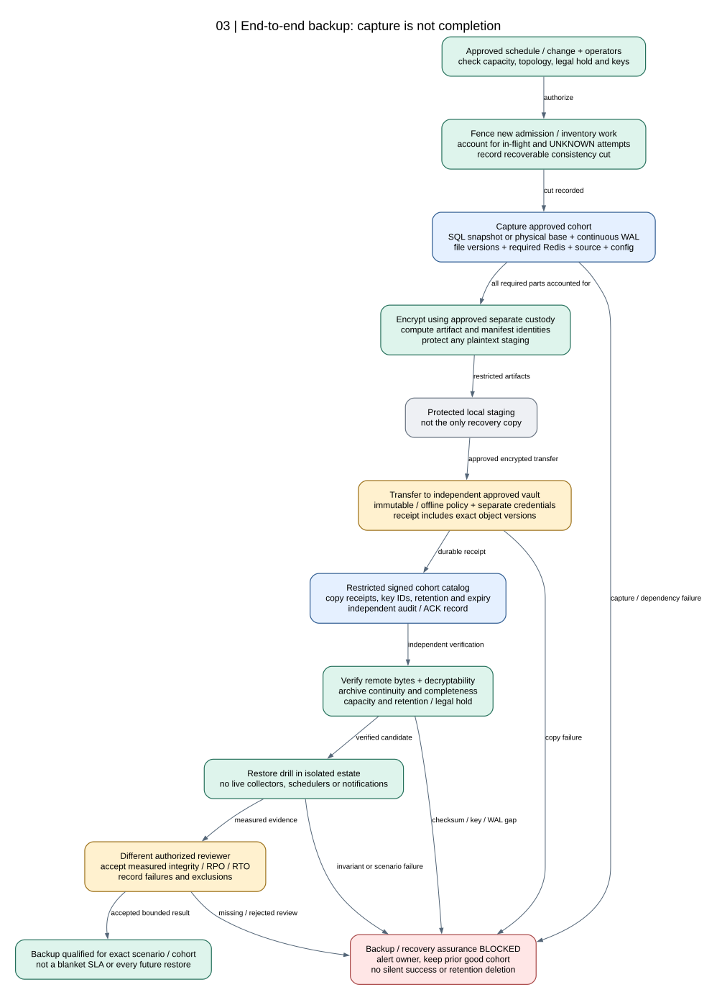

# 03 — Backup policy, schedules, tooling and complete dataflow

[Pack index](README.md) · [Previous](02-data-inventory-and-consistency-groups.md) ·
[Next: recovery](04-disaster-recovery-runbook.md)

## 1. Capture → independent copy → usable recovery



[Full-resolution SVG](diagrams/03-backup-dataflow.svg) ·
[Editable DOT](diagrams/03-backup-dataflow.dot)

A backup job is not complete merely because a local file exists. The approved
completion definition must include encryption, independent durable copy,
restricted catalog/receipt, key availability, integrity checks, alerting and a
current successful restore exercise for the declared scenario.

## 2. Choose recovery objectives before schedules

For each business workflow set an approved maximum data loss, recovery time,
minimum recovery throughput, retention and evidence age. Name the actual bank
approver. Objectives remain **UNAPPROVED/UNMEASURED** until supplied and tested.

- **RPO:** acceptable gap between the incident recovery reference and the latest
  consistently recoverable business state. Verify with independent commit/ACK IDs,
  not the backup filename or configured cron frequency.
- **RTO:** time from the pre-agreed incident start/reference to validated service
  availability at the accepted scope/load. Include detection if the agreement
  includes it, key retrieval, restore, reconciliation, validation and approval.
- **Maximum tolerated disruption:** separate business limit; it may be longer or
  shorter than an engineering target but must be explicitly agreed.
- **Data-loss result:** enumerate pre-fault ACKs/IDs not recovered, uncertain
  outcomes and affected estates. Time alone hides record loss and clock error.

Daily backups can lose more than a day if the latest copies failed or were
already corrupt. Async replicas can lose acknowledged writes. A configured
five-minute WAL upload interval is not proof of five-minute achieved RPO.

## 3. Concrete planning example — not deployed defaults or promises

The following is an **illustrative proposal** to review with the bank. Numbers
are not accepted RPO/RTO, legal retention, a product schedule or a configured job.

| Asset | Example capture cadence | Example retention/copy | Acceptance prerequisite |
|---|---|---|---|
| PostgreSQL physical recovery | Daily provider-supported physical base/snapshot plus continuous WAL; investigate archive freshness exceeding 5 minutes | 35-day usable recovery window and separately approved longer archive | Complete WAL/base chain, provider restore test, timeline/LSN validation, actual ACK-loss measurement. |
| PostgreSQL logical export | Daily encrypted export; additionally before approved upgrades | 35 daily versions; independently reviewed monthly archive where required | Complements physical/PITR recovery; logical `pg_dump` alone cannot supply WAL/PITR. |
| External artifacts and source cohorts | Versioned capture at admitted release/cohort and at least with each daily SQL cohort | Match legal/source retention and SQL references; immutable independent copy | Exact object versions and all SQL references recover together. |
| Redis | DBA-selected AOF/RDB/provider persistence; an example is AOF plus 15-minute RDB copies where appropriate | Role-specific recoverability and retention; independent ACK ledger | Actual power-loss/lag/restore behavior measured. An fsync setting is not a zero-loss guarantee. |
| Release/configuration | Every accepted change/release; protected daily catalog copy | Keep every release needed to read retained data and perform supported recovery | All image bytes, compatibility metadata, detached attestation and independent trusted key available. |
| Secrets/PKI/keys | Every authorized version/rotation through the dedicated custody system | Key lifetime must support retained encrypted data and historical verification | Dual-control recovery exercise, rotation/revocation policy, no private values in general backups. |
| Audit/incident/ACK records | Continuously to independently controlled custody | Bank legal/incident requirements | Capture lag, gaps, access, authenticity and recovery checked separately. |
| Restore drills | Example monthly component restore, quarterly integrated DR, after material changes | Retain adverse and successful reports under bank policy | Different witness/reviewer; full workload, isolation and failback scope agreed. |

Apply a 3-2-1-style design only with explicit failure domains: multiple copies,
different storage/control planes, an approved off-host/off-site copy, and an
immutable/offline protection layer. This is a planning pattern, not a product
feature or proof that cross-border copying is lawful.

## 4. End-to-end backup procedure

1. **Authorize:** incident/change ID, named operator/reviewer, estate/profile,
   stores, objectives, destinations, retention/hold, key references and rollback.
2. **Preflight:** free space/quota, dependency health, archive lag, clock health,
   source permissions, storage mounts, recipient/key availability and alert route.
3. **Establish the consistency cut:** pause/drain or use the independently tested
   online method in file 02. Inventory RUNNING/UNKNOWN work and external effects.
4. **Capture:** SQL transaction state or provider physical base/WAL; exact file,
   source and object versions; separately required Redis/configuration state.
5. **Seal:** use approved encryption; restrict temporary plaintext and local file
   permissions. Record tool/release/schema versions, artifact sizes and hashes.
6. **Catalog:** link all cohort parts, SQL position/time, object versions,
   independent markers, key IDs, exclusions and custody. Authenticate the catalog
   through a separately trusted signing process; the helpers do not sign it.
7. **Transfer:** copy encrypted bytes/catalog to the independent approved vault.
   Verify exact remote object/version, retained bytes and immutable retention.
   Local success plus failed upload is a failed required backup outcome.
8. **Verify:** read back remote bytes; validate checksums and authenticated
   decryption in isolation; check WAL continuity and referenced object completeness.
9. **Exercise:** restore into an isolated target and execute file 07's data,
   authority and service invariants. Never let a drill send live effects.
10. **Review/retain:** different reviewer accepts the exact bounded result; alert
    on failures, keep the last known good cohort and enforce legal holds before
    lifecycle deletion. Record secure handling of plaintext remnants.

## 5. Repository helper compatibility and limits

| Helper | Actual format / behavior | Important limitation |
|---|---|---|
| [db_backup.sh](../../scripts/db_backup.sh) | Compose `postgres` service; `pg_dump -Fc`; `.dump.age` with age recipient when configured; required encryption by default; `.sha256` covers encrypted artifacts. | Not a generic external managed-PostgreSQL/Kubernetes backup adapter. No WAL/PITR or SQL/file/Redis atomic cohort. Off-host transfer is not implemented by the script. |
| [db_restore.sh](../../scripts/db_restore.sh) | Compose target; verifies adjacent `.sha256` entry, optionally decrypts age, then `pg_restore --clean --if-exists --no-owner`. | **Destructive** to the selected database. Not the plain-SQL/AES helper. Requires approved isolated target, version/extension/grant checks and separate service/queue reconciliation. |
| [backup_evidence.py](../../scripts/backup_evidence.py) | SQLite online backup API, or PostgreSQL plain SQL via `pg_dump --no-owner --no-privileges`; adjacent `.manifest.json`; optional `.enc`. | `--verify` applies only to SQLite and is a limited row/hash-shape check, not full chain/manifest validation. It can warn/record errors without failing the backup process. |
| [backup_crypto.py](../../scripts/backup_crypto.py) | CSBC1 format: AES-256-GCM with scrypt-derived key; encrypted helper manifest retains **plaintext** SHA-256. Successful encryption removes the source plaintext file. | Key minimum length is not entropy assurance. Whole-file memory handling and failure-path plaintext/temp cleanup require capacity and operational review; deletion is not guaranteed forensic erasure. |
| [restore_evidence.py](../../scripts/restore_evidence.py) | Companion JSON manifest; decrypts `.enc`/CSBC1 before plaintext checksum; SQLite staging/rotation, or plain SQL through `psql --single-transaction`. | Not `.dump.age`/custom format. Do not use `--force` for normal recovery: it only permits a **missing** manifest, not a mismatched hash. Inspect SQL errors independently; the command does not set `ON_ERROR_STOP`. |
| [verify_evidence.py](../../scripts/verify_evidence.py) | Stored scan/content/manifest verification using its configured database. | PASS/EMPTY is a per-scan verdict, not a complete DR result; EMPTY does not prove expected targets were observed. Uses DB initialization: run only in the prepared compatible isolated environment. |
| [verify_evidence_chain.py](../../scripts/verify_evidence_chain.py) | Stored chain verdict, including the scan's retained records. | Chain integrity is one invariant, not proof of complete history, external truth, no rollback, correct ownership or full restoration. |
| [backup service/timer](../../deploy/systemd/cryptoscan-backup.service) | Oneshot Compose backup service; [timer](../../deploy/systemd/cryptoscan-backup.timer) at 02:20 **host-local** with randomized delay and persistent catch-up. | Not automatically installed/configured for the bank. Offsite hook is commented. Confirm timezone/DST, missed-run behavior, encryption environment, alerting and retention. |
| [backup_drill.py](../../scripts/backup_drill.py) | Historical SQLite/local event-bus/live-CBOM drill with API seeding and a second instance. | Not the controlled production drill. CLI credential/default assumptions and mutating seed behavior need separate review; do not point it at bank production or copy old password examples. |
| [HA replication overlay](../../deploy/ha/docker-compose.replication.yml) | Historical Compose streaming-replica template. | `archive_command=/bin/true` does **not archive WAL**; template comments do not establish PITR or zero loss. Real archive storage/configuration and restore tests must be supplied. |

Additional cautions for `db_backup.sh`: `KEEP` defaults to 14 **PostgreSQL artifact
count**, not a customer time-based retention contract. Optional Neo4j dump failure
can warn while SQL succeeds, and graph dumps are not thereby a complete accepted
cohort. Sequential SQL/Neo4j captures are not a cross-store transaction. Inspect
all required artifacts and maintain a separate policy for graph/file retention.

The JSON helper's limited SQLite verifier examines at most the first 100,000
listed live rows and basic
hash shape rather than validating stored hash equality and all chain links; it
must not be the only acceptance test. The names of its counters do not turn row
checks into verified scans. Use the stronger per-scan verification tools and
independent expected-ID/manifest/owner checks in the recovery gate.

## 6. Safe command-discovery examples only

These print help; they do not back up, decrypt, overwrite a database or contact
customer services. Use the repository's configured Python environment.

```bash
python scripts/backup_evidence.py --help
python scripts/restore_evidence.py --help
python scripts/verify_evidence.py --help
python scripts/verify_evidence_chain.py --help
```

Do not append a backup filename to `backup_evidence.py --verify`: it is a backup
creation flag, not an existing-backup positional verifier. Do not mix plain SQL,
custom dumps, age and CSBC1 manifests. Never place passwords in URL arguments,
public transcripts or shell history; use approved protected secret injection or
DBA-native credential facilities and redact endpoint metadata as required.

## 7. What the bank must actually supply

External PostgreSQL physical/PITR service and tested WAL archival; all durable
volume/object mappings; Redis persistence and role recovery policy; backup
scheduler and failure alerting; immutable/offline destination; authentic catalog;
key recovery; adequate storage/bandwidth/restore capacity; and witnessed drills.
The present reference deployment and helper scripts do not provision these.

**Credential handling limitation:** the PostgreSQL JSON helpers pass their DSN to
`pg_dump`/`psql` as a child-process argument. Supplying it through `DATABASE_URL`
does not hide a password embedded in that DSN from process listings. Use the
approved password-free connection reference and restricted libpq credential
facility (for example a bank-managed `PGPASSFILE`) or DBA-native tooling; review
process visibility, manifests and error logs before production authorization.
Partial URL redaction in a helper is not guaranteed secret-safe reporting.
