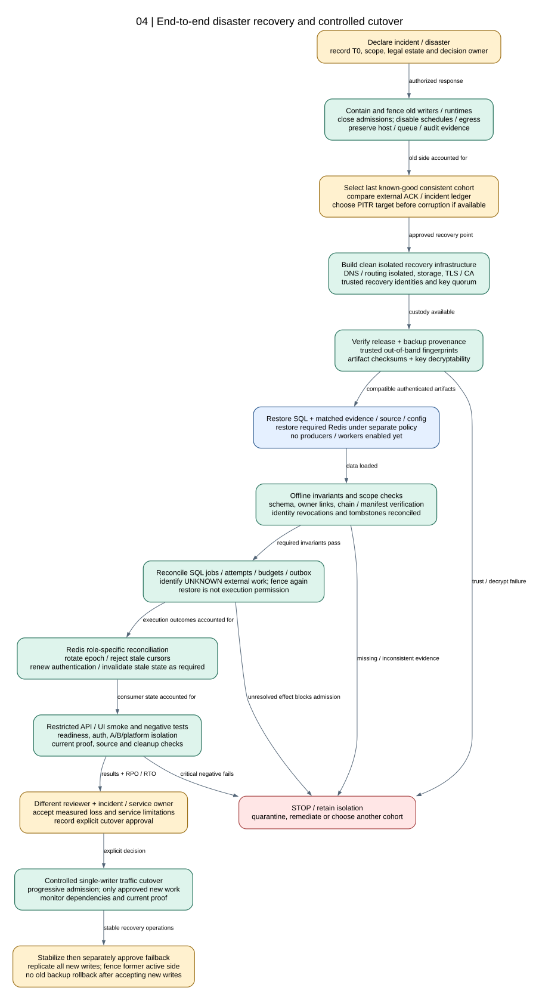

# 04 — End-to-end disaster-recovery runbook

[Pack index](README.md) · [Previous](03-backup-policy-and-end-to-end-dataflow.md) ·
[Next: execution reconciliation](05-queue-execution-and-evidence-reconciliation.md)

## 1. Recovery sequence and stop gates

[Full-resolution SVG](diagrams/04-recovery-dataflow.svg) ·
[Editable DOT](diagrams/04-recovery-dataflow.dot)

This is a procedure to adapt and authorize for the bank's actual environment.
It does not execute fencing, provider failover, key recovery or service restart.
When a gate fails, retain isolation and record the blocker; do not skip it to
meet a target time.

## 2. Named authority before any destructive action

| Responsibility | Required decision or action |
|---|---|
| Incident commander / service owner | Declare incident/DR, state scope and business impact, authorize the recovery mode and communications. |
| DB owner + different reviewer | Choose consistent recovery point, prove old-primary fencing, perform restore/promotion and validate data/LSN/timeline. |
| Storage/backup owner | Supply authenticated cohort, all referenced objects/source versions, retention/hold and independent-copy evidence. |
| Security/key custodians | Establish clean management access, approve key recovery/rotation, investigate compromise and reconcile revocations. |
| Application/runtime owner | Prevent duplicate workers/effects; reconstruct compatible release, CA/mounts and runtime isolation. |
| Identity/network owners | Restore IdP/break-glass, DNS, certificates, routing and least-privilege access. |
| Independent recovery reviewer | Witness gates, actual loss/time and limitations; accept or reject technical recovery. |
| Bank customer/service decision authority | Separately accept restored service scope and business limitations; no implicit SLA promotion. |

Name an actual primary and backup person for each duty. A username in a template
is not assigned responsibility or evidence of 24/7 availability.

## 3. Phase-by-phase operating procedure

| Phase | Actions | Required output / go-no-go |
|---|---|---|
| P0 — Detect and declare | Identify affected estates, stores, regions and time range; open incident; start the agreed RTO clock; distinguish availability from corruption/compromise. | Incident ID, UTC/clock source, decision authority, impact, scope, communication channel and approved recovery scenario. |
| P1 — Contain | Close new admission and automation; pause schedules/outbound integrations; isolate affected hosts/credentials and preserve evidence. Account for existing operations without falsely declaring them stopped. | Isolation/maintenance evidence and affected job/attempt/ACK inventory; no new uncontrolled effects. |
| P2 — Fence | Prevent the previous SQL primary, workers, daemon hosts and other producers from writing or acting. Use infrastructure/DBA fencing that actually works across a partition. | Positive fencing evidence, not only failed PING/heartbeat. If old effects cannot be established stopped, retain UNKNOWN and restrict admission. |
| P3 — Choose point | Select last known-good consistent cohort or independently tested PITR point before corruption; compare independent markers, revocations and object versions. | Approved point/LSN/timeline/cohort, projected loss/uncertainty, matched keys/images and legal location. No “latest” without integrity review. |
| P4 — Prepare isolated target | Create clean compatible SQL/storage/runtime environment; recover trust/keys, CA, clocks, network and registry access. Keep application admission, live egress and old queue consumers disabled. | Dedicated recovery endpoints/credentials; verified no accidental production DNS, broker, IdP-writeback, SIEM/ITSM duplicate or collector effect. |
| P5 — Authenticate artifacts | Verify independent public trust, release/backup signature where supplied, checksum, object versions and authenticated decryption. Check every required file, not just SQL. | Authentic complete candidate and tested key availability. Wrong/missing key, hash, signature or dependency blocks restore. |
| P6 — Restore | Restore compatible SQL and required globals through DBA tooling; recover referenced file/source versions and configuration; handle required Redis persistence separately. | Restore logs/errors, actual database identity, schema/version, object counts and cohort mapping. No producers/workers enabled. |
| P7 — Validate data and identity | Run offline invariants, scans/chains, owner links, tombstones, current revocation/expiry reconciliation, package/schema compatibility and data-loss checks. | Accepted invariant report; missing histories/bytes/current authority remain explicit blockers. |
| P8 — Reconcile execution and Redis | Apply file 05: classify jobs/attempts/outbox, retain UNKNOWN reservations, establish old effects, handle replay/role state and renew current authentication. | Per-job/role recovery ledger; unresolved risks and intentionally disabled features; no raw status/counter edits. |
| P9 — Restricted service smoke | Start minimum API/UI dependencies without enabling uncontrolled workers/effects. Test readiness/auth/scope/current proof; validate runtime before a permitted disposable canary. | Healthy required dependencies and adverse tests; expected SKIPPED components distinguished from failures. Liveness is insufficient. |
| P10 — Approve and cut over | Different reviewer and service authority accept measured state, loss and limitations; switch routing only to the single authorized writer; progressively admit current approved work. | Signed/approved cutover record, new authority endpoints, current credentials and live monitoring. |
| P11 — Stabilize and close | Observe agreed workload/time; verify backups from the recovered estate; communicate residual loss; decide separate failback plan. | Stability evidence, incident review and accepted ongoing scope. Closure is not automatic after a successful HTTP response. |

## 4. SQL restoration choices — do not mix formats

### A. Provider physical backup / WAL / PITR

1. Verify the physical base/snapshot and all required WAL segments/timelines are
   available and authenticated under the provider's supported procedure.
2. Choose the incident-approved target before the corruption/undesired change,
   documenting expected lost valid commits and clock uncertainty.
3. Restore into new isolated storage with compatible database version/extensions,
   correct recovery timeline and no accidental access to the original primary.
4. Pause/inspect the recovered position using the provider's supported controls;
   compare independent committed IDs and object-cohort versions.
5. Promote only after fencing and reviewer approval. Configure new backup/WAL
   protection on the promoted service before accepting unrestricted writes.

A `pg_dump` SQL file/custom dump cannot be substituted for a physical base plus
WAL. A running replica may already contain logical corruption and is not the
same as a pre-corruption recovery point.

### B. Logical dump

1. Select the exact helper/provider format and its companion manifest/key method.
2. Use a new isolated target with the required extensions/roles/encoding and
   compatible client/server versions; inspect grants and ownership explicitly.
3. Treat `--clean` as destructive. Preserve the original database and candidate
   backup; do not run Compose restore scripts against a managed target by guess.
4. Stop on SQL restore errors through the reviewed DBA procedure, inspect logs,
   then check sequences, constraints, row relationships and actual schema head.
5. Restore matched external artifact/source versions and reconcile SQL/Redis
   effects. Logical restore does not recover actions that occurred after the dump.

For development SQLite, stop writers/sidecars, use the companion staging restore,
and handle WAL/SHM files under the reviewed SQLite procedure. It is not the bank
production plan; do not perform an in-place live file swap as a universal recipe.

## 5. Trust and schema checks before API startup

- Confirm the actual database host, database name, region, ownership and restored
  row markers. An empty/wrong database must not be mistaken for a clean restore.
- Use trusted compatible verification tooling. Some application tools initialize
  DB metadata; run them only on the prepared isolated target, not arbitrary stores.
- Check the candidate's expected Alembic revision; this source baseline is 0105.
  Do not blindly migrate an old backup with an unrelated current image. Use the
  compatible release and separately approved upgrade path; back up before change.
- Recover independently trusted release verification material and the detached
  attestation. A public key supplied by the untrusted backup is not automatically
  trusted. Include API, worker, parser, frontend and approved sidecar digests.
- Provision the recovered CA/secret mounts and current host/origin allowlists.
  Do not disable hostname verification or create permissive CORS/host settings.
- Reconcile authentication/bootstrap carefully: API startup can initialize a
  configured bootstrap admin when the users table is empty. Do not start against
  an unverified empty target and call that restored identity.

## 6. Runtime and effect isolation checklist

- [ ] Recovery DNS/ingress cannot be reached by normal production traffic yet.
- [ ] No recovery component points to the production SQL database or Redis broker.
- [ ] Platform control plane, CNI/CSI, PV/PVC bindings and reclaim policies are
      checked; restored volumes cannot attach to old and new writers accidentally.
- [ ] GitOps/CI/controller automation cannot reconnect the fenced side or roll back
      recovery policy; protected IaC state is reviewed separately.
- [ ] Automatic schedules, publishers, workers, collectors and notifications are
      stopped or positively constrained by the incident-approved method.
- [ ] Old runtime hosts/containers are fenced or explicitly UNKNOWN; a timed-out
      Docker CLI is not proof the container stopped.
- [ ] Dedicated worker daemon access remains trusted/root-equivalent and is not
      exposed to the parser; source mounts and staging absolute paths are correct.
- [ ] Restore credentials cannot bypass estate ownership in the recovered API.
- [ ] Current revocations, expiry, legal holds and withdrawals are reconciled from
      independently retained incident/authority evidence, not rolled back blindly.
- [ ] Logs, crash dumps, temporary decrypted backups and source staging remain
      protected; no passwords/keys/URLs with credentials enter public transcripts.

## 7. Cutover and fallback rules

Cut over only with explicit single-writer/fencing evidence, mandatory invariant
passes, role-specific Redis recovery, current authority and an accepted loss report.
Record DNS TTL/connection draining, old/new endpoints, operator/reviewer and exact
cutover time. Drain/reset clients through documented current authentication and
replay resynchronization; a retained browser cache is not recovered authority.

Before accepting new writes, an approved return to the untouched original service
may be possible if its integrity/fencing is established. **After accepting new
writes**, never roll back by overwriting with an older backup. Preserve and
reconcile every newly accepted write/effect; use forward recovery or the controlled
failback procedure in file 08. Keep only one active writer/effect-producing side.

## 8. Mandatory stop conditions

Unproven old-primary fencing; missing key or trustworthy release; unknown backup
provenance; WAL gap; unmatched object/source cohort; failed tenant/history/hash
invariant; unresolved revoked authority; false current proof; unsafe old parser;
unaccounted data loss; or missing mandatory approval. A healthy UI does not waive
any of these. The incident authority can accept a **restricted degraded scope**
only with explicit limitations and no false claims about unavailable evidence.
