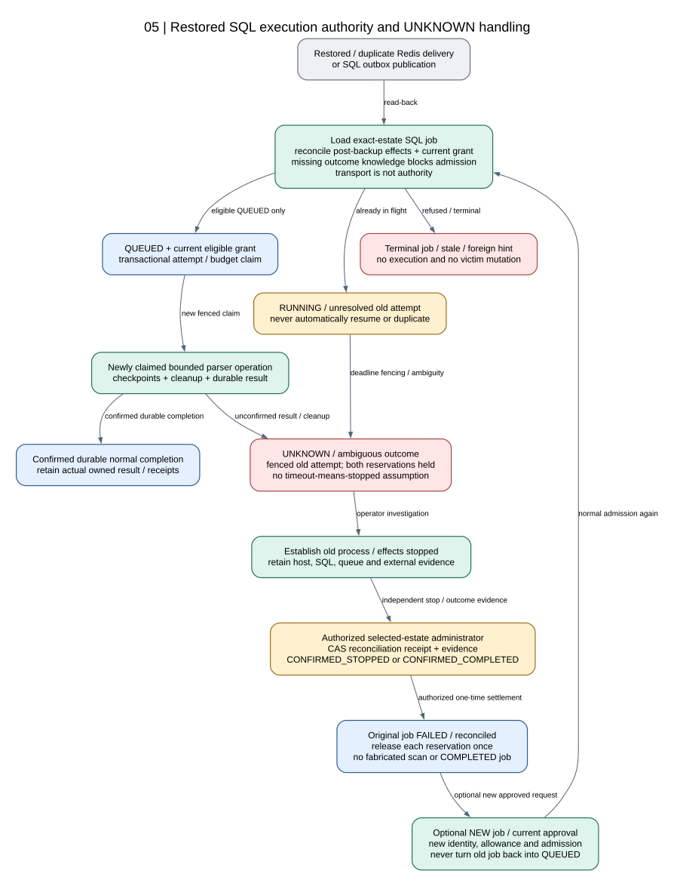

# 05 — Queue, execution, identity and evidence reconciliation

[Pack index](README.md) · [Previous](04-disaster-recovery-runbook.md) ·
[Next: security and keys](06-security-keys-ransomware-and-retention.md)

## 1. Execution safety after restore

[Full-resolution SVG](diagrams/05-execution-reconciliation.svg) ·
[Editable DOT](diagrams/05-execution-reconciliation.dot)

**SQL owns controlled execution authority; Redis owns transport/replay state.**
There is no exactly-once external-effect guarantee or general SQL/Redis transaction.
A restored job, queue item or expired lease is not permission to execute.

## 2. Restore is a knowledge rollback as well as a data rollback

A backup can predate a launch, completion, revocation, effect or reconciliation.
The restored SQL row might say QUEUED even though work ran after that point.
**QUEUED-only claim alone cannot recover knowledge missing from the backup.**
Compare independently retained pre-fault ACKs, host/container records, job/result
IDs, control events and incident/authority logs before enabling restored work.
Keep affected ranges/estates disabled when the old outcome is not established.
Do not fabricate missing attempts/results, enqueue pins or historical approvals.
Where the existing application cannot safely represent the missing knowledge,
retain a recovery blocker and obtain an explicitly reviewed remediation procedure;
there is no generic command in this pack that reconstructs lost authority.

Similarly, SQL restore can roll back a version/fence to an older value that an
old process still knows. Infrastructure fencing, revoked old credentials and
isolated new endpoints are mandatory. Do not rely on database fencing tokens
alone to protect against a worker that survived a database time rollback.

## 3. Per-job recovery decision table

| Restored SQL / external evidence | Safe disposition | Never do |
|---|---|---|
| QUEUED, typed authority intact, current policy/approval permits it, no unaccounted later effect | Existing outbox/reconciler may republish a transport hint and normal claim may run, only after cohort/incident reconciliation and approved admission reopening. | Treat QUEUED in an old snapshot as proof it never executed. |
| QUEUED with post-backup execution ambiguity | Keep affected admission/worker scope closed; investigate independent evidence and obtain an authorized procedure. | Reset/update rows to simulate a known attempt or immediately redeliver. |
| RUNNING with no durable completion | Account for surviving process/container/effects; existing deadline/recovery logic can fence to UNKNOWN. Preserve reservations. | Resume or duplicate the original operation because its Redis lease expired. |
| UNKNOWN | Hold both provider/estate reservations; exact-owner authorized human reconciliation with evidence and current authority. | Free budgets, fabricate success or claim timeout means stopped. |
| COMPLETED with owned actual result/receipts | Keep immutable result; verify consistency/ownership/meaning and do not rerun the old job. | Interpret recorded completion as every host or observation succeeded. |
| FAILED/reconciled or other terminal state | Preserve history; an eligible permitted retry is a new job with current approval and allowance. | Turn old history back into QUEUED. |
| Legacy/unpinned or foreign/forged delivery | Refuse execution; preserve existing SQL/history; use separately authorized new submission where supported. | Guess authority from username, tag, queue envelope or another estate. |
| Missing SQL job but Redis delivery exists | Transport hint is not authority; investigate chosen recovery point and lost IDs. | Adopt the envelope into a new authoritative job automatically. |
| Outbox PUBLISHED but no surviving queue item | Existing maintenance can reconcile still-QUEUED delivery; it must retain current eligibility and duplicate safety. | Stamp COMPLETED or force collection just because publication was once recorded. |
| Duplicate delivery for RUNNING/UNKNOWN/terminal work | No duplicate execution or victim-job mutation. | Let dead-letter exhaustion or redelivery overwrite durable execution truth. |

## 4. UNKNOWN settlement procedure

1. Read the original exact-estate job/attempt; retain deadlines, checkpoints,
   private fence custody, budget references, incident and owned result IDs.
2. Independently establish old process/container/effects stopped or completed.
   Host death, missing heartbeat, failed Docker CLI or empty queue is insufficient.
3. A currently entitled platform administrator in the selected estate submits
   the existing evidence-backed reconciliation receipt, with explicit stopped
   confirmation and `CONFIRMED_STOPPED` or `CONFIRMED_COMPLETED` as applicable.
4. Existing CAS settlement releases each reservation once and fences late writes.
   The original job becomes FAILED/reconciled, **not fabricated COMPLETED**;
   confirmation does not invent a scan, finding or successful observation.
5. If further work is needed, use a new job under the current actor, exact owner,
   current approval/runtime/source limits and remaining allowance. Restored stale
   grants or held UNKNOWN attempts do not authorize automatic retry.

Use the actual [controlled execution recovery procedure](../runbooks/controlled-execution-upgrade.md#unknown-outcomes-and-safe-recovery)
and [execution models](../../services/database/db/models/execution_control.py).
Do not issue direct UPDATE statements to history, fences, job states or counters.

## 5. All eight Redis roles need separate decisions

The role list is source-present in
[shared assurance models](../../shared/shared_models/shared_models/assurance.py)
and the [consumer recovery contract](../bank-environment/47-redis-consumer-and-recovery-evidence.md).
Actual deployments may separate URLs/ACLs and persistence per role.

| Role | State/meaning | Recovery decision and negative test |
|---|---|---|
| `realtime` | Retained journals, stream/replay state and delivery | Recover required durable records; compare pre-fault ACK IDs. Primary/process changes require cursor resynchronization; a new snapshot cannot prove old ACK survival. |
| `current_run` | Shared current-run coordination/read state | Reconcile with owned SQL jobs/results; stale restored running state must not imply a healthy/current collector or authority to restart it. |
| `queue` | Delivery hints, processing leases, list movement/ACK | Restore/rebuild only through approved SQL/outbox reconciliation. Duplicate hints are possible; recovered RUNNING work cannot be claimed as QUEUED. |
| `rate_limit` | Shared limits/counters/TTL | Keep required production limits fail closed. Resetting/loss must not silently relax shared admission. SQL execution budgets are a separate authority and cannot be reset with Redis. |
| `health` | Probe/scratch operational state | PING/readiness is not durable business evidence. Do not invent ACK-loss metrics for a role without durable events. Clean only approved scratch keys. |
| `platform_state` | Shared deployment/platform state used by enabled consumers | Identify each key's source and rebuild/restore policy. Do not assume every key is disposable cache or import another deployment's identity. |
| `sso_state` | One-time/replay-sensitive authentication state | Restoring consumed state can reopen replay windows. Apply the approved identity/session invalidation or re-establishment policy; test expired/used assertions fail. Do not blindly replay authentication transactions. |
| `telecom` | Snapshot/consumer state where an approved topology uses it | Inventory exact deployment/owner scope and freshness; qualify restoration separately or keep the feature unavailable. This role does not enable a refused adapter. |

Restore Redis TLS, named ACL users, CA/discovery trust, prefixes, retention and
primary identity along with the chosen role policy. Sentinel topology/credentials
need separate recovery; three configured endpoints are not independent sites.
Never restore a broad shared instance by blindly deleting unknown keyspaces.

## 6. Replay and browser recovery

- Production replay epochs bind to the actual primary process. Restart/promotion
  can invalidate old cursors even if some/all retained data survived.
- On epoch reset, retention gap or refused continuation, discard the old cursor
  and perform authoritative current-state rereads in the selected estate.
- A 503/backend unavailable result is not empty history. Midstream unavailable/
  refused events require recovery, not optimistic completion or endless retry.
- Reauthenticate using current durable authority after identity reconciliation.
  Clear old estate/cache/action state; do not replay a mutation from a browser
  continuation or use another estate's cursor.
- Compare the same pre-fault acknowledged IDs against recovered state; “snapshot
  complete” and “PING works” are not loss measurements.

See [replay upgrade/recovery](../runbooks/execution-and-replay-upgrade.md) and the
[Redis scratch observer](../../scripts/redis_recovery_evidence.py), which observes
approved scratch state but does not itself cause server faults or promote nodes.

## 7. Evidence, lifecycle and current-proof reconciliation

1. Recover original content/chain records and tombstones, immutable assurance
   revisions/blobs, exact identities and matched source/SBOM artifact versions.
2. Compare independent post-backup retraction/revocation/deletion records before
   allowing restored data to become current. Missing revocation knowledge is not
   proof that permission remains valid.
3. Recheck observed-at/expiry, approval/policy binding, supplier signer state,
   active deployment/binding/evidence and intended exact package version.
4. Trace revision envelopes must verify before they influence current paths.
   A known unresolved version stays unresolved; do not repair hashes/identities.
5. A source comparison containing withdrawn findings cannot establish current
   remediation proof. The full bounded frozen corpus must retain live exact-owner
   membership; no clean-by-absence filtering or historical label-as-proof.
6. Operator current resolution and the existing pilot proof gate must reject
   missing/stale/withdrawn backing proof. Earlier VERIFIED history remains visible.
7. Authorized audited restore of a finding is a separate justified act; it is not
   a new rescan, independent truth or automatic permission to recover a green gate.

The source baseline includes [trace checks](../../services/api/api/assurance/relationships.py),
[source eligibility](../../services/api/api/assurance/remediation.py),
[operator read model](../../services/api/api/assurance/operator.py) and
[pilot gates](../../services/api/api/assurance/launch.py).
These are bounded checks, not full database completeness, arbitrary mutable-content
reverification or a serializable PostgreSQL withdrawal fence.

## 8. External deliveries and integrations

Reconcile emails, webhooks, SIEM/ITSM tickets and other effects using their owned
external IDs/receipts and current permission. Their remote systems have separate
backup/retention/acknowledgement responsibilities. A SQL restore can resurrect an
old pending action after the remote action already happened. Keep integration
egress disabled until an approved deduplication/reconciliation decision is made;
no universal exactly-once integration replay is supplied by this plan.
