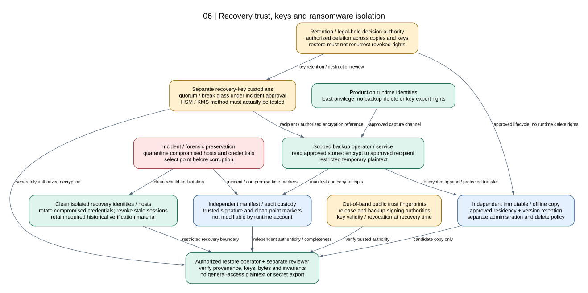

# 06 — Security, key recovery, ransomware, residency and retention

[Pack index](README.md) · [Previous](05-queue-execution-and-evidence-reconciliation.md) ·
[Next: drills and acceptance](07-drills-validation-and-acceptance.md)

## 1. Independent custody and cyber-recovery boundaries

[Full-resolution SVG](diagrams/06-key-and-ransomware-boundaries.svg) ·
[Editable DOT](diagrams/06-key-and-ransomware-boundaries.dot)

This is a **bank-managed target control design**. The repository does not provision
an HSM, vault, immutable bucket, separate account, recovery quorum or automatic
credential-rotation system by drawing these nodes.

## 2. Separate privileges and failure domains

| Principal / role | Allowed responsibility | Must not implicitly receive |
|---|---|---|
| API/worker runtime | Least-privilege approved operational data access | Backup deletion, vault administration, restore ownership or key export. |
| Backup capture identity | Approved data read/snapshot and encrypted copy | Unrestricted application mutation or every private recovery key. |
| Vault/storage administrator | Approved object/version/retention administration | Unreviewed ability to delete all immutable copies and recover all keys alone. |
| Key custodians | Approved encryption/decryption/signing recovery ceremony | Broad customer evidence browsing or unilateral unlogged restore. |
| Restore operator | Time-bounded access to a specific isolated target and cohort | Direct writes to active production or general cross-estate API authority. |
| Independent reviewer | Inspect evidence, witness gates and accept/reject scope | Fictional self-approval or fabricated customer acceptance. |
| Incident/legal authority | Containment, notifications, legal hold and destruction decision | Permission to rewrite evidence hashes or erase an adverse drill result. |

Where staffing combines duties, document the conflict and require compensating
controls and different authorized review. A generic shared administrator account
is not a sufficient custody design.

## 3. Key and trust recovery register

Record purpose, algorithm/format, key ID/version, custodian, protected recovery
method, affected backup/releases, expiration/revocation, historical verification
need and last witnessed test. Never put private values in this repository.

| Key/trust class | Recovery requirement | Common unsafe shortcut |
|---|---|---|
| Backup encryption recipient/identity or CSBC1 passphrase | Tested independent recovery of the exact historical key version; approved entropy/custody; match the artifact format. | Store the decryption key beside the only backup or assume age and AES helpers are interchangeable. |
| Database/storage encryption keys | Provider/HSM/KMS-supported recovery and access policy; retain wrapped key/version metadata and independent break-glass procedure. | Restore encrypted volume bytes without proving key availability. |
| Authentication/session/API-key signing secrets | Current compromise/rotation policy; invalidate/reissue restored stale sessions and key authority as required. | Trust restored tokens or password/session tables without post-backup revocation reconciliation. |
| CBOM/document signing and historical verification material | Retain approved key IDs, retired verification material and required trusted provenance for historical documents. | Rotate every key blindly and lose history verification, or treat private HMAC material as a public verification key. |
| Release and backup-catalog signing trust | Independently distributed trusted public fingerprints, detached signatures, validity/revocation decision and signer custody. | Trust a new key from the same unverified backup/package. |
| TLS/mTLS/CA/SSH/federation trust | Reissue/recover through bank PKI/IdP with hostname, expiry and revocation validation; document rotation overlap. | Disable TLS verification, accept an unknown SSH host key or reuse a compromised IdP credential. |
| External integration credentials | Restore only current authorized scope or reissue; reconcile remote effects before enabling egress. | Replay all pending actions with a restored old privileged token. |

Inspect actual feature configuration: CBOM code has dedicated key/ring settings
and legacy fallback behavior. See [CBOM keyring](../../services/api/api/routers/cbom.py)
and [CBOM settings](../../services/cbom/cbom/config/settings.py).
Do not assume every signing purpose uses the same `SECRET_KEY`, or that changing
an authentication secret safely preserves historical CBOM verification.

The helper [CSBC1 encryption](../../scripts/backup_crypto.py) is not a complete
HSM/KMS integration. Its passphrase-length floor is not a strength certificate.
HSM nonexportable keys need the provider's actual wrapped-backup/replication or
reissuance procedure; no plaintext key export is prescribed here.

## 4. Ransomware/corruption response

1. Declare cyber incident and retain forensic/legal authority. Availability
   failover is not sufficient when the replica and latest backups may contain
   the same corruption or attacker-created identities.
2. Isolate compromised hosts, control-plane credentials and replication/copy
   paths as authorized. Protect existing immutable copies and independent audit
   records; do not let an attacker-controlled lifecycle job prune clean points.
3. Establish earliest known compromise and reliable last-known-good markers
   through independent evidence. Assess signing-key and backup-catalog compromise.
4. Select a trusted cohort before the undesired change; estimate valid later
   writes that will be lost/reconciled. “Latest checksum valid” is insufficient.
5. Build clean isolated hosts/runtime and management identities, not a clone of a
   compromised machine image. Recover/rotate secrets under incident authority.
6. Restore/validate data and reconcile post-backup access revocations, withdrawals,
   deletion/hold decisions and external effects before reopening access.
7. Reconnect replication, queues and integrations only after clean-point, trust,
   fencing and reviewer gates. Verify that new backups are protected too.
8. Retain adverse evidence, residual risk, lost IDs, notifications and root-cause
   remediation/retest. A restored UI is not cyber-incident closure.

A checksum detects changed bytes relative to a trusted expected value. An attacker
who can replace both backup and checksum can make them agree. Even an authentic
signed dump can contain logically corrupted data. Separate trust, immutability,
independent markers and domain invariants are all required.

## 5. Backup confidentiality and temporary data

- Treat database dumps, evidence, source, password hashes, tenant names, paths,
  manifests, logs, sizes and object-version catalogs as classified data.
- Encrypt in transit and at rest with approved algorithms, trusted endpoints and
  least-privilege credentials. Protect metadata/catalogs as well as payloads.
- Use restricted per-job temporary directories and space/quota monitoring.
  Review both successful and interrupted encryption/decryption cleanup paths.
- Removing a plaintext file is not guaranteed secure erasure on SSD, snapshots,
  journaling or provider storage. Apply approved encrypted-volume and sanitization
  controls; review swap, core dumps, logs and crash artifacts.
- Do not pass passwords/secret URLs in CLI arguments, email, chat or screenshots.
  Use the bank's protected secret injection and redact diagnostics before support.
  The PostgreSQL JSON helpers pass DSNs to child-process arguments; protected
  environment injection alone does not conceal embedded DSN passwords. See file 03.
- Verification environments must not expose restored customer data to unrelated
  testers, public previews, analytics, external package downloads or unapproved AI.

## 6. Retention, legal hold, deletion and restore-time reapplication

| Data class | Required decision |
|---|---|
| Operational SQL and evidence history | Bank-approved retention and immutable/auditable handling; determine which records must remain inspectable after retraction. |
| Raw source/artifact/export copies | Classification, license/contract, minimization and reproduction needs; no indefinite default just because a backup can store it. |
| Backup versions/WAL/object replicas | Minimum recoverable window, maximum lawful retention, immutable-lock period, legal holds and deletion authorization. |
| Keys and historical verification material | Retain as long as needed to recover/verify lawful retained data; review compromise and destruction separately. |
| Logs, temporary decrypted data and failed backup fragments | Incident/forensic need versus minimum exposure; document every location and cleanup boundary. |

A finding tombstone is not physical erasure of every backup. Conversely, deleting
a live record does not delete its historical copies. The bank's legal owner must
approve any delayed backup deletion model, restricted retention and restore-time
reapplication of authorized erasure/revocation. Document immutable-lock limitations
rather than promising immediate destruction that the vault cannot perform.

Before user access, reconcile lawful post-backup deletions, holds, account
revocations and evidence withdrawals through authorized auditable procedures.
If the independent record is missing or ambiguous, keep affected scope restricted;
do not resurrect rights or silently rewrite history. Key destruction is not a
universal deletion shortcut when other plaintext/copies/keys still exist.

## 7. Residency and cross-site constraints

Approve actual primary/replica/vault/drill/DR location, provider account, support
access and every transfer path. Region strings in execution policy are not proof
of physical data placement. Cross-region/country replication is **not enabled or
legally qualified** by this plan. Keep the controlled profile's approved execution,
evidence region and destination binding intact after recovery; a recovery operator
cannot silently widen estate/source/network scope.

## 8. Key-loss and break-glass decision

If the necessary decryption/private trust material cannot be lawfully recovered,
mark the affected backup unusable and the recovery objective failed/unmet. Do not
weaken encryption, substitute an unrelated key, repair the manifest or claim a
metadata-only restore recovered the evidence. Escalate to the designated bank key,
security and service authorities; use another independently verified cohort only
if it satisfies the same scope and accepted loss decision.
