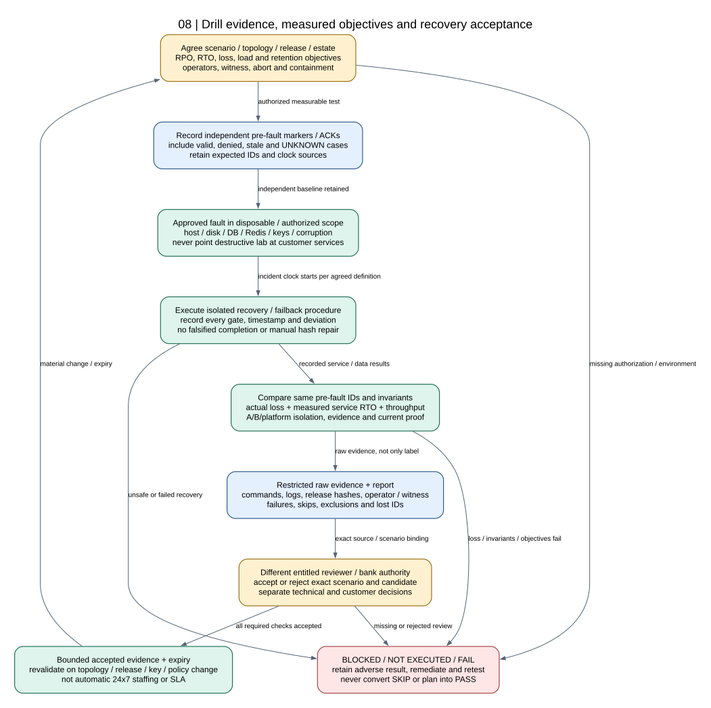

# 07 — Recovery drills, measurements, validation and acceptance

[Pack index](README.md) · [Previous](06-security-keys-ransomware-and-retention.md) ·
[Next: scenarios and templates](08-scenario-playbooks-and-operating-templates.md)

## 1. Evidence-producing drill, not a planning PASS

[Full-resolution SVG](diagrams/08-drill-and-acceptance.svg) ·
[Editable DOT](diagrams/08-drill-and-acceptance.dot)

Writing a plan, rendering a diagram or syntax-checking a command is not a restore
exercise. Run destructive/fault tests only on separately authorized disposable
services or an explicitly approved site scope with containment, witnesses and
abort controls. No such production exercise was performed for this pack.

## 2. Before the drill

- Record scenario, legal estate, enabled profile/features, exact source/release,
  all image digests, schema/database/provider versions and topology digest.
- Agree objectives **before** measuring: RPO, RTO start/end definition, maximum
  ACK loss, minimum workload/throughput, duration, evidence age and exclusions.
- Obtain named operator, incident authority, primary/backup and different reviewer.
- Verify isolated endpoints, egress restrictions, credentials, storage/key custody,
  network management access and abort/rollback/fencing methods.
- Seed permitted representative markers through actual supported paths: valid
  current work, denied/revoked actors, bank A/B/platform, a tombstone, immutable
  histories, owned result IDs and an accounted RUNNING/UNKNOWN case where safe.
- Retain an independent fsynced pre-fault ACK/commit/effect ledger and expected
  object/source versions. The failed DB/Redis instance must not be its only copy.
- Record clock sources/uncertainty and restoration target. Do not manipulate clock,
  expiry, ownership or hashes merely to obtain a passing result.

## 3. Scenario matrix

Each scenario needs its own exact release/topology/role binding and result.
A subset may be approved for a particular exercise, but unexecuted required rows
remain NOT_EXECUTED/BLOCKED, never implicitly passed.

| Scenario | Fault/recovery exercise | Required observations |
|---|---|---|
| API/worker pod or node loss | Clean replacement after controlling old writers/runtime | Durable IDs/history survive; no duplicate work or plaintext exposure; readiness and authority remain correct. |
| Parser/daemon loss or unconfirmed cleanup | Isolated fault at approved boundary | Actual stop evidence or UNKNOWN with reservations retained; no timeout-as-stop assumption. |
| PostgreSQL process/host/disk loss | Restore or separately approved replica promotion | Fencing, recovery point/LSN, committed-ID survival, schema/owner integrity and actual service recovery time. |
| Logical corruption / accidental deletion | PITR or earlier consistent cohort | Chosen point predates undesired change; valid lost later writes/objects enumerated; histories not patched. |
| File/object loss or version mismatch | Restore referenced raw artifacts/source versions | SQL references resolve to exact owner/hash/version; missing bytes block affected claims. |
| Redis process/power loss | Per-role persistence recovery | Same pre-fault ACK IDs, loss list, primary/epoch change, consumer-specific behavior and throughput. |
| Redis partition/split brain/replica lag | Bank-approved infrastructure event | Single active authority, measured ACK survival, no stale-cursor acceptance or unsafe queue replay. |
| Disk full / memory pressure | Bounded storage or memory fault | Honest errors, no silent local fallback for required durability, prior good backups retained, cleanup evidence. |
| Credential/CA/certificate rotation or expiry | Approved overlap and failure cases | Hostname-verified TLS/role access; wrong/expired trust fails; recovery does not disable verification. |
| Key loss / wrong key / corrupt backup | Isolated decrypt and restore refusal | Wrong key/tag/hash/signature/manifest refuses; no overwrite, fabricated PASS or public secret dump. |
| Identity and authority rollback | Reconcile post-backup revocations/membership | Revoked/disabled/foreign/machine-reviewer paths refuse; old API keys/SSO replay do not regain authority. |
| Evidence withdrawal / expiry | Restore then current proof evaluation | Tombstones/history survive; post-backup withdrawals reconciled; current trace/proof/pilot cannot reuse stale evidence. |
| Whole site / approved regional loss | Clean isolated alternative under residency rules | All keys, images, data, networking and people available; no hidden dependency on failed site; cutover measured. |
| Ransomware / management-plane compromise | Clean-point recovery with separate custody | Independent immutable/offline copy usable; compromised credentials/keys investigated; no contaminated failback. |
| Recovery load / catch-up | Representative backlog, volume and concurrent reads | Restore bandwidth, WAL/object lag, SQL/Redis resource/latency and user critical journey meet agreed objectives without weakening controls. |
| Failback and second recovery | Follow file 08, then repeat backup/restore | All new recovery-side writes preserved, old writers fenced, current backup protection works after migration. |

For Redis, qualify each requested **role × scenario**, not just a shared PING.
The existing [Redis objectives/measurement/review workflow](../bank-environment/47-redis-consumer-and-recovery-evidence.md)
requires current exact-topology operator measurements and separate human review;
it does not independently witness the external fault. The scratch observer must
not be treated as a production failover controller.

## 4. RPO/RTO and data-loss measurement

Use independently retained markers and clearly defined clock boundaries:

- `T_incident`: agreed fault/service-loss reference, including clock uncertainty.
- `T_detect`, `T_authorize`, `T_keys_ready`, `T_data_restored`, `T_reconciled`,
  `T_validated`, `T_cutover`, `T_service_accepted`: retain each milestone.
- `T_last_consistent_state`: latest recoverable **complete cohort**, validated
  across required stores, not merely the newest SQL commit or file timestamp.
- Observed recovery-point time gap: `T_incident - T_last_consistent_state`, with
  scenario/clock caveats and a separate explicit lost/uncertain-ID list.
- Measured service recovery time: `T_service_accepted - T_incident` under the
  pre-agreed RTO definition. Report excluded detection/approval intervals explicitly.
- ACK survival: compare those same IDs acknowledged **before** the fault with
  recovered records; do not substitute newly generated IDs or a fresh snapshot.

**Illustrative example, not a measured CryptoScan result:** incident reference
10:00 UTC; newest intact cross-store cohort 09:50; critical service accepted at
11:30. The observed time gap is 10 minutes and service recovery is 90 minutes.
List actual lost/uncertain IDs between the points. A database that opened at
10:40 does not make service RTO 40 minutes if authority/evidence validation and
cutover were not complete until 11:30.

If clocks disagree or loss cannot be enumerated, report uncertainty and the
measurement limitation. Do not assert zero RPO from async replication or absence
of visible errors. Expected-target coverage and business data-loss tolerance are
separate from cryptographic chain validity.

## 5. Mandatory technical validation checklist

### Data, identity and provenance

- [ ] Correct target database/site/region and compatible schema/release.
- [ ] Required row IDs/counts/markers, roles/grants, constraints, sequences and indexes.
- [ ] A/B/platform isolation including same-name systems/artifacts and foreign IDs.
- [ ] Evidence content/chain/scan manifests and assurance revision envelopes/links.
- [ ] Original tombstones, lifecycle history, signer/revocation/expiry and retained
      historical verification material; post-backup authority changes reconciled.
- [ ] Exact external artifact/source versions, hashes, custody and storage ownership;
      restored source permissions/symlinks cannot escape the approved root.
- [ ] Current trace/coverage/remediation/operator/pilot semantics agree with actual
      current evidence, without rewriting older history or turning EMPTY into complete.

### Execution and service

- [ ] Job/attempt/budget/outbox consistency and independently accounted effects.
- [ ] UNKNOWN reservations remain held; authorized exact-owner settlement and late
      worker fencing are checked where the drill scope permits.
- [ ] Duplicate/redelivered/legacy/unpinned/foreign hints do not execute or mutate victims.
- [ ] Redis roles, ACL/TLS, primary identity, replay gaps and current-state refresh.
- [ ] Correct dedicated runtime/source/staging/socket configuration; parser has no
      network, credentials or daemon socket; actual cleanup/stop evidence retained.
- [ ] Required SQL/Redis readiness, current login/roles and critical browser/API path.
- [ ] Disabled profile components remain disabled; no fallback enables refused collectors.
- [ ] New accepted writes receive the recovered estate's backup/audit protection.

### Security and operations

- [ ] Restored sessions/SSO/API keys cannot resurrect revoked authority.
- [ ] Key/certificate rotation and cold-start management dependencies work as scoped.
- [ ] Public diagnostics contain no credentials, customer source or raw SQL exceptions.
- [ ] Backups, decrypted staging and forensic copies obey access/retention/hold.
- [ ] Incident communications, primary/backup reachability, handover and abort path.
- [ ] Actual load/capacity, loss and time objectives are measured, not inferred.

## 6. Evidence and independent acceptance

Retain in the bank's protected evidence store:

1. Authorization, scenario, exact release/topology and agreed objectives.
2. Independent pre-fault markers/ACK ledger and expected corpus/owner mapping.
3. Fencing/containment, key custody, backup/copy/authentication records.
4. Timestamped raw tool/provider/host/application logs, results, error/skip details,
   SQL/WAL/object positions, lost/uncertain IDs and evidence verification outputs.
5. Operator/witness/reviewer identities, decisions and actual measured RPO/RTO/load.
6. Cutover/failback record, residual risks, business limitations and next actions.

Different-human technical review and bank customer acceptance are separate from
the operator's execution result. A signed release is separate from a signed drill
report. An authentic report with missing mandatory scope does not qualify it.
Changed images, topology, policy, credentials/trust, objectives or expired evidence
require revalidation; retain older reports as history.

## 7. Existing evidence and this documentation change

The [historical SQLite drill](../backup-drill.md) and dated readiness evidence
retain their original environments/results; they are not current PostgreSQL,
whole-site or cyber-recovery proof. Recent [quality implementation records](../product-improvement/IMPLEMENTATION-STATUS.md)
exercise selected local/SQLite/mock contracts; they do not close the site matrix.

This pack's checks are documentation/source-link and diagram parse/render checks.
No destructive drill, live backup/restore, production key recovery, real failover,
capacity measurement or new application test campaign is claimed for this change.
