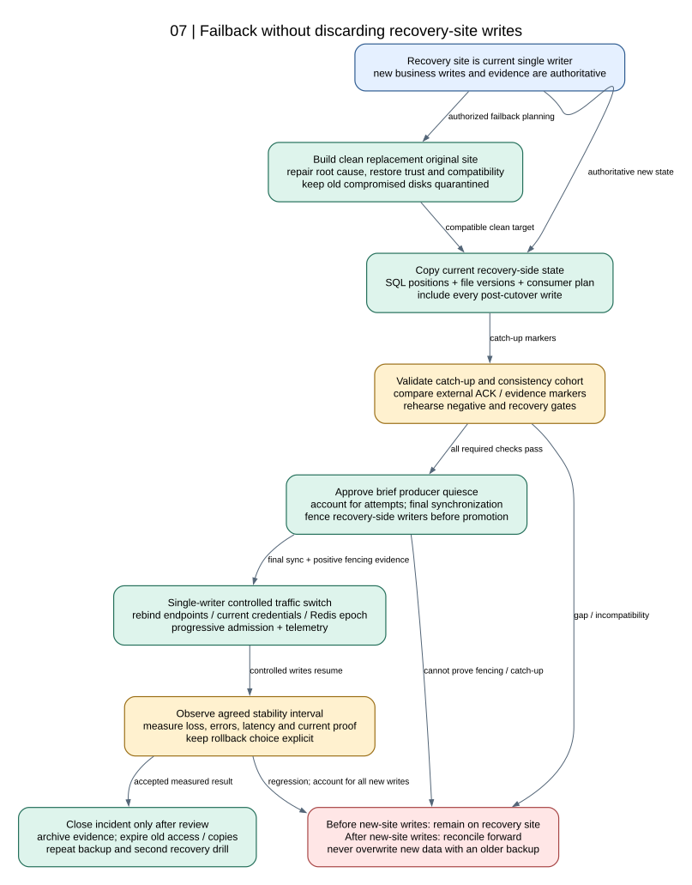

# 08 — Scenario playbooks, failback and operating templates

[Pack index](README.md) · [Previous](07-drills-validation-and-acceptance.md)

## 1. Scenario-specific first actions and release gates

All scenarios inherit file 04's authority, fencing, isolated-restore and acceptance
sequence. Do not select a shortcut below that bypasses those gates.

| Incident | First safe action | Recover and verify | Do not do |
|---|---|---|---|
| API/frontend node loss | Keep data stores intact; isolate failed node and investigate compromise versus ordinary failure. | Redeploy verified compatible images/config/CA; validate readiness, login, A/B/platform and current data. | Restore an old DB unnecessarily or use arbitrary latest image tags. |
| Worker/parser/daemon host lost | Close affected admission; inventory surviving containers and SQL attempts. | Rebuild dedicated runtime; prove old effects stopped or preserve UNKNOWN; check socket/staging/source isolation. | Assume container stopped because the dispatcher disappeared; free reservations. |
| SQL service unavailable | Stop unsafe producers/effects and preserve outage/fencing evidence. | DBA-authorized fenced promotion or isolated restore; validate cohort and independently committed IDs. | Promote because primary PING failed; run two writers or assume zero async loss. |
| SQL corruption / accidental delete | Preserve current state/forensics and stop propagation as authorized. | Last-known-good PITR/cohort; reconcile lost valid later writes and withdrawals. | Choose newest replica solely because it is healthy; patch historical hashes. |
| External SBOM/artifact/source bytes missing | Keep SQL history; mark affected claims unavailable. | Restore exact owner/version/hash from matched cohort and verify links. | Substitute same-name files or treat document digest as release digest. |
| Redis queue lost or restored stale | Keep required durability fail closed; retain SQL and pre-fault ACK ledger. | Per-role recovery plus SQL/outbox/effect reconciliation; test duplicates/current authority. | Requeue every historical job, reset RUNNING to QUEUED or flush shared Redis blindly. |
| Redis primary promotion/restart | Preserve role/ACK evidence; expect cursor invalidation. | Verify TLS/ACL/new primary, reconcile ACK loss, explicit fresh current-state reads. | Call a complete fresh snapshot proof of all old acknowledged writes. |
| SSO/secret manager/PKI outage | Use only the approved audited break-glass/management path. | Restore independent trust/custody; reissue/renew credentials and reconcile current revocations. | Create implicit admins, bypass TLS or reuse stale restored assertions. |
| Backup decrypt/hash/signature failure | Quarantine candidate; preserve failing evidence and previous good copy. | Correct authorized key/tool/format or choose another trusted cohort; measure extra loss. | Force normal restore, edit manifests or weaken encryption. |
| Ransomware/admin compromise | Isolate compromised identities/control planes and protect clean copies. | Clean infrastructure and trusted pre-compromise cohort; rotated access, independent evidence and forensic/security approval. | Reconnect compromised replication or use the attacker's newest catalog as trust. |
| Whole-site outage | Declare DR with infrastructure, key, identity and service owners. | Approved residency-compliant target; all trust/data/images/services; complete measured recovery and separate cutover. | Assume a second namespace or three Sentinel addresses constitute another site. |
| Wrong tenant/cohort appears after restore | Immediately restrict affected access and preserve evidence. | Revalidate target, ownership/references and all cohort parts; choose correct candidate and investigate exposure. | Rename owners or copy rows into another tenant to make tests pass. |
| Disk/quota full during backup/restore | Preserve prior good artifacts and stop incomplete publication. | Restore capacity safely; validate partial/temp files and copy receipts; rerun protected capture. | Prune legal-held/only-good backups automatically to make space. |
| Clock skew, stale approval or retracted proof | Keep current gates closed and inspect trusted time/authority records. | Correct time through bank process; obtain current eligible evidence/approval where required. | Backdate evidence, extend old expiry or restore findings to force green. |
| Failed upgrade after new writes | Preserve every new accepted write and effect. | Approved forward fix or data-consistent migration/failback; verify compatible schema and signed images. | Overwrite with a pre-upgrade dump or truncate audit history to downgrade. |

## 2. Failback is another recovery migration



[Full-resolution SVG](diagrams/07-failback-dataflow.svg) ·
[Editable DOT](diagrams/07-failback-dataflow.dot)

1. Stabilize the active recovery estate, continue backups/audit and establish its
   current state as authoritative. Do not let the former primary rejoin as writer.
2. Repair root cause and build a clean compatible target at the approved original
   location. Rotate compromised trust/access and validate storage/network/runtime.
3. Synchronize **all** recovery-side accepted SQL writes, file versions, source
   custody and required role state under a separately tested migration method.
4. Compare independent markers/ACKs and cohort references; measure catch-up lag
   and prove the target can satisfy integrity/current-authority/service checks.
5. Authorize producer quiesce, inventory outstanding attempts and perform final
   sync. Prove recovery-side fencing before making the new side a writer.
6. Switch traffic in controlled stages, reconcile replay epochs/current clients
   and resume only current approved work. Monitor loss/errors/latency/current proof.
7. Before target-side writes, an approved return to the still-authoritative
   recovery side may be possible. After new writes, preserve/reconcile them and
   recover forward; never return to stale copies without accounting for them.
8. Verify new-site backup protection, perform a second scoped recovery test and
   close the incident only after independent review and authorized acceptance.

A repository promotion script is not an automatic fenced failover system. In
particular, [the historical Compose promotion helper](../../deploy/ha/promote-replica.sh)
checks reachability and prints repointing steps; inability to contact a primary
is not positive partition fencing, and its lag output is not a complete loss gate.
Use the actual bank DBA/provider procedure and witnessed acceptance.

## 3. Site recovery register — complete before adoption

| Field | Required site-supplied value |
|---|---|
| Plan owner, bank service owner, primary/backup operators, different reviewer | Actual entitled people, approved contact/escalation paths and availability. |
| Legal estate / platform boundary | Included tenants/platform records; permitted restore access and any exclusions. |
| Actual topology and failure domains | Site/region/provider/account/host/storage/key administrators; active/recovery and management dependencies. |
| Release and compatibility | Source/release ID, image digests, schema, provider/client versions and trusted public fingerprints. |
| Recovery objectives | Agreed RPO/RTO definitions, tolerable ACK loss, workload/throughput, duration and measurement uncertainty. |
| Stores and consistency groups | D01–D26 disposition, real paths/volumes/object versions, SQL/WAL points, Redis roles and ownership. |
| Capture/copy policy | Actual jobs/timezone/frequency, encryption, independent-copy receipt, immutability and alerting. |
| Key and break-glass custody | Key IDs/versions/quorum and secure access reference; no private values. |
| Retention/legal hold/residency | Approved storage/replicas/drill locations and destruction/reapplication authority. |
| Fence/isolation/abort method | Positive old-writer/runtime stop evidence and no-live-effect recovery boundary. |
| Acceptance and revalidation | Required tests, evidence store, reviewers, expiry/material-change triggers and customer decision. |

Until completed and reviewed, this pack remains a planning document, not the
bank's accepted operational runbook.

## 4. Cohort catalog template

This JSON is a **planning record**, not a schema implemented by the backup
helpers and not a signed/verified manifest. Keep populated records in restricted
bank custody. Null fields mean unknown, not zero loss or implicit acceptance.

```json
{
  "template_kind": "planning-record-not-an-implemented-tool-schema",
  "cohort_id": null,
  "incident_or_change_ref": null,
  "profile": "kubernetes-external-services/local-source-v1",
  "estate_scope_ref": null,
  "source_release_and_image_inventory_ref": null,
  "expected_schema_revision": null,
  "capture_interval_utc": {"start": null, "end": null},
  "clock_source_and_uncertainty_ref": null,
  "sql": {
    "method": null,
    "snapshot_or_lsn_timeline_ref": null,
    "base_and_wal_inventory_ref": null,
    "global_roles_configuration_ref": null
  },
  "external_artifact_and_source_version_inventory_ref": null,
  "redis_role_persistence_config_and_primary_inventory_ref": null,
  "pre_fault_ack_and_authority_change_ledger_ref": null,
  "encrypted_artifact_hash_size_inventory_ref": null,
  "separate_key_ids_and_custody_ref": null,
  "independent_copy_object_versions_and_receipts_ref": null,
  "retention_hold_and_residency_approval_ref": null,
  "detached_catalog_signature_and_trusted_fingerprint_ref": null,
  "exclusions_and_missing_dependencies_ref": null,
  "verification": {"status": "NOT_EXECUTED", "evidence_ref": null},
  "different_reviewer_and_decision_ref": null
}
```

Record the helper's **actual** companion `.sha256` or `.manifest.json` separately;
do not replace it with this planning JSON or imply the helpers sign a catalog.

## 5. Incident/drill timeline and outcome template

```json
{
  "template_kind": "planning-record-not-an-implemented-tool-schema",
  "incident_or_drill_id": null,
  "scenario_and_authorized_scope_ref": null,
  "topology_and_cohort_ref": null,
  "operators_witness_reviewer_ref": null,
  "agreed_objectives_ref": null,
  "times_utc": {
    "incident_reference": null,
    "detected": null,
    "recovery_authorized": null,
    "old_writers_fenced": null,
    "keys_available": null,
    "data_restored": null,
    "effects_reconciled": null,
    "validation_complete": null,
    "cutover": null,
    "service_accepted": null
  },
  "last_consistent_recovered_state_ref": null,
  "acknowledged_ids_lost_or_uncertain_ref": null,
  "observed_rpo_seconds": null,
  "measured_service_rto_seconds": null,
  "measured_workload_and_throughput_ref": null,
  "mandatory_invariants_and_negative_results_ref": null,
  "unknown_attempts_reservations_and_effects_ref": null,
  "raw_evidence_and_deviations_ref": null,
  "result": "NOT_EXECUTED",
  "restricted_service_limitations_ref": null,
  "technical_acceptance_ref": null,
  "separate_customer_acceptance_ref": null,
  "failback_and_next_actions_ref": null
}
```

Use PASS/FAIL/NOT_EXECUTED/BLOCKED only according to actual evidence. A failed
mandatory step remains failed even when a restricted degraded service is accepted.

## 6. Communications and operating cadence

| When | Required content / owner |
|---|---|
| Incident declared | Bank incident/service authority states affected scope, known versus uncertain loss, current containment and next update decision. No premature recovery ETA. |
| Each recovery gate or material change | Operator reports actual timestamps/results, blockers, key/fencing status, affected jobs/estates and revised uncertainty. |
| Before cutover/failback | Different reviewer and designated authority record exact approved scope, measured results and rollback/forward constraints. |
| Stabilization/handover | Primary/backup operators receive endpoints/trust references, current reservations/UNKNOWN work, alerts, retention/hold, open defects and recovery evidence location. |
| Proposed weekly joint review | Bank owners and our agreed support team review failed backups, restore evidence age, capacity, keys/certificates, unresolved incidents/defects and next actions. Actual staffing/hours/contact terms must be agreed. |
| Urgent incident | Follow the agreed urgent escalation path immediately according to severity; do not wait for the weekly review. No response time or 24/7 staffing is invented by this document. |

The intended operating model can include continuous bank-owned monitoring and
weekly vendor-team error review. It is not proof of actual on-call staffing,
contracted support availability, uptime or SLA. Assign real primary/backup humans
for the existing nine duties and exercise them; see
[operating ownership](../runbooks/launch-assurance-handoff.md).

## 7. Recurring backup/DR health checklist

- [ ] Last successful **independent** copy and latest accepted restore evidence.
- [ ] WAL/archive/object-copy lag, retention holes, capacity and cost/bandwidth.
- [ ] Failed/corrupt/partial jobs and orphaned encrypted/plaintext temporary files.
- [ ] Key/CA/certificate/credential expiry and tested historical decryptability.
- [ ] Unresolved UNKNOWN attempts, held reservations and unaccounted external effects.
- [ ] Current revocations, evidence withdrawals and legal holds across restore points.
- [ ] Current release/topology/role inventory versus accepted drill scope/expiry.
- [ ] Backup/restore/delete permissions and evidence of immutable/offline protection.
- [ ] Actual operator/reviewer reachability, incident handover and customer limitations.
- [ ] Affected defects have accountable owners, adverse evidence, correction/retest
      and accepted closure; no undocumented readiness percentage.
