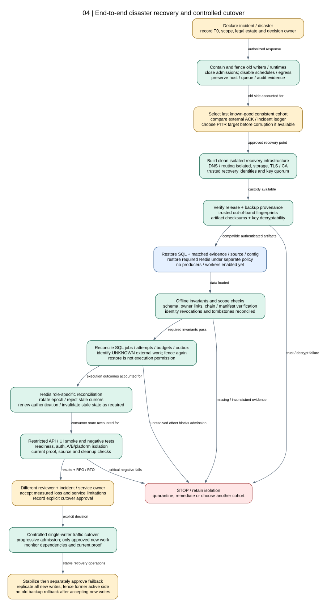

# End-to-end backup and disaster-recovery plan

- **Prepared:** 2026-10-23 UTC
- **Source baseline:** `08b48df0d3667123b5aa90b791014a0cc6e5907d`
- **Primary profile:** `kubernetes-external-services/local-source-v1`
- **Status:** detailed engineering and bank-site planning pack, **not an executed production DR exercise or accepted SLA**.

This pack connects architecture, data custody, backup, isolation, restoration,
execution reconciliation, verification, cutover and failback. It is new Markdown
documentation with editable, rendered diagrams. No application, database schema,
backup service, cluster, storage account or recovery site is provisioned by it.

## Read in this order

| File | What it answers |
|---|---|
| [01 — Architecture and recovery boundaries](01-architecture-and-recovery-boundaries.md) | What runs where; which dependencies and failure domains must survive; what the controlled profile actually supports. |
| [02 — Inventory and consistency groups](02-data-inventory-and-consistency-groups.md) | Everything that must be retained, separately recovered, rebuilt or explicitly excluded; cross-store consistency and exact-estate authority. |
| [03 — Backup policy and full dataflow](03-backup-policy-and-end-to-end-dataflow.md) | Capture → encryption → independent copy → catalog → verification → restore test; proposed schedules; exact helper formats and limitations. |
| [04 — Disaster-recovery runbook](04-disaster-recovery-runbook.md) | Declaration → fencing → recovery-point choice → isolated restore → validation → controlled cutover; gates and abort conditions. |
| [05 — Queue, execution and evidence reconciliation](05-queue-execution-and-evidence-reconciliation.md) | Redis's eight roles; SQL/outbox authority; RUNNING/UNKNOWN work; held reservations; replay, revoked authority and current proof. |
| [06 — Security, keys, ransomware and retention](06-security-keys-ransomware-and-retention.md) | Independent trust/key custody, cyber recovery, identity rollback, immutability, residency, legal holds and secure destruction. |
| [07 — Drills, validation and acceptance](07-drills-validation-and-acceptance.md) | Measurable RPO/RTO, scenario matrix, source-bound evidence, negative tests, different-human review and completion criteria. |
| [08 — Scenario playbooks and operating templates](08-scenario-playbooks-and-operating-templates.md) | Component/site/cyber failure actions, loss estimates, failback, incident and recovery-manifest templates, handover and recurring review. |
| [Diagram index and editable sources](diagrams/README.md) | Eight full-resolution SVG diagrams and their Graphviz DOT sources. |

## Start with the complete recovery path

[Open full-resolution diagram](diagrams/04-recovery-dataflow.svg) ·
[Editable source](diagrams/04-recovery-dataflow.dot)

## Four labels used throughout

- **Implemented/source-present:** a referenced script, model or control exists.
  This does not establish deployment configuration or witnessed fault behavior.
- **Site-required plan:** the bank/operator must provision, authorize, configure,
  execute and retain evidence. A diagram arrow is not an implemented integration.
- **Illustrative proposal:** a concrete planning example, not a contractual target,
  default production configuration or measured result.
- **Historical/local evidence:** applies only to its named revision and environment.
  SQLite/local/mock results are not PostgreSQL or actual bank-site qualification.

## Recovery completeness checklist

| Coverage area | Where to find it |
|---|---|
| PostgreSQL data, roles/grants, schema, physical backup/WAL/PITR and logical export differences | 02, 03, 04 |
| Users, sessions, memberships, API-key policies, revocations and platform/tenant scope | 02, 04, 06 |
| Evidence, SQL blobs, raw external artifacts, manifests, source custody and all six BOMs | 01, 02, 03, 05 |
| Immutable history, tombstones, audit anchors, policy/approval expiry and current remediation proof | 02, 05, 06, 07 |
| Redis realtime/current-run/queue/rate-limit/health/platform/SSO/telecom roles | 02, 05, 07 |
| Outbox, attempts, budgets, RUNNING/UNKNOWN, old parsers and external effects | 04, 05, 08 |
| Secrets, CAs, historical verification keys, release trust, DNS, ingress and image access | 01, 04, 06 |
| Dedicated runtime node, daemon socket, approved-source PVC and private transient staging | 01, 02, 04 |
| Optional Neo4j, local event logs/live-CBOM stores, exported files and notifications | 01, 02, 05, 08 |
| Off-host/offline/immutable copies, ransomware, legal hold, deletion and residency | 03, 06, 08 |
| Detection, incident ownership, fencing, restore, cutover, failback and communications | 04, 07, 08 |
| RPO/RTO/loss/throughput measurement, adverse tests, capacity and customer acceptance | 03, 07, 08 |

“No missing component” means every deployed dependency is classified and has an
owner and recovery disposition. It is **not** a claim that an unknown customer
estate has been fully discovered. The site must sign off actual paths, volumes,
regions, feature use, providers and exclusions before this becomes its runbook.

## Non-negotiable recovery rules

1. Fence the old writers/runtime; isolate restoration and block live outbound effects.
2. Restore a **consistent cohort**, not unrelated latest SQL and file copies.
3. A replica is not an immutable backup; asynchronous replication can lose ACKed writes.
4. A checksum is not authenticity; a signed manifest is not factual completeness.
5. A restored queue/job/approval is not permission to repeat external work.
6. UNKNOWN keeps both reservations until authorized, evidence-backed settlement.
7. Restore tombstones and revocations; reconcile post-backup withdrawals from an
   independent incident/authority record. An old VERIFIED label is not current proof.
8. Never patch ownership, history, hashes or counters to manufacture acceptance.
9. Do not reopen service because `/healthz`, `pg_isready` or Redis PING succeeds.
10. Independent review, signed release, actual site drills and customer acceptance
    remain separate decisions. No uptime, staffing or RPO/RTO is promised here.

## Documentation validation record

[Source-bound documentation checks and explicit unexecuted scope](../readiness-evidence/backup-disaster-recovery-documentation-2026-10-23.md).

## Related authoritative operating material

- [Current installation, coordinated upgrade and recovery boundary](../runbooks/operator-install-upgrade-recover.md)
- [Bank on-premises deployment and responsibility boundary](../BANK-ON-PREMISES-DEPLOYMENT.md)
- [Controlled execution and UNKNOWN recovery](../runbooks/controlled-execution-upgrade.md)
- [Replay/queue upgrade procedure](../runbooks/execution-and-replay-upgrade.md)
- [Current source-evidence withdrawal behavior](../runbooks/evidence-assurance-upgrade.md#current-source-evidence-withdrawal-handoff-2026-10-23)
- [Existing customer architecture template](../company/backup-and-recovery-architecture.md)
- [Historical HA runbook — do not reuse its targets as promises](../runbooks/dr-recovery.md)

**Publication scope:** documentation and diagram sources/assets only, on the
existing PR branch with `[skip ci]`. No live backup, restore, key recovery,
failover, destructive drill or customer update was executed to write this pack.
