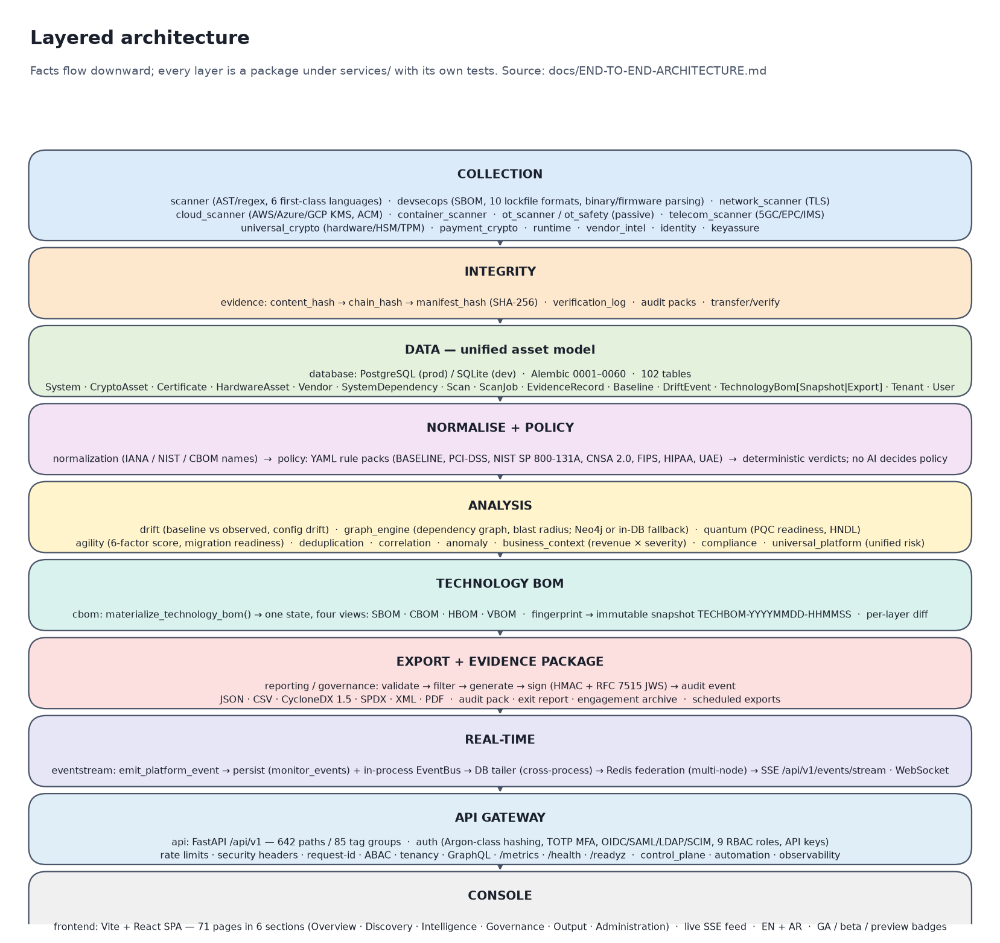
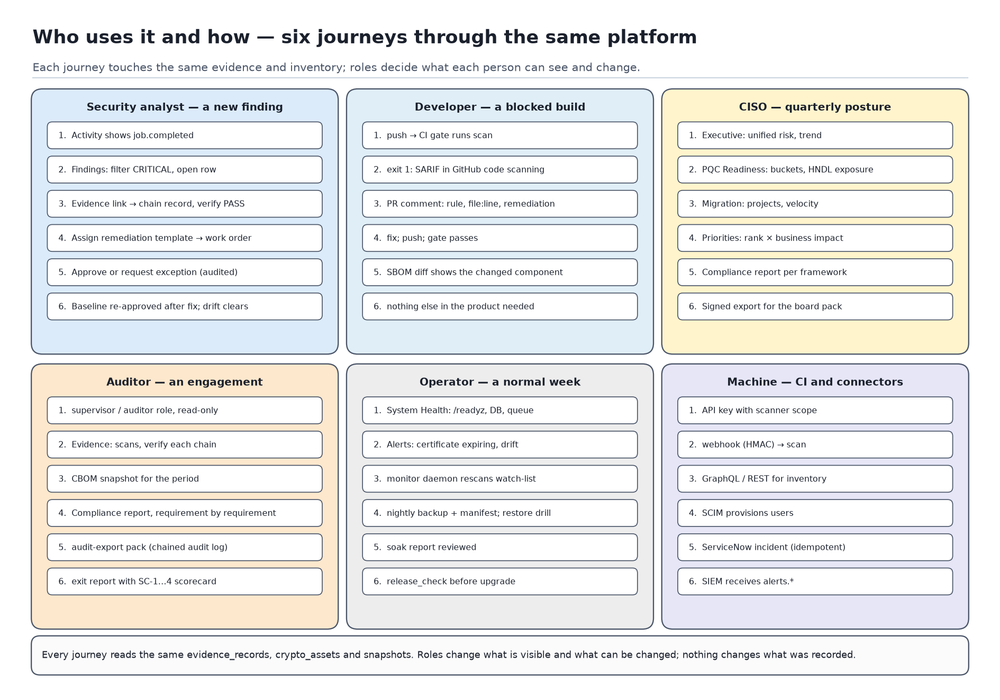

# 1. What it is

## The problem

Every organisation runs on cryptography it cannot see. Keys are hard-coded in
repositories written years ago; a payment HSM still signs with 3DES; a
customer-facing endpoint negotiates TLS 1.0 because a load balancer default
was never changed; a firmware image on a factory floor ships an OpenSSL from
2014; a 5G core exposes a SEPP with a certificate chain nobody has audited;
and a thousand dependency manifests pull in crypto libraries at versions no
one chose deliberately.

Three things now make this urgent at once:

1. **Regulators ask for an inventory**, not a policy. PCI-DSS 4.0, DORA, the
   ECB's ICT guidance, NIST SP 800-131A, CNSA 2.0 and the UAE IA standard all
   assume you can list what cryptography you run, where, and prove the list is
   correct.
2. **Post-quantum migration** is a multi-year programme that cannot start
   without knowing what to migrate. "Harvest now, decrypt later" makes data
   protected by RSA/ECC today a liability already.
3. **Crypto agility** — the ability to swap an algorithm without a rewrite —
   is now a design requirement, and it can only be measured against an
   inventory.

## What CryptoScan does about it

CryptoScan is a **cryptographic inventory and compliance platform**. It
collects cryptography from everything, records each observation in a
tamper-evident evidence chain, assesses it deterministically, watches it for
change, gates it in CI, and produces artefacts a regulator can verify.

_Figure 2 — the four layers: the React console, the FastAPI API tier, 51 backend service packages, and the stores (PostgreSQL, Redis, optional Neo4j). Requests only flow downward; evidence only flows upward._

Read the layers top to bottom:

| Layer | What it is | Package(s) |
|---|---|---|
| **Collection** | The scanners. Read-only, deterministic; each reports what it could not reach rather than guessing | `scanner`, `devsecops`, `network_scanner`, `cloud_scanner`, `container_scanner`, `ot_scanner`, `telecom_scanner`, `universal_crypto`, `payment_crypto`, `runtime`, `vendor_intel`, `identity`, `keyassure` |
| **Integrity** | The evidence chain. Every finding hashed, chained to the previous one, sealed by a manifest | `evidence` |
| **Data** | One unified asset model in PostgreSQL. Systems, crypto assets, certificates, hardware, vendors, dependencies, scans, jobs, baselines, drift, snapshots | `database` |
| **Normalise + policy** | Names and sizes brought to IANA/NIST vocabulary; YAML rule packs evaluated deterministically | `normalization`, `policy`, `ruleset` |
| **Analysis** | Drift, dependency graph and blast radius, PQC readiness, agility score, deduplication, correlation, business impact, unified risk | `drift`, `graph_engine`, `quantum`, `agility`, `deduplication`, `correlation`, `anomaly`, `business_context`, `compliance`, `universal_platform` |
| **Technology BOM** | One materialised state with four views (SBOM, CBOM, HBOM, VBOM), fingerprinted into immutable snapshots | `cbom` |
| **Export + evidence package** | Six formats, each signed; audit pack, exit report, engagement archive; schedules | `reporting`, `governance` |
| **Real-time** | Every operation emits a platform event: persisted, fanned out in-process, tailed across processes, federated across nodes over Redis, delivered by SSE | `eventstream`, `api/events` |
| **API gateway** | FastAPI `/api/v1`, GraphQL, auth, RBAC, rate limits, audit, metrics | `api`, `control_plane`, `automation`, `observability` |
| **Console** | React SPA, 71 pages, live feed, EN + AR, GA / beta / preview badges | `frontend/` |

## Who it is for

_Figure 20 — six people, one platform. Every journey reads the same
`evidence_records`, `crypto_assets` and snapshots; roles change what is
visible and what can be changed, never what was recorded._

### The six journeys, step by step

**Security analyst — a new finding.** The Activity page shows
`job.completed` for a repository scan. The analyst opens Findings, filters
to CRITICAL, and opens the row. The finding carries the rule that fired
(`BASELINE-001`, forbidden algorithm), the file and line, and a link to
its evidence record. Clicking *verify* runs `GET /scans/{id}/verify`,
which recomputes the chain from the stored rows and returns `PASS` with
`chain_intact = true`. The analyst assigns a remediation template (for
example *replace 3DES with AES-256-GCM*), which produces a work order,
or approves a time-boxed exception, which is audited and shown on the
finding. When the fix lands, the next scan clears the drift event and the
baseline is re-approved — a recorded human action.

**Developer — a blocked build.** A `git push` triggers the GitHub webhook
(HMAC-verified). The CI gate (`scripts/ci_gate.py`) runs the scan, applies
the gate profile and exits `1`. GitHub code scanning shows the SARIF 2.1.0
result; the PR comment names the rule, `file:line` and the remediation. The
developer fixes the line and pushes; the gate passes with exit `0`. The SBOM
diff on the DevSecOps page shows exactly which component changed. Nothing
else in the product is needed for this journey.

**CISO — quarterly posture.** Executive dashboard for unified risk and
trend; PQC Readiness for the NIST IR 8547 buckets and harvest-now-decrypt-
later exposure; Migration for project velocity; Priorities for the
deterministic rank (business impact × severity ÷ effort); a compliance
report per framework (PCI-DSS 4.0, DORA, NIST SP 800-131A …); and a signed
export for the board pack, carrying `integrity_sha256` and a JWS signature.

**Auditor — an engagement.** A `supervisor` or `auditor` role is read-only
by construction. The auditor opens Evidence, verifies each scan's chain,
takes the CBOM snapshot for the period, reads the compliance report
requirement by requirement, downloads the audit-export pack (deterministic
JSON + SHA-256 manifest of the chained audit log) and finishes with the exit
report and its SC-1…4 scorecard.

**Operator — a normal week.** System Health (`/readyz`, DB, queue), Alerts
(certificate expiring in 30 days, drift on a production system), the monitor
daemon re-scanning the watch-list, the nightly `db_backup.sh` with manifest
and a restore drill, the weekly soak report, and `release_check.py` before
any upgrade.

**Machine — CI and connectors.** An API key scoped to the `scanner` role can
submit scan results and nothing else. Webhooks (HMAC) start scans; GraphQL
and REST read the inventory; SCIM provisions users; ServiceNow receives
idempotent incidents (stable `correlation_id`); the SIEM receives `alerts.*`.

| Journey | Role(s) | Pages | Can change |
|---|---|---|---|
| Analyst | `security_analyst` | Activity · Findings · Evidence · Drift · Baselines | exceptions, baselines, work orders |
| Developer | `developer` | DevSecOps · CI gate results | own repos' scans |
| CISO | `ciso` | Executive · PQC · Migration · Priorities · Reports | approvals, API keys |
| Auditor | `auditor`, `supervisor` | Evidence · CBOM · Reports · Audit export | nothing |
| Operator | `superadmin` | System Health · Alerts · Backups · Settings | configuration, users |
| Machine | `scanner` API key | none — API only | submit scan results |

| Role | What they get | Where |
|---|---|---|
| **Security / crypto team** | findings with evidence, the inventory, drift alerts, PQC and agility scores, remediation work orders | Findings · Assets · Drift · PQC · Agility · Reports |
| **Developers** | a CI gate verdict on their commit with the rule that fired and the line it fired on; remediation templates; SBOM diffs | CI gate API · DevSecOps page · GitHub integration |
| **CISO / executive** | posture, unified risk score, migration roadmap and velocity, cost-of-inaction | Executive · Command Center · Migration |
| **Auditor / regulator** | hash-manifested evidence packs, compliance reports per framework, a read-only supervisor role, the ability to re-verify any artefact | Evidence · Compliance · Supervision · audit-export API |
| **Operations** | monitor daemon, alert channels, SSE feed, `/health` `/readyz` `/metrics`, backup + DR runbooks | System Health · Alerts · Integrations |
| **Machines** | REST + GraphQL, GitHub and registry webhooks, SCIM, SIEM / ServiceNow connectors, scoped API keys | API reference |

## What it deliberately does not do

These are product decisions, encoded in `shared_models/platform_scope.py` and
shown on the Scope page, not omissions:

- **It does not let AI decide policy.** Rules are YAML; verdicts are
  deterministic and reproducible. AI may summarise; it never judges.
- **It does not send packets on OT networks.** The OT scanner is passive.
- **It does not fabricate.** A page with no scan behind it shows zero, empty
  or offline. An unreachable target is reported as unreachable with the
  reason. A binary whose filesystem cannot be extracted says so
  (`BIN-FIRMWARE-NOT-EXTRACTED`), it does not pretend.
- **It does not phone home.** Air-gap mode reads JWKS from a file and imports
  feeds; there is no telemetry.
- **It does not let a directory mint an administrator.** SCIM, LDAP and OIDC
  can create users; only an existing superadmin can grant superadmin.
- **It is not a secrets manager, a CA, a WAF or a SIEM.** It inventories and
  assesses; it integrates with those systems rather than replacing them.

## How to think about it

One sentence: **it turns "what cryptography do we run?" from a question nobody
can answer into a versioned, signed, re-verifiable artefact — and keeps it
true as the estate changes.**

Everything in the following documents is a consequence of that sentence.
Collection is broad because the question covers the whole estate. The
evidence chain exists because "signed" is meaningless without it. Drift,
gates and the monitor exist because the inventory must stay true. Snapshots
and exports exist because a regulator needs an artefact, not a dashboard.

Next: [2. Features, end to end](02-features.md)
