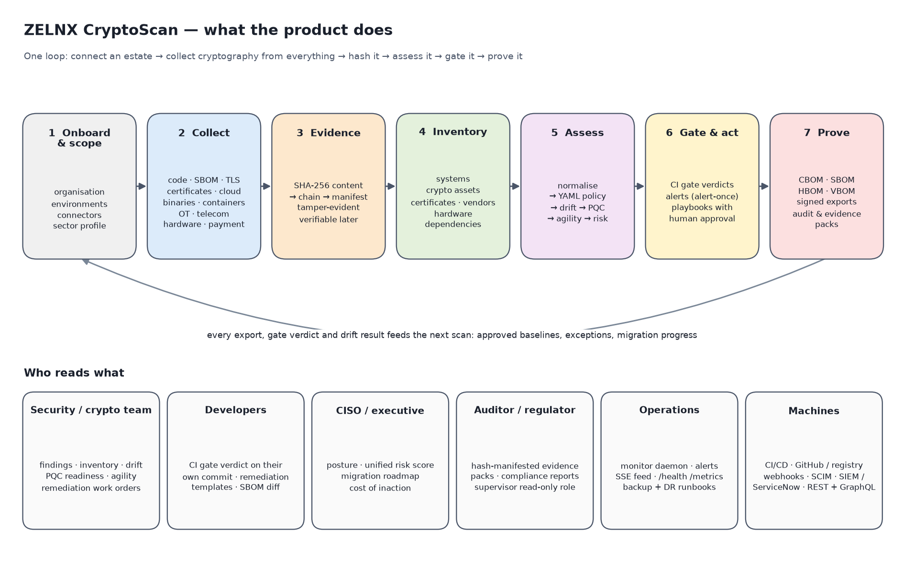
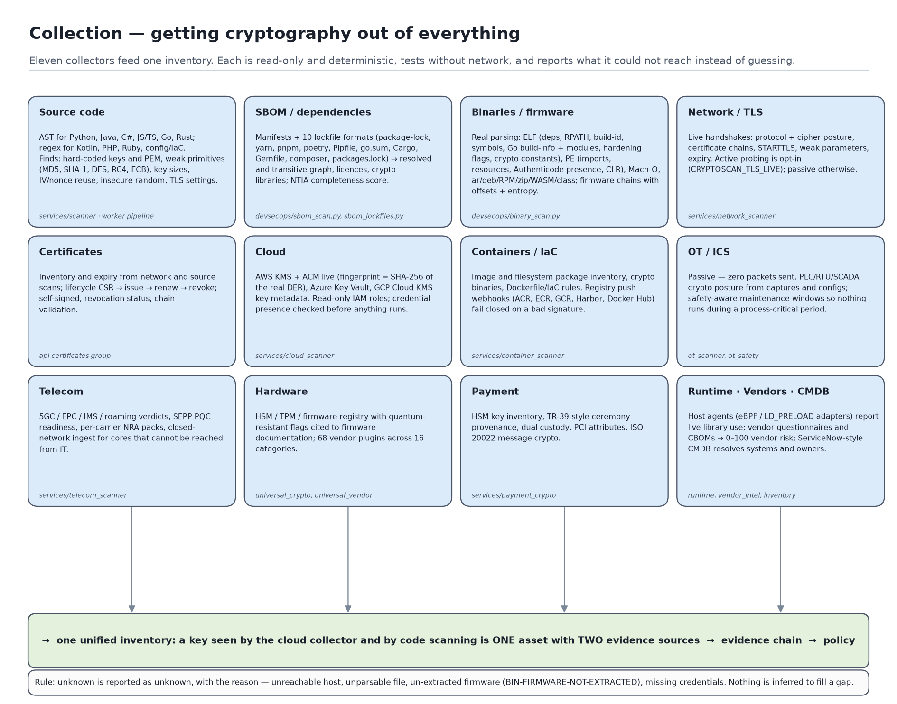
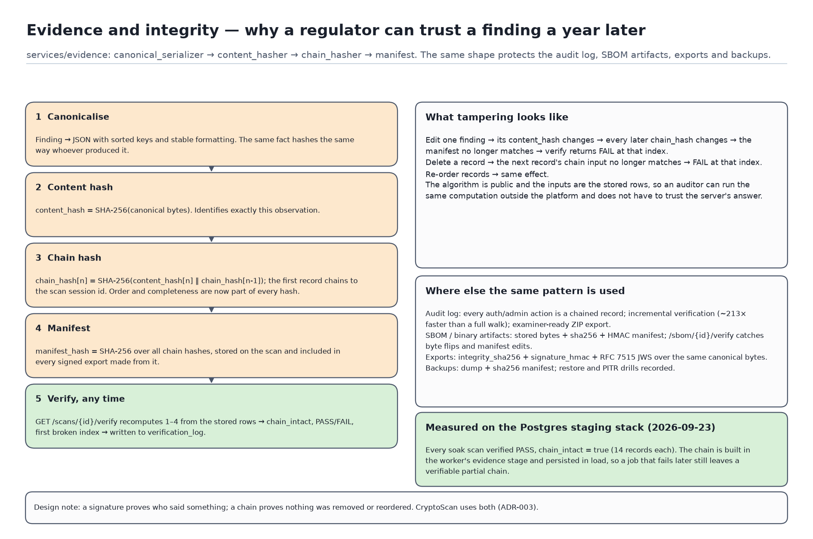
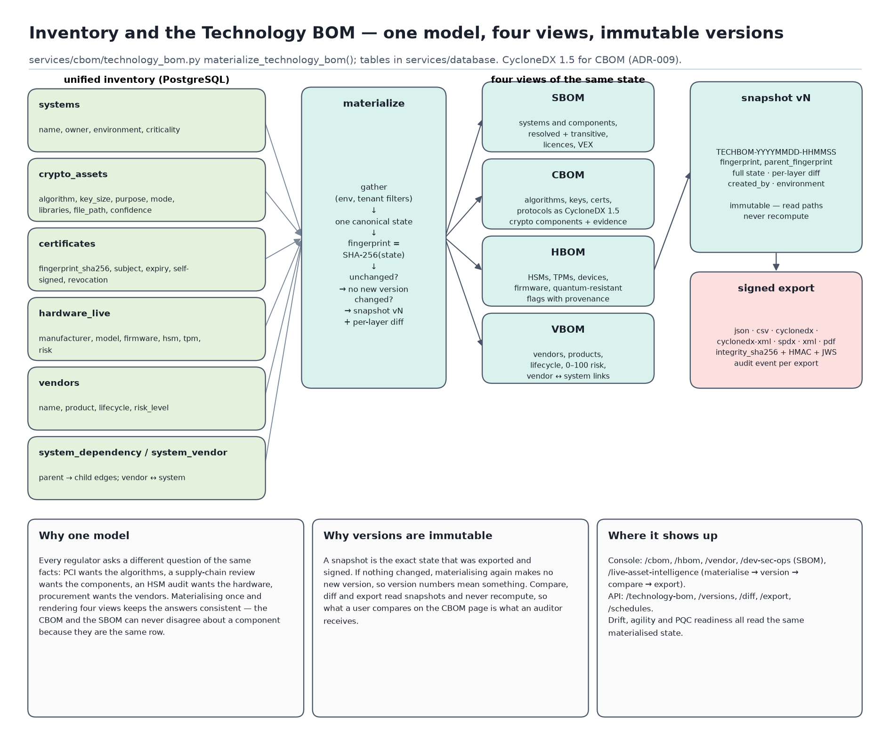
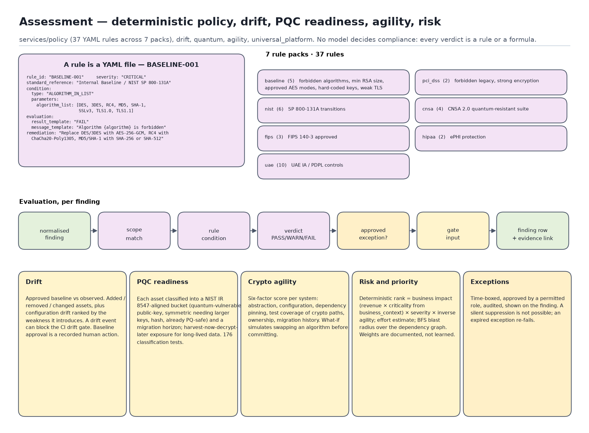
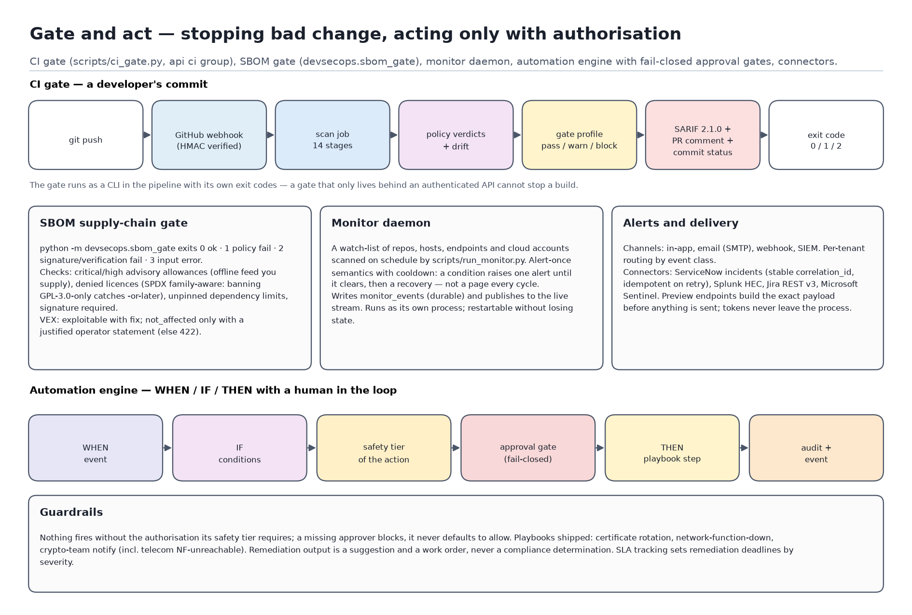
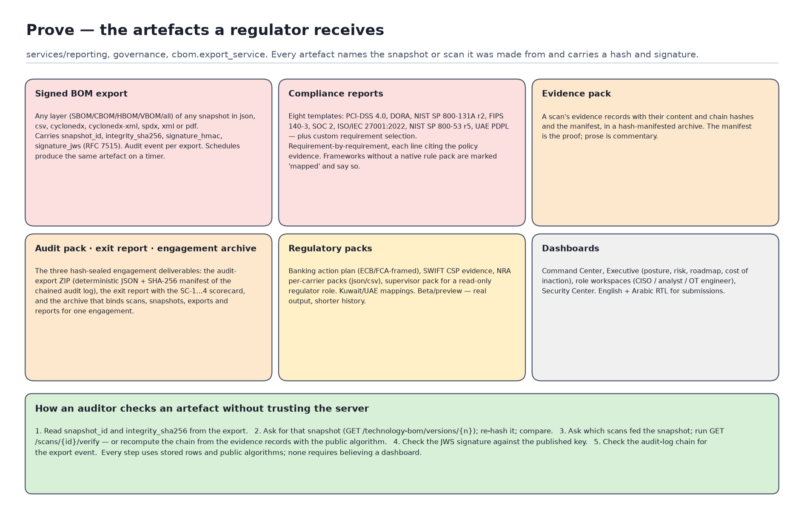
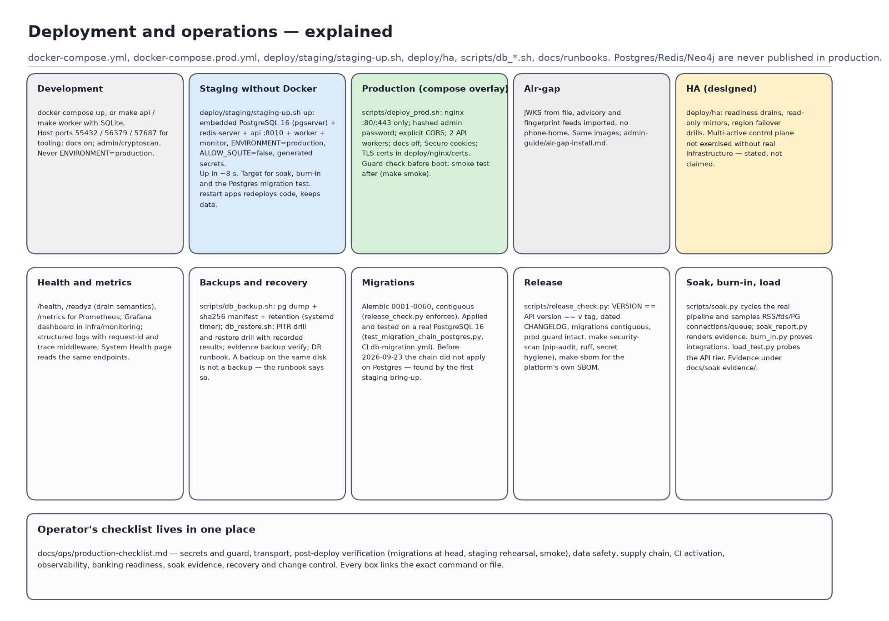

# 2. Features, end to end

_Every capability, grouped by the stage of the loop it belongs to. Each row
names the console page, the API group and the service that implements it,
and its maturity tier (**GA** · **beta** · **preview**) from
`shared_models/capability_maturity.py`. Nothing is listed that a reader
cannot exercise on the current build._



_Figure 1 — the product in one picture: collect → evidence → inventory/BOM → assess → gate & act → prove, with a live console over all of it._

---

## Stage 1 — Onboard and scope

_"What am I responsible for?" Everything downstream is filtered by this._

| Feature | What it does | Page · API · service | Tier |
|---|---|---|---|
| First-run onboarding | create organisation, environments, scope, connectors; test credentials; launch first discovery scan | `/onboarding` · `onboarding` · `api` | beta |
| Platform scope self-description | the product states what it does and what it refuses to do, from one source of truth | `/scope` · `platform/scope` · `shared_models/platform_scope.py` | GA |
| Sector profiles | banking / telecom / energy / government baselines select the rule packs used later | `/sectors` · `sectors` · `sector_profiles` | beta |
| Organisation and business context | business processes, owners, revenue and criticality per system — feeds impact scoring | `/organization` · `business` · `business_context` | beta |
| Repository configuration | which repos, branches, schedules; GitHub App / webhook wiring | Integrations · `repos`, `webhooks` · `api` | GA |
| Network scan targets and scan policy | who may scan which CIDRs / hosts; active vs passive | Network · `network_scans` · `network_scanner` | GA |
| Multi-tenancy core | tenant model, invitations, tenant-scoped queries (single-tenant deployment is the default) | `/tenancy` · `tenants` · `api/security/tenancy.py` | beta |

## Stage 2 — Collect



_Figure 10 — the eleven collectors and what each one actually extracts._

### How collection works

Every collector follows the same contract: it is **read-only** (it never
changes the target), **deterministic** (the same input yields the same
findings, so results can be diffed and hashed), **testable without a
network** (fixtures cover every parser), and **honest about gaps** — an
unreachable host, an unparsable file or a firmware image that could not be
extracted is reported as a finding of type *unknown* with a reason
(for example `BIN-FIRMWARE-NOT-EXTRACTED`), never silently skipped.

- **Source code.** Full AST parsing for Python, Java, C#, JavaScript/
  TypeScript, Go and Rust; pattern-based scanning for Kotlin, PHP, Ruby and
  configuration/IaC files. It finds hard-coded keys and PEM blocks, weak
  primitives (MD5, SHA-1, DES, RC4, ECB), undersized keys, IV/nonce reuse,
  insecure random sources and TLS settings — each with `file:line` and the
  surrounding expression.
- **SBOM / dependencies.** Manifests plus ten lockfile formats (npm
  package-lock, yarn, pnpm, poetry, Pipfile, go.sum, Cargo, Gemfile,
  composer, packages.lock). The resolved and transitive graph is built,
  licences are recorded, cryptographic libraries are tagged, and an NTIA
  completeness score is computed.
- **Binaries / firmware.** Real format parsing — ELF (dependencies, RPATH,
  build-id, symbols, Go build info, hardening flags, crypto constants), PE
  (imports, resources, Authenticode presence, CLR), Mach-O, archive formats
  (ar, deb, RPM, zip, WASM, class) and firmware images with offsets and
  entropy.
- **Network / TLS.** Live handshakes recording protocol and cipher posture,
  certificate chains, STARTTLS behaviour, weak parameters and expiry.
  Active probing is opt-in (`CRYPTOSCAN_TLS_LIVE`); otherwise the scanner is
  passive.
- **Certificates.** Inventory and expiry from network and source scans;
  lifecycle actions (CSR → issue → renew → revoke); self-signed detection,
  revocation status and chain validation.
- **Cloud.** AWS KMS and ACM (the fingerprint is the SHA-256 of the real
  DER), Azure Key Vault and GCP Cloud KMS key metadata. Only read-only IAM
  roles are used and credential presence is checked before anything runs.
- **Containers / IaC.** Image and filesystem package inventory, crypto
  binaries, Dockerfile and IaC rules. Registry push webhooks (ACR, ECR, GCR,
  Harbor, Docker Hub) fail closed on a bad signature.
- **OT / ICS.** Passive only — zero packets are sent. PLC/RTU/SCADA crypto
  posture is derived from captures and configurations; maintenance windows
  are respected so nothing runs during a process-critical period.
- **Telecom.** 5GC / EPC / IMS / roaming verdicts, SEPP PQC readiness,
  per-carrier NRA packs and closed-network ingest for cores that cannot be
  reached from IT.
- **Hardware.** HSM / TPM / firmware registry with quantum-resistant flags
  cited to firmware documentation; 68 vendor plugins across 16 categories.
- **Payment.** HSM key inventory, TR-39-style ceremony provenance, dual
  custody, PCI attributes and ISO 20022 message cryptography.
- **Runtime · Vendors · CMDB.** Host agents (eBPF / `LD_PRELOAD` adapters)
  report which libraries are actually loaded; vendor questionnaires and
  CBOMs feed a 0–100 vendor risk score; a ServiceNow-style CMDB resolves
  systems and owners.

The result of all eleven is **one inventory**: a key seen by the cloud
collector and by code scanning is one `crypto_assets` row with two evidence
sources, not two assets.


_Eleven kinds of input into one inventory. Every collector is read-only and
deterministic; an unreachable target is reported as unreachable._

| Collector | What it finds | Page · API · service | Tier |
|---|---|---|---|
| **Source code** | hard-coded keys and PEM material, weak primitives (MD5, SHA-1, DES, RC4, ECB), key sizes, IV/nonce reuse, insecure random, TLS settings, secrets misuse. Python, Java, C#, JS/TS, Go, Rust first-class (AST); Kotlin, PHP, Ruby, config/IaC | `/scanners` · `scans`, `jobs`, `trigger` · `scanner`, `worker` | GA |
| **SBOM / dependencies** | manifests + 10 lockfile formats → resolved and transitive components, licences, crypto libraries; NTIA completeness score | `/dev-sec-ops` · `devsecops/sbom/*` · `devsecops` | GA |
| **Binaries / firmware** | real parsing: ELF (deps, RPATH, build-id, symbols, Go build-info + module graph, hardening flags, crypto constant tables), PE (imports, resources, Authenticode presence, CLR), Mach-O, `ar`/`.deb`/RPM/zip/WASM/Java class; firmware container chains with offsets and entropy; containers followed inside a stated budget | `/dev-sec-ops` → Binaries · `devsecops/binary/*` · `devsecops/binary_scan.py` | GA |
| **Network / TLS** | live handshakes: protocol and cipher posture, certificate chains, STARTTLS, weak parameters, expiry | `/network`, `/protocols` · `network_scans` · `network_scanner` | GA |
| **Certificates** | inventory and expiry from network and source scans; full lifecycle (CSR → issue → renew → revoke) | `/certificates` · `certificates` · `api` | GA |
| **Cloud** | AWS KMS / ACM (live), Azure Key Vault and GCP Cloud KMS key metadata; read-only roles | `/cloud` · `cloud`, `inventory/cloud` · `cloud_scanner` | GA (needs credentials to show data) |
| **Containers / IaC** | image and filesystem package inventory, crypto binaries, Dockerfile/IaC rules; registry push webhooks (ACR/ECR/GCR/Harbor/Docker Hub) | `/scanners` · `container_scans`, `webhooks` · `container_scanner` | GA |
| **OT / ICS** | passive — zero packets sent; PLC/RTU/SCADA crypto posture; safety-aware maintenance windows | `/scanners` · `ot` · `ot_scanner`, `ot_safety` | GA (passive core) |
| **Telecom** | 5GC / EPC / IMS / roaming verdicts, SEPP PQC readiness, per-carrier packs, closed-network ingest | `/telecom` · `telecom` · `telecom_scanner` | beta |
| **Hardware** | HSM / TPM / firmware registry, quantum-resistant flags with firmware-cited provenance; 68 vendor plugins across 16 categories | `/hardware`, `/catalog` · `hardware` · `universal_crypto`, `universal_vendor` | beta |
| **Payment** | HSM key inventory, TR-39-style ceremony provenance, dual custody, PCI attributes, ISO 20022 | Banking · `payment-crypto` · `payment_crypto` | GA |
| **Runtime hosts** | agent-reported findings from live hosts (eBPF / LD_PRELOAD adapters) | `/runtime`, `/live-environment` · `runtime` · `runtime` | beta |
| **Vendors** | vendor questionnaires, vendor CBOMs and documents → 0–100 vendor crypto risk | `/vendor` · `vendors` · `vendor_intel` | GA |
| **CMDB import** | ServiceNow-style CMDB resolution into systems | `/cmdb` · `cmdb` · `inventory` | beta |

## Stage 3 — Evidence



_Figure 11 — the five steps from a finding to a verifiable record, and what
tampering does to them._

### How the evidence chain works

1. **Canonicalise.** The finding is serialised to JSON with sorted keys and
   stable formatting (`services/evidence/.../canonical_serializer.py`). The
   same fact therefore produces the same bytes regardless of which collector
   or process produced it.
2. **Content hash.** `content_hash = SHA-256(canonical bytes)`. This
   identifies exactly this observation.
3. **Chain hash.** `chain_hash[n] = SHA-256(content_hash[n] ‖ chain_hash[n-1])`
   (`hashing/chain_hasher.py`). The first record chains to the scan session
   id. Because each record's hash includes the previous one, **order and
   completeness** become part of every hash.
4. **Manifest.** `manifest_hash = SHA-256` over all chain hashes, stored on
   the scan and included in every signed export made from it.
5. **Verify, any time.** `GET /scans/{id}/verify` recomputes steps 1–4 from
   the stored rows and returns `chain_intact`, `PASS`/`FAIL` and the first
   broken index; the result is written to `verification_log`.

**What tampering looks like.** Edit one finding and its `content_hash`
changes, so every later `chain_hash` changes and the manifest no longer
matches — verify returns `FAIL` at that index. Delete a record and the next
record's chain input no longer matches. Re-order records and the same
happens. The algorithm is public and the inputs are the stored rows, so an
auditor can run the computation outside the platform and does not have to
trust the server's answer.

**Where else the same pattern is used.**

| Artefact | What is chained / hashed | How to check |
|---|---|---|
| Audit log | every auth/admin action as a chained record | incremental verification (~213× faster than a full walk); examiner-ready ZIP export |
| SBOM / binary artifacts | stored bytes + SHA-256 + HMAC manifest | `/sbom/{id}/verify` catches byte flips and manifest edits |
| Exports | `integrity_sha256` + `signature_hmac` + RFC 7515 JWS over the same canonical bytes | re-hash and verify against the published key |
| Backups | dump + SHA-256 manifest | restore and PITR drills recorded |

**Measured on the Postgres staging stack (2026-09-23).** Every soak scan
verified `PASS`, `chain_intact = true` (14 records each). The chain is built
in the worker's evidence stage and persisted in the load stage, so a job that
fails later still leaves a verifiable partial chain.

Design note (ADR-003): a signature proves *who* said something; a chain
proves *nothing was removed or re-ordered*. CryptoScan uses both.


_Every finding becomes a record whose integrity can be checked later by
someone who does not trust the server._

| Feature | What it does | Page · API · service | Tier |
|---|---|---|---|
| Evidence chain | `content_hash → chain_hash → manifest_hash` (SHA-256) per scan; chain includes the previous record | `/evidence` · `scans/{id}/verify` · `evidence` | GA |
| Verification on demand | recomputes every hash; returns `chain_intact`, `PASS/FAIL`, first broken index; logged to `verification_log` | `/evidence` · `scans/{id}/verify` | GA |
| Hash-chained audit log | every auth/admin action chained; incremental verify; examiner-ready export ZIP | Audit Log · `audit-export/pack` · `api` | GA |
| Artifact provenance | stored bytes + sha256 + HMAC manifest for every SBOM/binary artifact; `/verify` detects byte flips and manifest edits | DevSecOps · `devsecops/sbom/{id}/verify` | GA |
| WORM retention gate | append-only stores refuse truncation or deletion | — · `compliance` | GA |

## Stage 4 — Inventory and BOMs



_Figure 12 — one inventory, shared BOM views, binary-derived NBOM/vulnerability evidence, immutable versions, and signed export._

### How the Technology BOM works

**The unified inventory.** Five PostgreSQL table families hold the state:
`systems` (name, owner, environment, criticality), `crypto_assets`
(algorithm, key size, purpose, mode, libraries, file path, confidence),
`certificates` (fingerprint, subject, expiry, self-signed, revocation),
`hardware_live` (manufacturer, model, firmware, HSM/TPM, risk) and `vendors`
(name, product, lifecycle, risk level), linked through `system_dependency`
and `system_vendor` edges.

**Materialise.** `services/cbom/technology_bom.py::materialize_technology_bom()`
gathers the inventory for the requested environment and tenant, renders one
canonical state and computes `fingerprint = SHA-256(state)`. If the
fingerprint is unchanged, **no new version is created** — so version numbers
mean something. If it changed, a new snapshot `vN` is written together with
a per-layer diff against its parent.

**Shared views of the same state.** The general Technology BOM snapshot is
rendered as:
- **SBOM** — systems and components, resolved and transitive, licences, VEX;
- **CBOM** — algorithms, keys, certificates and protocols as CycloneDX 1.5
  crypto components with evidence links (ADR-009);
- **HBOM** — HSMs, TPMs and devices with firmware and quantum-resistant
  flags, each with provenance; and
- **VBOM** — vendors and products with lifecycle, 0–100 risk and vendor ↔
  system links.

A **binary or firmware scan** produces a correlated bundle in addition to the
shared views:
- **NBOM** — static network capability and listener candidates from imports,
  exports and strings. Every binary-derived candidate is `observed: false` and
  must not be described as a live endpoint without a separately authorized
  network probe;
- **Vulnerability BOM** — normalized weak/deprecated algorithm, hardening,
  malformed/truncated/refused-artifact and supplied-feed findings. It keeps
  “no evidence” separate from “not vulnerable”; and
- **Technology-BOM snapshot** — stable component references, scan provenance,
  fingerprints, layer counts and diffs that correlate all of the above.

The general four-view model and binary bundle are materialized from the same
bounded evidence boundary; they are not independent claims about the estate.

**Snapshots are immutable.** A snapshot (`TECHBOM-YYYYMMDD-HHMMSS`, with
`fingerprint`, `parent_fingerprint`, full state, per-layer diff, `created_by`
and environment) is the exact state that was exported and signed. Compare,
diff and export **read** snapshots and never recompute — what a user compares
on the CBOM page is what an auditor receives.

**Signed export.** Formats: `json`, `csv`, `cyclonedx`, `cyclonedx-xml`,
`spdx`, `xml`, `pdf`. Every export carries `integrity_sha256`, an HMAC and an
RFC 7515 JWS signature, and produces one audit event.

| Where it shows up | Path |
|---|---|
| Console | `/cbom`, `/hbom`, `/vendor`, `/dev-sec-ops` (SBOM), `/live-asset-intelligence` (materialise → version → compare → export) |
| API | `/technology-bom`, `/technology-bom/versions`, `/diff`, `/export`, `/schedules` |
| Consumers | drift, agility and PQC readiness all read the same materialised state |


_One asset model; a key seen by two collectors is one asset with two evidence sources._

| Feature | What it does | Page · API · service | Tier |
|---|---|---|---|
| Unified asset inventory | System · CryptoAsset · Certificate · HardwareAsset · Vendor · dependencies; activity feed; unified risk | `/assets`, `/cmdb` · `assets`, `systems` · `database`, `inventory` | GA |
| Crypto inventory by primitive | algorithms, key sizes, libraries, protocols — where each is used | `/crypto-assets`, `/libraries`, `/protocols` · `crypto`, `algorithms` | GA / beta |
| Normalisation | IANA / NIST / CBOM vocabulary for names and sizes; 114 normalisation tests | — · `normalization` | GA |
| Deduplication and correlation | one asset, N occurrences; cross-scanner identity resolution | — · `deduplication`, `correlation` | GA / preview |
| **CBOM** | CycloneDX 1.5 cryptographic BOM; versioned, fingerprinted, signed | `/cbom` · `cbom/*` · `cbom` | GA |
| **HBOM / VBOM** | hardware and vendor views over the same Technology BOM | `/hbom`, `/vendor` · `technology-bom` | beta / GA |
| **SBOM** | per-artifact software BOM with licence, VEX and gate | `/dev-sec-ops` · `devsecops/sbom/*` | GA |
| **Binary BOM bundle** | one bounded binary/firmware scan materializes SBOM, CBOM, HBOM, static NBOM, VBOM, vulnerability BOM and a correlated technology snapshot | `/dev-sec-ops` · `/binary/artifacts/{id}/bom/{type}` · `devsecops.binary_boms` | pilot / pre-production |
| Technology BOM materialisation | `materialize_technology_bom()` → shared four-view state; binary scans add static NBOM and vulnerability evidence; unchanged fingerprint → no new version; per-layer diff | `/live-asset-intelligence` · `technology-bom/*` · `cbom/technology_bom.py`, `devsecops.binary_boms` | GA / pilot |
| Dependency graph and blast radius | component/system relationships; interactive graph; Neo4j when configured, in-database otherwise | `/graph`, `/dependency-graph` · `graph` · `graph_engine` | beta |
| Library fingerprint database | fingerprints for crypto libraries and versions (ADR-007) | `/libraries` · `fingerprints` · `database` | GA |

## Stage 5 — Assess



_Figure 13 — a rule as it really exists on disk, the seven packs, and the
per-finding evaluation path._

### How assessment works

**A rule is a YAML file.** `services/policy/rule_definitions` holds 37 rules
across 7 packs. `BASELINE-001`, shown on the poster, is representative:

```yaml
rule_id: "BASELINE-001"
severity: "CRITICAL"
standard_reference: "Internal Baseline / NIST SP 800-131A"
condition:
  type: "ALGORITHM_IN_LIST"
  parameters:
    algorithm_list: [DES, 3DES, RC4, MD5, SHA-1, SSLv3, TLS1.0, TLS1.1]
evaluation:
  result_template: "FAIL"
  message_template: "Algorithm {algorithm} is forbidden"
remediation: "Replace DES/3DES with AES-256-GCM, RC4 with ChaCha20-Poly1305,
  MD5/SHA-1 with SHA-256 or SHA-512"
```

| Pack | Rules | Focus |
|---|---|---|
| `baseline` | 5 | forbidden algorithms, minimum RSA size, approved AES modes, hard-coded keys, weak TLS |
| `pci_dss` | 2 | forbidden legacy, strong encryption |
| `nist` | 6 | SP 800-131A transitions |
| `cnsa` | 4 | CNSA 2.0 quantum-resistant suite |
| `fips` | 3 | FIPS 140-3 approved |
| `hipaa` | 2 | ePHI protection |
| `uae` | 10 | UAE IA / PDPL controls |

**Evaluation, per finding.** normalised finding → scope match (does this
rule apply to this system/environment?) → rule condition → verdict
`PASS`/`WARN`/`FAIL` → approved exception check → gate input → finding row
with evidence link. No model decides compliance: every verdict is a rule or a
formula, which is why the same input always yields the same verdict.

- **Drift.** Approved baseline vs observed. Added / removed / changed assets,
  plus configuration drift, ranked by the weakness it introduces. A drift
  event can block the CI drift gate. Baseline approval is a recorded human
  action.
- **PQC readiness.** Each asset is classified into a NIST IR 8547-aligned
  bucket (quantum-vulnerable public-key, symmetric needing larger keys, hash,
  already PQ-safe) with a migration horizon; harvest-now-decrypt-later
  exposure for long-lived data. 176 classification tests.
- **Crypto agility.** A six-factor score per system: abstraction,
  configuration, dependency pinning, test coverage of crypto paths,
  ownership, migration history. What-if simulates swapping an algorithm
  before committing.
- **Risk and priority.** Deterministic rank = business impact (revenue ×
  criticality from `business_context`) × severity × inverse agility; effort
  estimate; BFS blast radius over the dependency graph. Weights are
  documented, not learned.
- **Exceptions.** Time-boxed, approved by a permitted role, audited and
  shown on the finding. Silent suppression is not possible; an expired
  exception re-fails.


_Inventory becomes posture. Every verdict is a rule or a formula._

| Feature | What it does | Page · API · service | Tier |
|---|---|---|---|
| **Policy engine** | YAML rule packs — baseline, PCI-DSS, NIST SP 800-131A, CNSA 2.0, FIPS, HIPAA, UAE; scopes; deterministic; the only source of pass/fail | `/security-policy`, `/findings` · `policies`, `findings` · `policy`, `ruleset` | GA |
| Findings | policy-evaluated findings with evidence links, severity, rule, location, remediation hint; CSV export | `/findings` · `findings` | GA |
| **Drift** | approved baseline vs observed; added / removed / changed, including config drift with weakness-ranked severity; CI drift gate | `/drift`, `/crypto-changes` · `drift`, `baselines` · `drift` | GA / beta |
| **PQC readiness** | NIST IR 8547-aligned migration buckets; harvest-now-decrypt-later exposure; per-asset quantum classification (176 tests) | `/pqc`, `/pqc-map` · `quantum` · `quantum`, `shared_models` | GA / preview |
| **Crypto agility** | 6-factor agility score, migration readiness, what-if simulation of an algorithm swap | `/agility`, `/what-if` · `agility` · `agility` | beta / preview |
| Risk and prioritisation | deterministic rank (revenue × severity × agility), effort bars, replacement table, BFS blast radius | `/priorities`, `/risk` · `priority`, `risk` · `universal_platform` | beta |
| Migration tracking | scan → project → tasks → velocity | `/migration` · `migration` · `database` | beta |
| Crypto assurance | JWS-signed attestations over a snapshot (KeyAssure checks) | `/crypto-assurance` · `crypto-assurance` · `compliance`, `keyassure` | beta |
| Exceptions and waivers | time-boxed, approved, audited; never a silent suppression | `/governance` · `exceptions` · `governance` | beta |
| Security intelligence | cross-scanner correlation into incidents | `/security-intelligence` · `security` | preview |

## Stage 6 — Gate and act



_Figure 14 — a developer's commit through the CI gate, and the automation
engine with a human in the loop._

### How gating and automation work

**CI gate — a developer's commit.** `git push` → GitHub webhook (HMAC
verified) → scan job (14 stages) → policy verdicts + drift → gate profile
(pass / warn / block) → SARIF 2.1.0 + PR comment + commit status → exit code
`0` / `1` / `2`. The gate runs as a CLI (`scripts/ci_gate.py`) in the
pipeline with its own exit codes; a gate that only lives behind an
authenticated API cannot stop a build.

**SBOM supply-chain gate.** `python -m devsecops.sbom_gate` exits `0` ok ·
`1` policy fail · `2` signature/verification fail · `3` input error. It
checks critical/high advisory allowances (offline feed supported), denied
licences (SPDX family-aware, so banning GPL-3.0-only catches `-or-later`),
unpinned dependency limits and signature presence. VEX: `exploitable` with a
fix fails; `not_affected` is accepted only with a justified operator
statement (otherwise HTTP 422).

**Monitor daemon.** A watch-list of repositories, hosts, endpoints and cloud
accounts scanned on schedule by `scripts/run_monitor.py`. Alert-once
semantics with cooldown: a condition raises one alert until it clears, then a
recovery — not a page every cycle. Events are written to `monitor_events`
(durable) and published to the live stream. It runs as its own process and is
restartable without losing state.

**Alerts and delivery.** Channels: in-app, email (SMTP), webhook, SIEM, with
per-tenant routing by event class. Connectors: ServiceNow incidents (stable
`correlation_id`, idempotent on retry), Splunk HEC, Jira REST v3, Microsoft
Sentinel. Preview endpoints build the exact payload before anything is sent;
tokens never leave the process.

**Automation engine — WHEN / IF / THEN.** WHEN event → IF conditions →
safety tier of the action → approval gate (fail-closed) → THEN playbook step
→ audit + event. Guardrails: nothing fires without the authorisation its
safety tier requires; a missing approver blocks, it never defaults to allow.
Shipped playbooks: certificate rotation, network-function-down, crypto-team
notify (including telecom NF-unreachable). Remediation output is a
suggestion and a work order, never a compliance determination. SLA tracking
sets remediation deadlines by severity.


_Stop bad change at the pipeline; act only with the required human authorisation._

| Feature | What it does | Page · API · service | Tier |
|---|---|---|---|
| **CI gate** | profiles, SARIF 2.1.0 for GitHub code scanning, PR-comment markdown, blocked-deployment stats; exit codes | Integrations · `ci`, `gate` · `scripts/ci_gate.py`, `api` | GA |
| **SBOM gate** | critical/high allowances, denied licences, unpinned limits, signature requirement; CLI `python -m devsecops.sbom_gate` exits 0/1/2/3 | DevSecOps · `devsecops/sbom/gate` · `devsecops/sbom_gate.py` | GA |
| Offline advisory matching and VEX | feed you supply; `exploitable` with fix, `not_affected` requires a justified operator statement (else 422) | DevSecOps · `devsecops/sbom/advisories`, `vex` | GA |
| Licence policy | SPDX family-aware matching, undeclared reported as undeclared, copyleft review trigger | DevSecOps · `devsecops/sbom/license` | GA |
| **Monitor daemon** | watch-list of repos, hosts, endpoints; scheduled scans; alert-once with cooldown | Alerts, Live Stream · `monitor/*` · `scripts/run_monitor.py`, `api/live_scan` | GA |
| Alerts and notifications | in-app, email, webhook, SIEM channels; per-tenant routing by event class | `/alerts`, `/notifications` · `alerts`, `notifications` | GA / beta |
| **Automation engine** | deterministic WHEN/IF/THEN plans, safety tiers, fail-closed approval gates; playbooks (certificate rotation, NF-down, crypto-team notify) | `/automation` · `automation/*` · `automation`, `control_plane` | beta |
| Remediation | deterministic suggestions and work orders — never a compliance determination | Findings · `remediation` · `remediation` | GA |
| SLA tracking | remediation deadlines by severity | — · `sla` | preview |
| Delivery integrations | ServiceNow incidents (idempotent `correlation_id`), Splunk HEC, Jira REST v3, Microsoft Sentinel; preview-the-payload endpoints | `/integrations` · `connectors` · `automation/connectors.py` | GA / beta |

## Stage 7 — Prove



_Figure 15 — the six artefact families and how an auditor checks one
without trusting the server._

### What a regulator receives

| Artefact | Contents | Integrity |
|---|---|---|
| **Signed BOM export** | any layer (SBOM/CBOM/HBOM/VBOM/all) of any snapshot in json, csv, cyclonedx, cyclonedx-xml, spdx, xml or pdf | `snapshot_id`, `integrity_sha256`, `signature_hmac`, `signature_jws` (RFC 7515); audit event per export; schedules produce the same artefact on a timer |
| **Compliance reports** | eight templates — PCI-DSS 4.0, DORA, NIST SP 800-131A r2, FIPS 140-3, SOC 2, ISO/IEC 27001:2022, NIST SP 800-53 r5, UAE PDPL — plus custom requirement selection; requirement by requirement, each line citing the policy evidence | frameworks without a native rule pack are marked *mapped* and say so |
| **Evidence pack** | a scan's evidence records with content and chain hashes and the manifest, in a hash-manifested archive | the manifest is the proof; prose is commentary |
| **Audit pack · exit report · engagement archive** | the audit-export ZIP (deterministic JSON + SHA-256 manifest of the chained audit log), the exit report with the SC-1…4 scorecard, and the archive binding scans, snapshots, exports and reports for one engagement | hash-sealed |
| **Regulatory packs** | banking action plan (ECB/FCA-framed), SWIFT CSP evidence, NRA per-carrier packs (json/csv), supervisor pack for a read-only regulator role, Kuwait/UAE mappings | beta/preview — real output, shorter history |
| **Dashboards** | Command Center, Executive (posture, risk, roadmap, cost of inaction), role workspaces (CISO / analyst / OT engineer), Security Center; English + Arabic RTL for submissions | read from the same rows as the artefacts |

**How an auditor checks an artefact without trusting the server.**

1. Read `snapshot_id` and `integrity_sha256` from the export.
2. Ask for that snapshot (`GET /technology-bom/versions/{n}`); re-hash it;
   compare.
3. Ask which scans fed the snapshot; run `GET /scans/{id}/verify` — or
   recompute the chain from the evidence records with the public algorithm.
4. Check the JWS signature against the published key.
5. Check the audit-log chain for the export event.

Every step uses stored rows and public algorithms; none requires believing a
dashboard.


_A regulator needs an artefact, not a dashboard._

| Feature | What it does | Page · API · service | Tier |
|---|---|---|---|
| **Signed exports** | json · csv · cyclonedx · cyclonedx-xml · spdx · xml · pdf; each with content hash, HMAC and RFC 7515 JWS; audit event per export | CBOM, Evidence · `technology-bom/export` · `cbom/export_service.py` | GA |
| Scheduled exports | cron-like schedules, idempotent run-due, run records | `/reports` · `technology-bom/schedules` | GA |
| **Compliance reports** | eight templates: PCI-DSS 4.0, DORA, NIST SP 800-131A r2, FIPS 140-3, SOC 2, ISO/IEC 27001:2022, NIST SP 800-53 r5, UAE PDPL; frameworks without a native pack say they are mapped | `/compliance` · `compliance` · `reporting`, `compliance` | GA |
| Evidence pack | hash-manifested export of scan evidence | `/evidence` · `evidence/pack` · `evidence` | GA |
| Audit pack · exit report · engagement archive | the three hash-sealed engagement deliverables; SC-1…4 scorecard | `/reports` · `audit-export`, `reports` · `reporting/exit_report.py` | GA |
| Regulatory packs | banking action plan (ECB/FCA-framed), SWIFT CSP evidence, NRA per-carrier packs, supervisor pack | `/banking-regulatory`, `/supervision` · `banking`, `telecom` | beta / preview |
| Executive and role dashboards | posture, risk, migration roadmap, cost of inaction; CISO / analyst / OT engineer workspaces | `/executive`, `/role-dashboard`, `/command-center` · `stats` | beta / GA |
| Localisation | English + Arabic RTL for regulatory submissions | all pages · `frontend/src/i18n` | GA |
| Own SBOM | the platform's own SBOM (`make sbom`) | — · `scripts/generate_own_sbom.py` | GA |

---

## Cross-cutting: operating the platform



_Figure 18 — the five deployment modes and the operational surface behind
them._

### How it is deployed and operated

| Mode | What it is | Notes |
|---|---|---|
| **Development** | `docker compose up`, or `make api` / `make worker` with SQLite | host ports 55432 / 56379 / 57687 for tooling; docs on; `admin/cryptoscan`; never `ENVIRONMENT=production` |
| **Staging without Docker** | `deploy/staging/staging-up.sh up`: embedded PostgreSQL 16 (pgserver) + redis-server + API :8010 + worker + monitor, `ENVIRONMENT=production`, `ALLOW_SQLITE=false`, generated secrets | up in ~8 s; the target for soak, burn-in and the Postgres migration test; `restart-apps` redeploys code and keeps data |
| **Production (compose overlay)** | `scripts/deploy_prod.sh`: nginx :80/:443 only, hashed admin password, explicit CORS, 2 API workers, docs off, Secure cookies, TLS certs in `deploy/nginx/certs` | guard check before boot; smoke test after (`make smoke`) |
| **Air-gap** | JWKS from file, advisory and fingerprint feeds imported, no phone-home | same images; `admin-guide/air-gap-install.md` |
| **HA (designed)** | `deploy/ha`: readiness drains, read-only mirrors, region failover drills | multi-active control plane not exercised without real infrastructure — stated, not claimed |

Postgres, Redis and Neo4j are never published outside the compose network in
production.

- **Health and metrics.** `/health`, `/readyz` (drain semantics), `/metrics`
  for Prometheus; Grafana dashboard in `infra/monitoring`; structured logs
  with request-id and trace middleware; the System Health page reads the
  same endpoints.
- **Backups and recovery.** `scripts/db_backup.sh` (pg dump + SHA-256
  manifest + retention, systemd timer); `db_restore.sh`; PITR and restore
  drills with recorded results; evidence backup verify; DR runbook. A backup
  on the same disk is not a backup — the runbook says so.
- **Migrations.** Alembic 0001–0060, contiguous (`release_check.py`
  enforces). Applied and tested on a real PostgreSQL 16
  (`test_migration_chain_postgres.py`). Before 2026-09-23 the chain did not
  apply on Postgres — found by the first staging bring-up and fixed.
- **Release.** `scripts/release_check.py`: VERSION == API version == `v` tag,
  dated CHANGELOG, migrations contiguous, production guard intact. `make
  security-scan` (pip-audit, ruff, secret hygiene); `make sbom` for the
  platform's own SBOM.
- **Soak, burn-in, load.** `scripts/soak.py` cycles the real pipeline and
  samples RSS / file descriptors / PG connections / queue depth;
  `soak_report.py` renders the evidence; `burn_in.py` proves integrations;
  `load_test.py` probes the API tier. Evidence under `docs/soak-evidence/`.
- **Operator's checklist.** `docs/ops/production-checklist.md` — secrets and
  guard, transport, post-deploy verification, data safety, supply chain, CI
  activation, observability, banking readiness, soak evidence, recovery and
  change control. Every box links the exact command or file.


| Feature | What it does | Where | Tier |
|---|---|---|---|
| Identity | local + TOTP MFA; OIDC token relay, authorization code, PKCE; SAML 2.0 SP with enveloped-signature verification; LDAP/AD group→role; SCIM 2.0 | `/identity` · `auth`, `sso`, `scim` | GA |
| RBAC | 9 roles (superadmin, ciso, security_analyst, developer, auditor, business_owner, scanner, readonly, supervisor); fail-closed `require_permission`; ABAC middleware | `/identity` · `api/security/rbac.py` | GA |
| API keys | scoped machine keys, rotation, IP allow-list | `/integrations` · `api-keys` | GA |
| Rate limiting and security headers | per-identity budget (600/min in production), CSP/HSTS/etc, request-id on every response | — · `api/middleware` | GA |
| Production guard | `ENVIRONMENT=production` refuses SQLite, demo secrets, weak webhook secret, `CORS=*`, plaintext admin password — tested both ways | — · `api/config/settings.py`, `scripts/check_prod_guard.py` | GA |
| Real-time | SSE `/api/v1/events/stream` with `Last-Event-ID` resume; WebSocket; Redis federation across nodes | `/live-stream` · `events`, `stream`, `ws` · `eventstream` | GA |
| Observability | Prometheus `/metrics`, `/health`, `/readyz` with drain semantics, structured logs, trace middleware, Grafana dashboard | `/system-health` · `observability` | GA |
| GraphQL | typed read API over the same repositories | — · `graphql` | beta |
| Backup, restore, PITR, DR | `db_backup.sh` with sha256 manifest and retention, restore and PITR drills with recorded results, region failover drills | `/resilience` · `scripts/db_*.sh`, `docs/runbooks/dr-recovery.md` | GA (scripts) / beta (page) |
| Air-gap mode | JWKS from file, feed import, no phone-home; air-gap install guide | admin guide | GA |
| Security posture of the platform itself | headers, rate limits, audit chain verification, pen-test findings tracker | `/security-center`, `/security` · `security`, `pentest` | GA / beta |
| Staging without Docker | embedded PostgreSQL + Redis + api/worker/monitor with production guards | `deploy/staging/staging-up.sh` | GA |
| Soak, burn-in, load | `scripts/soak.py` (7-day pipeline soak), `scripts/burn_in.py` (integrations), `scripts/load_test.py` | `docs/soak-evidence/` | GA (harness) |

## Not built, and said so

| Item | Status |
|---|---|
| Database TDE / mainframe (RACF, ICSF) collectors | not built — needs customer-environment adapters; mainframe *extract ingest* exists |
| Qualys / ServiceNow VR / Jira Server connectors | not built — same connector pattern, on demand |
| Multi-active HA control plane | partial — readiness drains and read-only mirrors designed; multi-active untested without real infrastructure |
| Managed multi-tenant SaaS operations | not claimed — tenant model ships; running it as a service is a product decision |
| ISO 27001 / SOC 2 attestation of this product | external — controls implemented and auditable; the audit is a company action |
| Independent penetration test, multi-site DR, 24/7 on-call | external |

Next: [3. Architecture](03-architecture.md)

See also [8. The engines behind the pages](08-platform-engines.md) for the scanner gate, privacy controls, deduplication, PQC planning, remediation/SLA, KeyAssure, the dependency graph and the platform services that sit under these stages.
