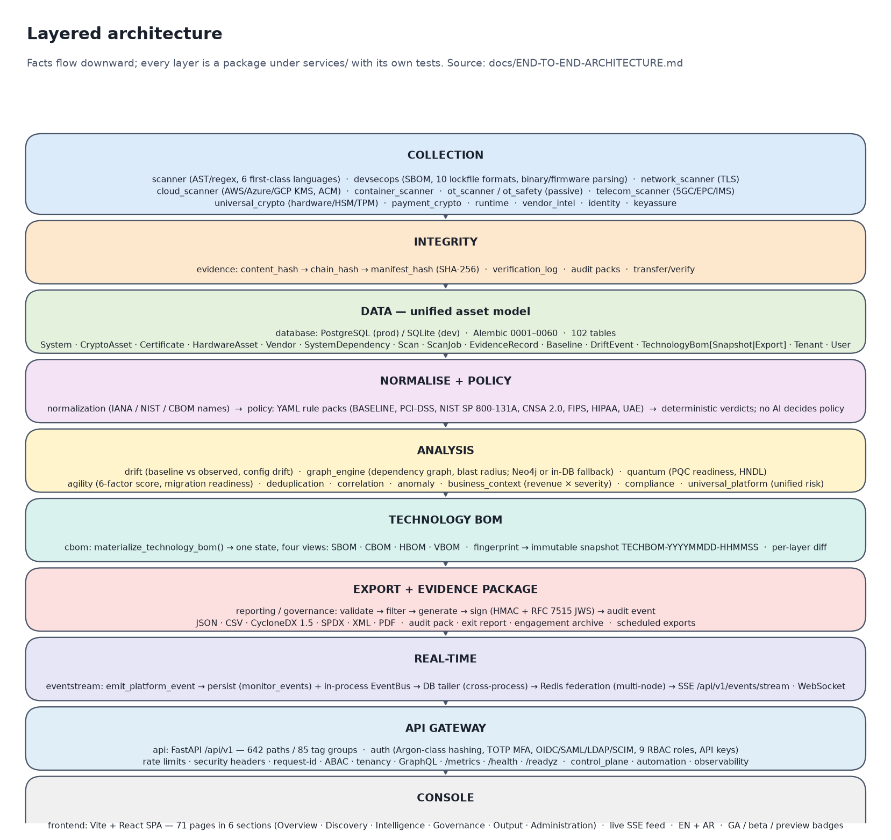
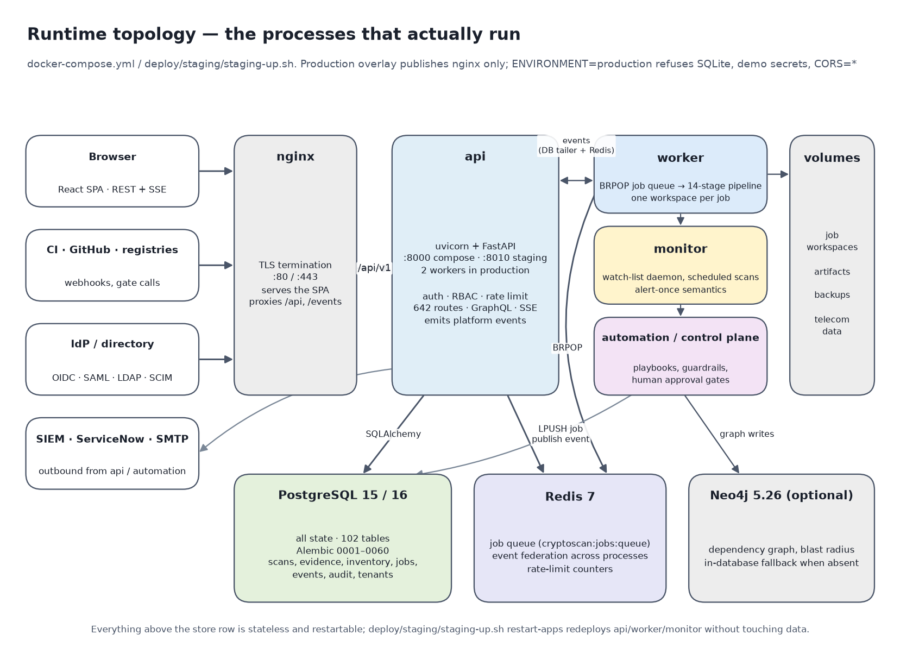
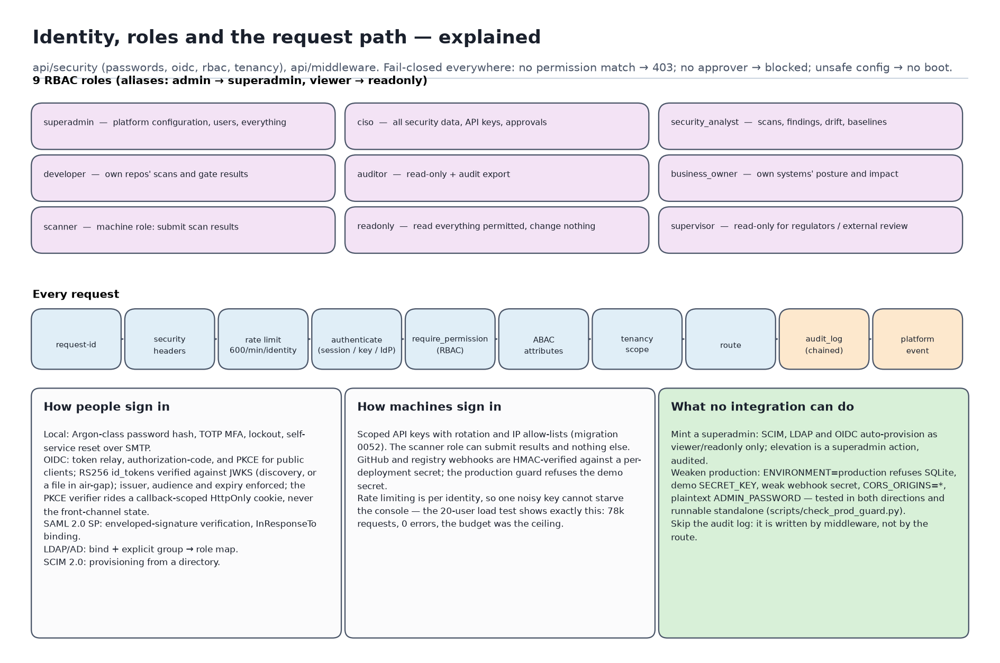
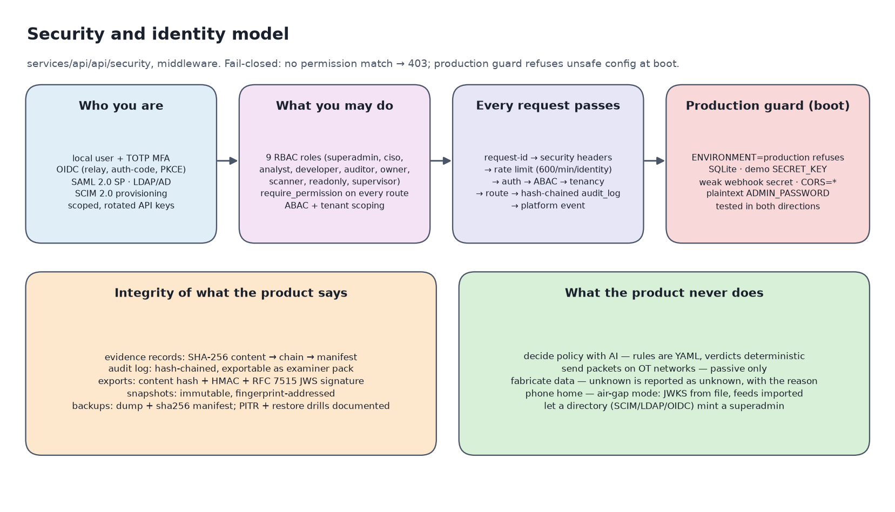
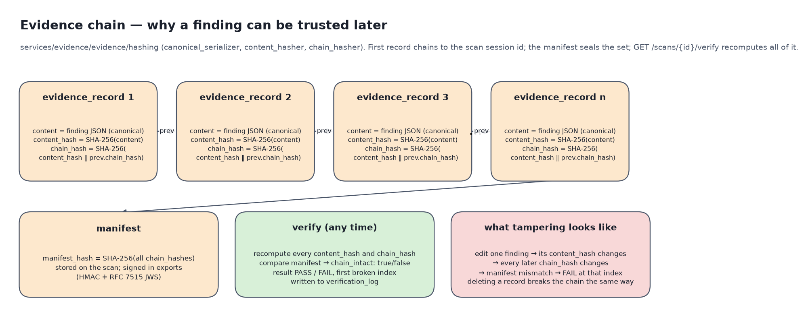
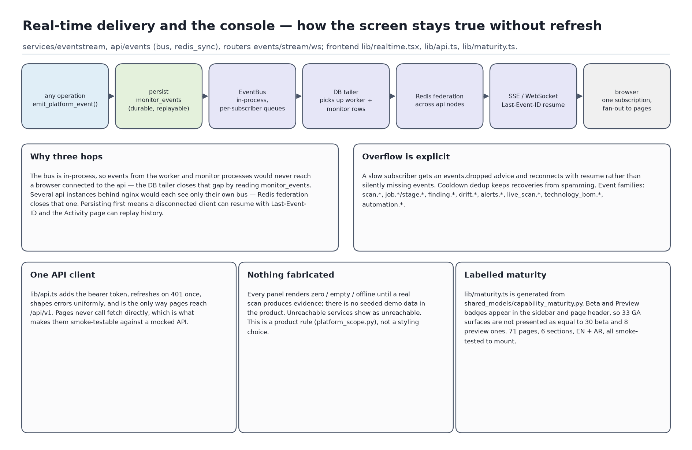
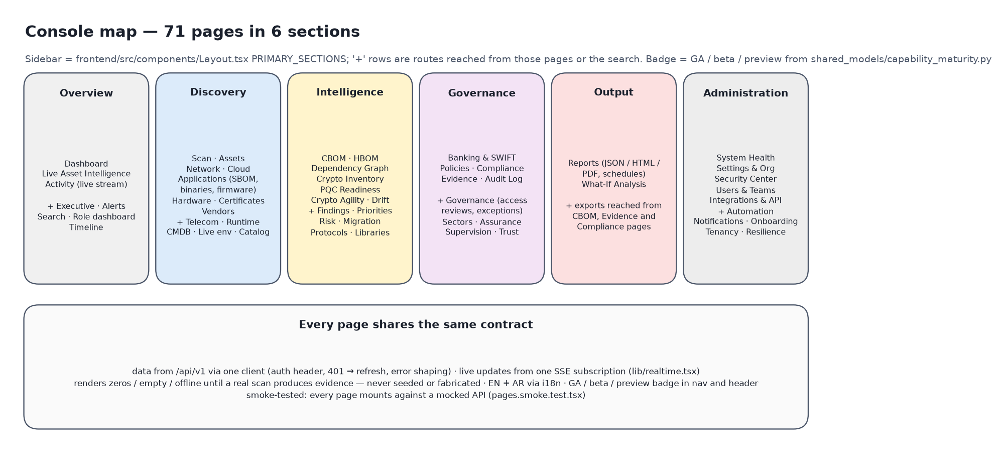

# 3. Architecture

_How the product is built: the layers, the processes that run, the stores,
and the security model. Diagrams are rendered from
`scripts/gen_docs_diagrams.py`; the deep references are
[END-TO-END-ARCHITECTURE.md](../END-TO-END-ARCHITECTURE.md),
[architecture/](../architecture/) and the [ADRs](../decisions/)._

## 3.1 The layers

The layering is strict in one direction: **facts flow down and nothing below
can alter what a layer above recorded.** A scanner produces facts; the
evidence layer hashes them; the data layer stores them; normalisation,
policy and analysis read them and write *derived* rows (verdicts, drift
events, scores) alongside — never over — the originals; the Technology BOM
materialises a state from the inventory; exports are made from a state or an
immutable snapshot and carry its content hash; the event layer announces each
of these steps; the API and console read all of it.

Two consequences worth stating:

- **Re-running policy never changes evidence.** You can add a rule pack a
  year later and evaluate old scans against it; the chain still verifies.
- **A snapshot is an argument, not a cache.** `TECHBOM-20260923-103033` is the
  exact state that was exported and signed; if the inventory has not changed,
  materialising again produces no new version.

### Layer by layer

| Layer | Responsibility | Key entry points |
|---|---|---|
| **Collection** | Turn an input (repo, image, host, cloud account, binary, packet capture, telecom config, HSM slot list) into structured findings. Each scanner is a package with an injected-client pattern so its tests need no network. | `scanner.core`, `devsecops.sbom_scan`, `devsecops.binary_scan`, `network_scanner.core.scanner`, `cloud_scanner.enterprise.engine`, `container_scanner`, `ot_scanner`, `telecom_scanner`, `universal_crypto`, `payment_crypto` |
| **Integrity** | Hash findings into a chain; seal with a manifest; verify on request; sign artefacts. | `evidence.chain`, `evidence.verify`, `cbom.signing.jws_signer` |
| **Data** | SQLAlchemy models, repositories (no raw SQL in routers), Alembic migrations. PostgreSQL in production; SQLite for development only (the production guard refuses it). | `db.models`, `db.repositories`, `migrations/versions/0001–0060` |
| **Normalise + policy** | Canonical names (IANA/NIST/CBOM), key-size normalisation; YAML rule packs with scopes and exceptions; verdict per finding. | `normalization`, `policy.engine`, `policy/rule_definitions/{baseline,pci_dss,nist,cnsa,fips,hipaa,uae}` |
| **Analysis** | Derived views: drift against baselines, dependency graph and blast radius, quantum classification, agility score, dedup/correlation, business impact, unified risk. | `drift.core`, `graph_engine`, `quantum`, `agility`, `deduplication`, `correlation`, `business_context`, `universal_platform.unified_risk` |
| **Technology BOM** | `materialize_technology_bom()` gathers inventory into one state; four renderers (SBOM/CBOM/HBOM/VBOM); fingerprint; snapshot; diff. | `cbom.technology_bom`, `cbom.export_service` |
| **Export + evidence package** | Validate → filter → generate → sign → audit. Report templates; audit pack, exit report, engagement archive; schedules. | `reporting`, `governance.audit_attest`, `reporting.exit_report` |
| **Real-time** | `emit_platform_event()` persists to `monitor_events` and publishes on an in-process bus; a DB tailer picks up events from other processes; Redis federates across nodes; SSE and WebSocket deliver. | `eventstream`, `api.events.bus`, `api.events.redis_sync`, `api.routers.events`, `api.routers.stream`, `api.routers.ws` |
| **API gateway** | FastAPI app, 88 routers, GraphQL, middleware stack, dependencies (`require_permission`, tenancy). | `api.main`, `api.routers.*`, `api.middleware.*`, `api.security.*` |
| **Console** | Vite + React SPA, one API client, one SSE subscription, i18n, maturity badges. | `frontend/src/App.tsx`, `lib/api.ts`, `lib/realtime.tsx`, `lib/maturity.ts` |

## 3.2 The processes that run

There are **five long-running processes** and **three stores**. Everything
above the store row is stateless and can be restarted or scaled
independently.

| Process | Role | Started by |
|---|---|---|
| **nginx** | TLS termination, serves the SPA, proxies `/api` and the event stream. The only port published in the production overlay. | compose `nginx` service |
| **api** | uvicorn + FastAPI. Handles every request, enqueues scan jobs, emits platform events, serves SSE. 2 workers in production. | compose `api`; `staging-up.sh api_up` |
| **worker** | `BRPOP` on the Redis job queue; runs the 14-stage pipeline in a per-job workspace; writes progress to `scan_jobs.progress` after every stage. | compose `worker`; `python -m worker.main` |
| **monitor** | watch-list daemon: scheduled scans of repos, hosts and endpoints; alert-once with cooldown. | compose `monitor`; `scripts/run_monitor.py` |
| **automation / control plane** | evaluates WHEN/IF/THEN plans against events; holds actions at human approval gates; delivers to connectors. Runs inside the api process by default, separable. | `automation`, `control_plane` |

| Store | Holds | Notes |
|---|---|---|
| **PostgreSQL 15/16** | everything: scans, evidence, inventory, jobs, baselines, drift, snapshots, exports, events, audit log, users, tenants — 102 tables | Alembic 0001–0060. The chain is applied and tested on a real PostgreSQL 16 (`test_migration_chain_postgres.py`) |
| **Redis 7** | job queue (`cryptoscan:jobs:queue`), event federation between processes and nodes, rate-limit counters | `noeviction`; losing Redis loses queued-but-not-started jobs (see [scan walkthrough](05-scan-walkthrough.md) § failure) |
| **Neo4j 5.26** | dependency graph and blast-radius queries | optional; `graph_engine` falls back to an in-database store when `NEO4J_URI` is unset |

Two ways to bring this up:

- `docker compose up` (dev) / `scripts/deploy_prod.sh` (production overlay:
  `ENVIRONMENT=production`, hashed admin password, explicit CORS, no host DB
  ports, 2 API workers, docs off, `Secure` cookies).
- `deploy/staging/staging-up.sh up` — the same five processes on one host
  with embedded PostgreSQL 16 and a `redis-server` binary, no Docker, for
  soak / burn-in / migration testing.

## 3.3 Security model

**Who you are.** Local accounts use an Argon-class password hash and TOTP
MFA. Enterprise identity arrives through OIDC (token relay, authorization
code, and RFC 7636 PKCE for public clients — the verifier rides a
callback-scoped HttpOnly cookie, never the front-channel state), SAML 2.0
(enveloped-signature verification, `InResponseTo` binding), LDAP/AD bind with
an explicit group→role map, and SCIM 2.0 provisioning. Machines use scoped
API keys with rotation and IP allow-lists.

**What you may do.** Nine RBAC roles. Every route declares
`require_permission(...)`; no match → 403. ABAC middleware adds
attribute-based constraints; tenancy middleware scopes queries. No external
directory can mint a superadmin.

**Every request passes** request-id → security headers → per-identity rate
limit (600/min in production; the load test in
[soak-evidence](../soak-evidence/2026-09-23-staging/REPORT.md) shows it
holding) → auth → ABAC → tenancy → route → hash-chained `audit_log` → platform
event.

**At boot**, the production guard refuses to start with SQLite, the demo
`SECRET_KEY`, a weak webhook secret, `CORS_ORIGINS=*`, or a plaintext
`ADMIN_PASSWORD`. It is tested in both directions (a bad config is rejected;
a good one is accepted) and can be run standalone with
`scripts/check_prod_guard.py`.

**Integrity of what the product says**: the evidence chain, the hash-chained
audit log, content hash + HMAC + JWS on every export, immutable
fingerprint-addressed snapshots, and backups with sha256 manifests. Full
treatment: [security/threat-model.md](../security/threat-model.md) and
[security/hardening-checklist.md](../security/hardening-checklist.md).

## 3.4 The evidence chain in detail

For each scan, findings are canonicalised (`canonical_serializer`: sorted
keys, stable formatting) and hashed (`content_hasher` → `content_hash`). Each
record's `chain_hash` is `SHA-256(content_hash ‖ previous chain_hash)`
(`chain_hasher.compute_chain_hash`); the first record chains to the scan
session id. Editing or removing any record therefore changes every later
`chain_hash`. The `manifest_hash`
over all chain hashes is stored on the scan and included in signed exports.

`GET /api/v1/scans/{id}/verify` recomputes all of it and returns
`chain_intact`, `result` (PASS/FAIL), the record count and, on failure, the
first broken index; the result is appended to `verification_log`. Because the
inputs are the stored records and the algorithm is public, an auditor can run
the same computation outside the platform.

The same pattern is used for the audit log (incremental verification, ~213×
faster than a full walk), for SBOM/binary artifacts (`/sbom/{id}/verify`
detects byte flips and manifest edits) and for backup manifests.

## 3.5 The console

The SPA has one API client (`lib/api.ts`: bearer header, 401 → refresh,
error shaping), one SSE subscription shared by every page
(`lib/realtime.tsx`), and one maturity table (`lib/maturity.ts`, generated
from `shared_models/capability_maturity.py`) that puts a **Beta** or
**Preview** badge in the sidebar and page header for anything not GA.

The sidebar shows 6 sections and ~35 primary pages; the remaining routes are
reached from those pages, from search, or from deep links in alerts and
reports. Every one of the 71 pages is smoke-tested to mount against a mocked
API (`pages.smoke.test.tsx`), and no page seeds or fabricates data.

## 3.6 Design decisions that shape everything

| Decision | Why | ADR |
|---|---|---|
| PostgreSQL, not a document store | evidence and inventory are relational; migrations are auditable | ADR-001 |
| SHA-256 evidence hashes and a chain, not just signatures | a signature proves who; a chain proves nothing was removed | ADR-003 |
| Eclipse JDT for Java, tree-sitter for JS/TS, Roslyn for C#; Python for services | AST accuracy over regex where the language allows it | ADR-002, 004, 005, 006 |
| Library fingerprinting and a dedup-key formula | a key seen twice is one asset | ADR-007, 008 |
| CycloneDX 1.5 for CBOM | the only standard with first-class crypto components | ADR-009 |
| Neo4j optional, in-DB fallback | graph queries are valuable; a hard dependency would be a deployment blocker | ADR-010 |
| Active vs passive TLS, eBPF vs LD_PRELOAD, multi-cloud IAM | explicit opt-in and read-only roles for anything that touches a live target | ADR-011, 012, 013 |
| Universal crypto engine and live hardware engine | one classification model across software, hardware and vendors | ADR-014, 015 |

Full list: [decisions/](../decisions/).

Next: [4. Data flow](04-dataflow.md)
