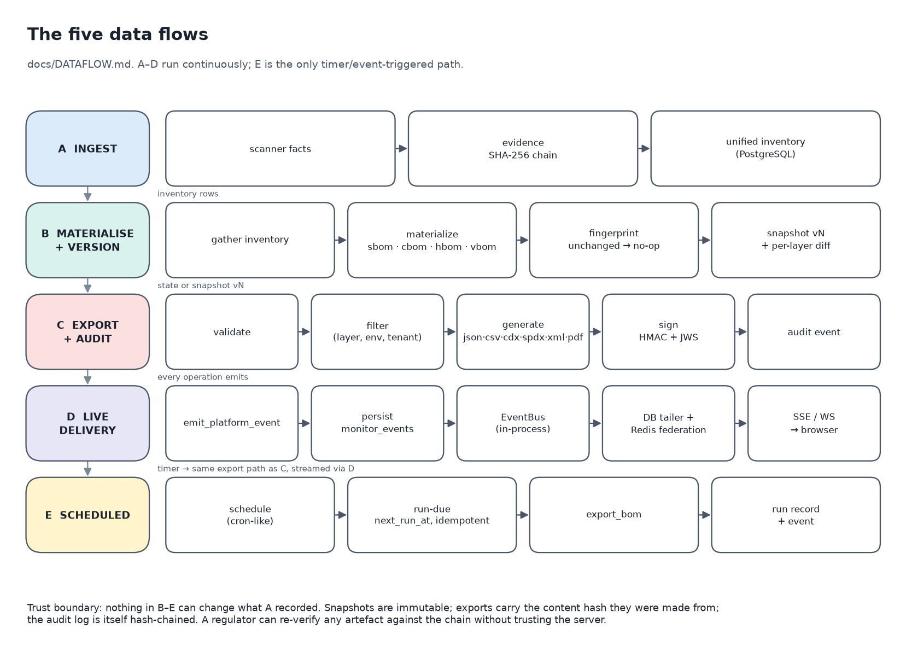

# 4. Data flow

_How one fact becomes evidence, inventory, a BOM, a signed export and a live
event — and why nothing downstream can alter what upstream recorded. The
reference with every table and event name is [DATAFLOW.md](../DATAFLOW.md)._



There are five flows. **A–D run continuously**; **E** is the only
timer-triggered path. Read them as a pipeline: facts are gathered (A), turned
into the one BOM (B), exported and audited (C), streamed live (D), and
reproduced on a schedule (E).

---

## Flow A — Ingest: scanner → evidence → inventory

**Input:** a scanner emits a structured finding. For source code:

```json
{
  "algorithm": "RSA-2048", "key_size": 2048, "purpose": "encryption",
  "confidence": "HIGH", "file": "/src/payment/keyservice.py", "line": 247,
  "rule": "CRYPTO-RSA-KEYSIZE", "language": "python"
}
```

**Steps:**

1. **Canonical serialisation** — sorted keys, stable formatting
   (`evidence/hashing/canonical_serializer.py`), so the same finding always
   hashes identically regardless of which scanner or process produced it.
2. **Content hash** — `content_hash = SHA-256(canonical bytes)`.
3. **Chain hash** — `chain_hash[n] = SHA-256(content_hash[n] ‖ chain_hash[n-1])`;
   the first record chains to the scan session id.
4. **Persist** — `evidence_records` (one per finding, with both hashes and the
   session), `scans` (with the `manifest_hash` over all chain hashes), and the
   derived inventory rows: `crypto_assets`, `crypto_asset_evidence` (the
   asset↔evidence link), `certificates`, `systems`, `system_dependencies`,
   `hardware_live`, `vendors`.
5. **Announce** — `scan.completed`, `finding.new` platform events (Flow D).

**Output:** the unified asset model. One asset can carry evidence from several
collectors; a key found by the cloud scanner and by code scanning is one
`crypto_assets` row with two `crypto_asset_evidence` links.

**What can go wrong and what happens:** a stage failure marks the job `FAILED`
with the stage name and error and leaves already-written evidence intact
(the chain for a partial scan still verifies up to its last record). See
[5. A scan, step by step](05-scan-walkthrough.md).

## Flow B — Materialise and version: inventory → Technology BOM → snapshot

**Trigger:** `GET /api/v1/technology-bom` (live view) or
`POST /api/v1/technology-bom/snapshot`.

1. **Gather** — `_gather_inventory()` reads `systems`, `crypto_assets`,
   `certificates`, `hardware_live`, `vendors`, `system_dependency`,
   `system_vendor`, filtered by environment and tenant.
2. **Materialise** — `materialize_technology_bom()` produces **one state with
   four views**: SBOM (systems and components), CBOM (crypto assets and
   certificates, CycloneDX 1.5 crypto-component shape), HBOM (hardware), VBOM
   (vendors), plus the dependency edges between them.
3. **Fingerprint** — SHA-256 over the canonical state. If it equals the latest
   snapshot's fingerprint, **no new version is created** — a no-op that is
   reported as such.
4. **Snapshot** — otherwise `technology_bom_snapshots` gets version N with
   `snapshot_id = TECHBOM-YYYYMMDD-HHMMSS`, `fingerprint`,
   `parent_fingerprint`, the full state, and a **per-layer diff** against
   N-1 (added / removed by layer).
5. **Announce** — `technology_bom.materialized`, `technology_bom.snapshot`.

**Read paths:** `GET /technology-bom/versions`, `/versions/{n}`,
`/diff?from=&to=`, and the CBOM page's compare view all read snapshots —
never recompute — so what a user compares is what was signed.

## Flow C — Export and audit: BOM → artefact → audit event

**Trigger:** `GET /api/v1/technology-bom/export?fmt=&layer=&version=` or a
schedule (Flow E).

1. **Validate** — format ∈ {json, csv, cyclonedx, cyclonedx-xml, spdx, xml,
   pdf}; layer ∈ {all, sbom, cbom, hbom, vbom}; version exists or "live".
2. **Filter** — environment, tenant, layer, optional component filters.
3. **Generate** — the renderer for the format; CycloneDX and SPDX outputs are
   schema-shaped and carry the snapshot id.
4. **Sign** — `integrity_sha256` over the content; `signature_hmac`; and an
   RFC 7515 compact **JWS** over the same canonical bytes (`signature_jws`),
   so old HMAC verifiers and new JWS verifiers both work.
5. **Audit** — an `audit_log` row (hash-chained) and, for scheduled runs, a
   `technology_bom_export_runs` row holding the artefact, its sha256, its
   signature and the audit event id.
6. **Announce** — `technology_bom.export` with format, layer, snapshot id and
   content hash.

The same validate → generate → sign → audit shape is used by the evidence
pack (`/evidence/pack`), the audit-export ZIP (`/audit-export/pack`), the
compliance reports and the exit report. Each artefact states which snapshot
or scan it was made from, so a regulator can ask for that snapshot and
re-hash it.

## Flow D — Live delivery: every operation → SSE → browser

Every meaningful operation calls `emit_platform_event(kind, payload)`:

1. **Persist** — a `monitor_events` row (durable; this is the source of truth
   for the Activity page and for replay).
2. **Publish** — on the in-process `EventBus` (thread-safe, per-subscriber
   queues with overflow → `events.dropped` advice to reconnect).
3. **Cross-process** — a **DB tailer** in the api process polls
   `monitor_events` for rows written by the worker and monitor processes and
   republishes them on the api's bus.
4. **Cross-node** — `api/events/redis_sync.py` federates bus events over a
   Redis channel so several api instances behind nginx deliver the same
   stream.
5. **Deliver** — `GET /api/v1/events/stream` (`text/event-stream`, honours
   `Last-Event-ID` for resume after a disconnect) and the WebSocket router.
   The console holds one subscription (`lib/realtime.tsx`) and fans out to
   pages; nothing on screen requires a full-page refresh.

Event families: `scan.*`, `job.*`/`stage.*`, `finding.*`, `drift.*`,
`alerts.*`, `live_scan.*`, `technology_bom.*`, `automation.*`,
`events.subscribe` / `events.dropped`. Reference: [DATAFLOW.md § 8](../DATAFLOW.md#8-event-types-reference).

## Flow E — Scheduled exports

`technology_bom_export_schedules` rows carry a frequency, format, layer,
filters and recipients. A run-due pass (`POST /technology-bom/schedules/run-due`,
called by the monitor loop or an external cron) selects schedules with
`next_run_at <= now`, runs Flow C for each, records a
`technology_bom_export_runs` row, advances `next_run_at`, and emits an event.
It is idempotent: running it twice in the same window does nothing the
second time.

---

## The trust boundary

Nothing in B–E can change what A recorded:

- Evidence rows are written once; policy, drift and analysis write *derived*
  rows next to them.
- Snapshots are immutable and fingerprint-addressed; the diff is stored, not
  recomputed.
- Every export carries the content hash and snapshot id it was made from and
  is signed.
- The audit log is itself hash-chained.

So a regulator holding an export can ask for the snapshot, re-hash it,
compare to the export's `integrity_sha256`, ask for the scan the snapshot
came from, and run `/verify` on its chain — none of which requires trusting
the server's word.

## An annotated timeline

```
t0   worker: source scanner finds RSA-2048 at keyservice.py:247
t1   evidence: canonical → content_hash → chain_hash (chained to t0-1)
t2   database: evidence_records, crypto_assets, crypto_asset_evidence written
t3   normalize/policy: canonical name RSA / 2048; rule CRYPTO-RSA-KEYSIZE → PASS under baseline, WARN under CNSA 2.0
t4   analysis: quantum bucket "migrate by 2030"; agility factors; drift vs baseline: unchanged
t5   api: GET /technology-bom → gather → materialize → 4-layer state
t6   api: POST /technology-bom/snapshot → fingerprint changed → v7 + diff (+1 cbom component)
t7   api: GET /technology-bom/export?fmt=cyclonedx&layer=cbom&version=7 → validate → generate → sign → audit
t8   eventstream: technology_bom.export emitted → monitor_events → EventBus → Redis → SSE
t9   console: CBOM page shows v7 and the export, Activity shows the event — no refresh
t10  monitor: nightly schedule run-due → same export → export_runs row + event
```

Next: [5. A scan, step by step](05-scan-walkthrough.md)
