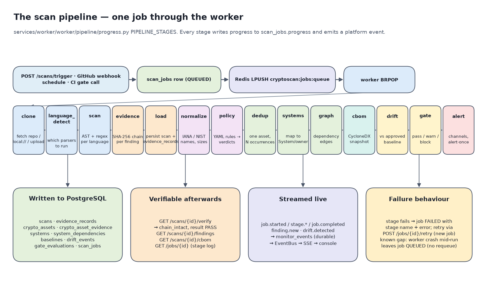

# 5. A scan, step by step

_One job traced from the trigger to a verified evidence chain, with the rows
it writes at each stage and how to check them. The commands are real and
were run against the Postgres+Redis staging stack on 2026-09-23
([soak evidence](../soak-evidence/2026-09-23-staging/REPORT.md))._



_Figure 4 — one scan job from trigger to verifiable result: clone, language detect, scan, evidence, load, normalise, policy, drift, quantum, gate, CBOM, alert._

## 0. Trigger

Four things can start a scan; all of them end in the same queue.

| Trigger | Path |
|---|---|
| Console or API | `POST /api/v1/scans/trigger {"repo_url": "...", "branch": "main"}` |
| GitHub push | `POST /api/v1/webhooks/github` — HMAC `X-Hub-Signature-256` verified against `GITHUB_WEBHOOK_SECRET`; a bad signature is refused, never queued |
| Schedule | the monitor daemon's watch-list, or a repo configuration schedule |
| CI | `scripts/ci_gate.py` → trigger, wait, evaluate gate, exit code |

```bash
curl -s -X POST http://127.0.0.1:8010/api/v1/scans/trigger \
  -H "Authorization: Bearer $TOKEN" -H "Content-Type: application/json" \
  -d '{"repo_url":"local://demo/vulnerable-app","branch":"main"}'
# → {"job_id":"b5e5c286-…","status":"QUEUED"}
```

What happened: a `scan_jobs` row was inserted with `status=QUEUED`, and the
job id was `LPUSH`ed to `cryptoscan:jobs:queue` in Redis. A `job.queued`
event was emitted.

## 1–14. The pipeline

The worker `BRPOP`s the queue, creates a workspace under `WORKSPACE_BASE_PATH`,
and runs `PipelineRunner.run(job_id)`. After each stage it writes
`scan_jobs.progress` (stage list, percent, a log line) and emits a `stage.*`
event, so `GET /api/v1/jobs/{id}` and the Activity page show live progress.

The executed order in `pipeline_runner.py` is:

| # | Stage | What it does | Writes |
|---|---|---|---|
| 1 | **clone** | fetch the repository (git clone, `local://` demo tree, or an uploaded archive) into the job workspace | — |
| 2 | **language_detect** | decide which parsers run (Python, Java, C#, JS/TS, Go, Rust, Kotlin, PHP, Ruby, config) | — |
| 3 | **scan** | run the detectors; AST where available, regex otherwise; each finding has rule, file, line, confidence | in-memory `ctx.findings` |
| 4 | **evidence** | canonicalise each finding; `content_hash`; `chain_hash` chained to the previous; compute the manifest | — (computed) |
| 5 | **load** | persist `scans` (with `manifest_hash`), `evidence_records`, and the inventory rows: `crypto_assets`, `crypto_asset_evidence`, `certificates`, `systems`, `system_dependencies`; dedup happens here (same dedup key → same asset, new evidence link) | scans, evidence_records, crypto_assets, crypto_asset_evidence, systems |
| 6 | **normalize** | IANA/NIST/CBOM canonical names and key sizes | updates crypto_assets |
| 7 | **policy** | evaluate the active YAML rule packs against the normalised findings; verdicts with rule ids and severities; apply approved exceptions | findings verdicts, gate inputs |
| 8 | **drift** | compare against the approved baseline for this repo/system; record added/removed/changed | baselines (read), drift_events |
| 9 | **quantum** | classify each asset into a PQC migration bucket; HNDL exposure | quantum fields on crypto_assets |
| 10 | **gate** | pass / warn / block from the policy verdicts and drift, per the configured profile | gate_evaluations |
| 11 | **cbom** | materialise the CycloneDX CBOM for this scan (and refresh the Technology BOM live state) | cbom snapshot on the scan |
| 12 | **alert** | route notable results to channels (in-app, email, webhook, SIEM) with alert-once semantics; post GitHub commit status if configured | monitor_events, notifications |
| — | **COMPLETED** | `scan_jobs.status=COMPLETED`, `scan_id` set, `completed_at` | scan_jobs |

`PIPELINE_STAGES` in `progress.py` names 14 stages for the progress bar
(it lists `dedup`, `systems` and `graph` separately, which run inside
`load`/`policy`, and omits `quantum`); the table above is the order the
runner actually executes. That mismatch is cosmetic — the stage log in
`GET /jobs/{id}` is the ground truth.

On the demo repository the whole pipeline takes **3–5 ms** wall-clock on
staging (14 findings); a real repository of 10,000 files runs at roughly
2,300 files/s through the scanner stage ([performance.md](../performance.md)).

## 15. Read the result

```bash
curl -s http://127.0.0.1:8010/api/v1/jobs/b5e5c286-… -H "Authorization: Bearer $TOKEN"
# status: COMPLETED, scan_id: 5a9e45d3-…, progress.stages: 14 × COMPLETED, logs: one line per stage

curl -s "http://127.0.0.1:8010/api/v1/scans/5a9e45d3-…/findings" -H "Authorization: Bearer $TOKEN"
# 14 findings: rule, severity, file:line, algorithm, verdict, evidence_id

curl -s "http://127.0.0.1:8010/api/v1/scans/5a9e45d3-…/cbom" -H "Authorization: Bearer $TOKEN"
# CycloneDX 1.5 document with crypto components
```

## 16. Verify the chain

```bash
curl -s "http://127.0.0.1:8010/api/v1/scans/5a9e45d3-…/verify" -H "Authorization: Bearer $TOKEN"
# {"result":"PASS","chain_intact":true,"records":14,"manifest_match":true, ...}
```

This recomputes every `content_hash` and `chain_hash` from the stored
records and compares the manifest. The outcome is appended to
`verification_log`. On the staging run every one of the soak's scans
verified `PASS` — and the evidence directory records it per cycle.

## What the console shows meanwhile

- **Activity** (`/live-stream`): `job.queued` → `stage.clone` … `stage.alert`
  → `job.completed`, arriving over SSE.
- **Scan** (`/scanners`): the job in the list with a live progress bar.
- **Findings** (`/findings`): the 14 rows with verdicts, filterable by rule
  and severity, each linking to its evidence record.
- **Crypto Inventory** / **CBOM**: the assets and the CycloneDX view; the
  Technology BOM live state now includes them and a snapshot will capture
  them as a new version.
- **Drift**: nothing, if this matches the approved baseline; a drift event
  otherwise.

## Failure behaviour — honest version

| Situation | What happens | Recovery |
|---|---|---|
| A stage raises | job → `FAILED` with `error_message="Pipeline failed at stage <name>: …"`; evidence already loaded stays and still verifies; GitHub status "failure" if configured | `POST /api/v1/jobs/{id}/retry` creates a **new** job for the same input |
| Repository unreachable | fails at `clone` with the reason | fix credentials / URL, retry |
| Parser error in one file | recorded as a `parse_error` finding with the file; the scan continues (0 parse errors on the 10k-file benchmark) | — |
| Redis unavailable at trigger time | trigger returns 503; no `scan_jobs` row is left dangling | retry the trigger |
| **Worker process dies mid-run** | Redis processing-list/lease recovery requeues or dead-letters the job; the DB reaper handles stale rows | **implemented, target-host qualification still required** — run `scripts/queue_kill9_drill.py` against real Redis and attach the artifact to the root readiness gate |
| Workspace cleanup | one directory per job under `WORKSPACE_BASE_PATH`, removed after the job | a path-resolution bug leaked every workspace until 2026-09-23; fixed with regression tests |

## Other job kinds

The same queue and progress contract carry **binary jobs**
(`binary_target → binary_scan → binary_sbom → binary_store → binary_ingest`,
`worker/pipeline/binary_job.py`) for firmware and executables, and the
monitor's **live scans** (network, cloud, container, telecom) use the live
scan runner in the api process with the same event and evidence handling.

Next: [6. Scope, maturity and readiness](06-scope-and-readiness.md)

For the same job followed beyond the pipeline — gate, dedup, priority, CI verdict, alerting, SLA, Technology BOM, report and regulator verification — see [9. End to end](09-end-to-end.md).
