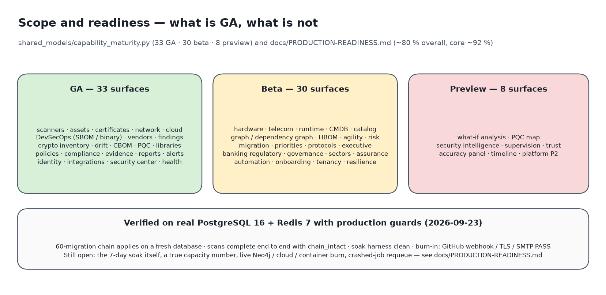
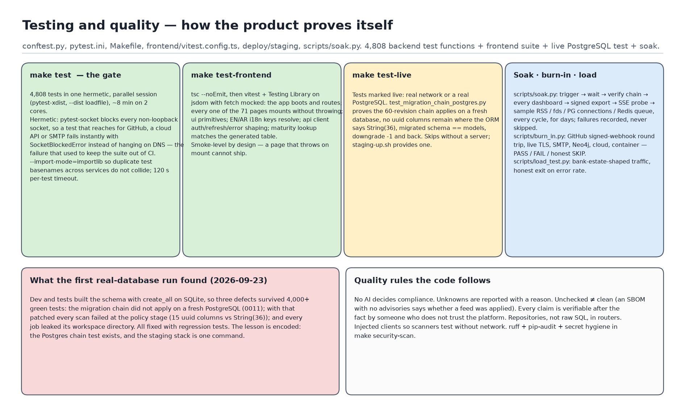

# 6. Scope, maturity and readiness

_Which surfaces are production-supported, how ready the whole thing is, and
what is still open. Sources: `shared_models/capability_maturity.py`
(generated into [CAPABILITY-MATURITY.md](../CAPABILITY-MATURITY.md)) and
[PRODUCTION-READINESS.md](../PRODUCTION-READINESS.md)._



_Figure 9 — the three maturity tiers (33 GA · 30 beta · 8 preview) and the readiness score per area; the console shows the same labels._

## Three tiers, one source of truth

Every console route has a tier. The table lives in Python, is generated into
the frontend (`lib/maturity.ts`) and the docs, is served by
`GET /api/v1/platform/capabilities` and GraphQL, and is shown as a badge in
the sidebar and page header. Changing a tier is a one-line, reviewed change.

| Tier | Meaning | Count |
|---|---|---|
| **GA** | Production-supported. Deterministic core, broad tests, exercised in the burn-in and soak. | 33 |
| **Beta** | Real code over real data; thinner test coverage or short deployment history. Shown, labelled, usable. | 30 |
| **Preview** | A working surface over a small engine, or analysis over inputs not yet collected at scale. | 8 |

**GA** — scanners, assets, certificates, network, cloud, DevSecOps (SBOM /
binary / firmware), vendors, live scanners, findings, crypto inventory and
registry, drift, CBOM / Technology BOM, PQC, libraries, policies, compliance,
evidence, reports, alerts, command center, live stream, search, identity,
integrations, security center, settings, system health, scope, admin, login,
password reset.

**Beta** — hardware, telecom, runtime, live environment, CMDB, catalog,
graph / dependency graph, HBOM, agility, risk, migration, priorities,
protocols, crypto changes, executive and role dashboards, banking regulatory,
governance, sectors, crypto assurance, automation, notifications, onboarding,
organisation, resilience, security settings, tenancy, register, invite
accept.

**Preview** — what-if analysis, PQC map, security intelligence, supervision,
trust, accuracy panel, timeline, platform P2.

The per-route reasoning ("why this tier") is in
[CAPABILITY-MATURITY.md](../CAPABILITY-MATURITY.md).

## How production-ready is it?

**~80 % overall; the core path ~92 %.** The core path is source scan →
evidence chain → normalise → policy → dedup → CBOM → drift → gate → alert,
running as separate api / worker / monitor processes on PostgreSQL + Redis
with production guards on. That path has been exercised end to end on a real
PostgreSQL 16, and every defect it exposed is fixed with a regression test.

### What was verified on 2026-09-23

| Check | Result | Evidence |
|---|---|---|
| Backend test suite | 4,808 tests, hermetic (no non-loopback sockets) and parallel, ~8 min | `make test`, `conftest.py`, `pytest.ini` |
| Frontend tests | app boots, every page mounts against a mocked API, ui, i18n, api client | `make test-frontend` |
| Migration chain on fresh PostgreSQL 16 | 60 revisions apply; no `uuid` columns remain where the ORM says `String(36)`; schema == models; downgrade/upgrade | `test_migration_chain_postgres.py` (`make test-live`) |
| End-to-end scans on Postgres + Redis, `ENVIRONMENT=production` | every cycle COMPLETED, `chain_intact: true`, 0 5xx | `docs/soak-evidence/2026-09-23-staging/` |
| Integration burn-in | GitHub signed-webhook round trip PASS, live TLS PASS, SMTP PASS; Neo4j / cloud / container honest SKIP (not on that host) | `burn_in_report.json` |
| Load | 78k requests / 20 users / 180 s, 0 errors; rate limiter was the ceiling (97 % 429) | `load_test_20u_180s.txt` |

### What the Postgres run found — and why it matters

Before 2026-09-23 the product had never had its migration chain applied on
a real PostgreSQL; development and tests used SQLite with `create_all` from
the models. The first real run found:

1. `alembic upgrade head` **failed** on a fresh database at revision 0011.
2. With that patched, **every scan failed** at the policy stage because 15
   columns were `uuid` in the database while the ORM declared `String(36)`.
3. Every job **leaked its workspace directory** (a relative-vs-resolved path
   comparison in cleanup).

All three are fixed (0011 patch, migration 0060, `WorkspaceManager` fix) and
guarded by tests. They are also why the earlier readiness estimate was
generous: the story looked complete from the code, and the first real
database said otherwise.

## What is still open

| Gap | Weight | Closes when |
|---|---|---|
| **The soak is ~20 minutes, not 7 days.** Leaks and stalls show over days; one was found in 20 minutes. | largest | `scripts/soak.py --hours 168` on a host that stays up; pass criteria in [soak-evidence/README.md](../soak-evidence/README.md) |
| **No true capacity number.** Every virtual user shared one identity, so the rate limit was the ceiling; the API held but its capacity is unmeasured. | medium | re-run `load_test.py` with one API key per virtual user |
| **Neo4j, cloud, container never burned live.** Skipped honestly where the host lacked them; also exactly the beta surfaces. | medium | `burn_in.py --target all` on a host with all three |
| **Crashed job stays QUEUED forever.** No visibility timeout or dead-letter on the job queue. | small–medium | requeue / reaper on `scan_jobs` |
| **Single api / worker process tested.** `deploy/ha/` exists, not exercised in this pass. | small | HA drill on the target host |
| **External attestation** (SOC 2 / ISO 27001 of the product), independent pen test, multi-site DR, 24/7 on-call | — | company actions; [soc2-readiness-gap-analysis.md](../soc2-readiness-gap-analysis.md) |

## How to check any of this yourself



_Figure 19 — the four test gates and what the first real-database run
found._

### How the product proves itself

- **`make test` — the gate.** 4,808 tests in one hermetic, parallel session
  (pytest-xdist, `--dist loadfile`), about 8 minutes on 2 cores. Hermetic
  means `pytest-socket` blocks every non-loopback socket, so a test that
  reaches for GitHub, a cloud API or SMTP fails instantly with
  `SocketBlockedError` instead of hanging on DNS — the failure that used to
  keep the suite out of CI. `--import-mode=importlib` lets duplicate test
  basenames across services coexist; a 120 s per-test timeout bounds the
  worst case.
- **`make test-frontend`.** `tsc --noEmit`, then vitest + Testing Library on
  jsdom with `fetch` mocked: the app boots and routes; every one of the 71
  pages mounts without throwing; UI primitives; the API client's
  auth/refresh/error shaping; maturity lookup matches the generated table.
  Smoke-level by design — a page that throws on mount cannot ship.
- **`make test-live`.** Tests marked `live` need a real network or a real
  PostgreSQL. `test_migration_chain_postgres.py` proves the 60-revision chain
  applies on a fresh database, no `uuid` columns remain where the ORM says
  `String(36)`, migrated schema == models, and downgrade −1 and back works.
  Skips without a server; `staging-up.sh` provides one.
- **Soak · burn-in · load.** `scripts/soak.py`: trigger → wait → verify chain
  → every dashboard → signed export → SSE probe → sample RSS / fds / PG
  connections / Redis queue, every cycle, for days; failures are recorded,
  never skipped. `scripts/burn_in.py`: GitHub signed-webhook round trip, live
  TLS, SMTP, Neo4j, cloud, container — PASS / FAIL / honest SKIP.
  `scripts/load_test.py`: bank-estate-shaped traffic with an honest exit on
  error rate.

**What the first real-database run found (2026-09-23).** Development and
tests had built the schema with `create_all` on SQLite, so three defects
survived 4,000+ green tests: the migration chain did not apply on a fresh
PostgreSQL (0011); with that patched, every scan failed at the policy stage
(15 `uuid` columns vs `String(36)`); and every job leaked its workspace
directory. All three are fixed with regression tests. The lesson is encoded:
the Postgres chain test exists and the staging stack is one command.

**Quality rules the code follows.** No AI decides compliance. Unknowns are
reported with a reason. Unchecked ≠ clean (an SBOM with no advisories says
whether a feed was applied). Every claim is verifiable after the fact by
someone who does not trust the platform. Repositories, not raw SQL, in
routers. Injected clients so scanners test without a network. `ruff` +
`pip-audit` + secret hygiene in `make security-scan`.


```bash
make test                          # hermetic backend gate
make test-frontend                 # vitest
deploy/staging/staging-up.sh up    # real PostgreSQL 16 + Redis 7, production guards, no Docker
make test-live                     # includes the PostgreSQL migration-chain test
python scripts/soak.py --cycles 3 --interval 10 --out /tmp/soak-check
python scripts/burn_in.py --target all --api http://127.0.0.1:8010 --username admin --password "$STAGING_ADMIN_PASSWORD"
python scripts/soak_report.py /tmp/soak-check
```

Next: [7. Glossary](07-glossary.md)
