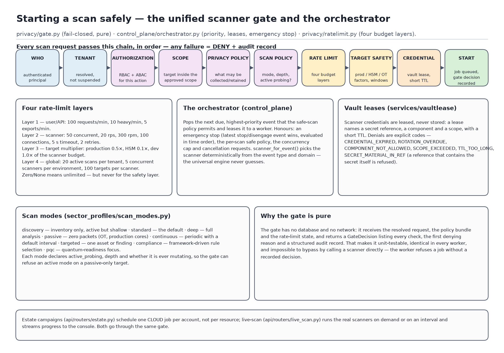
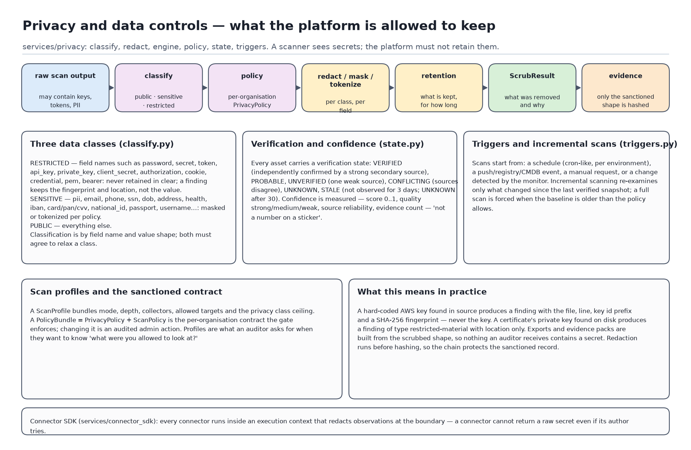
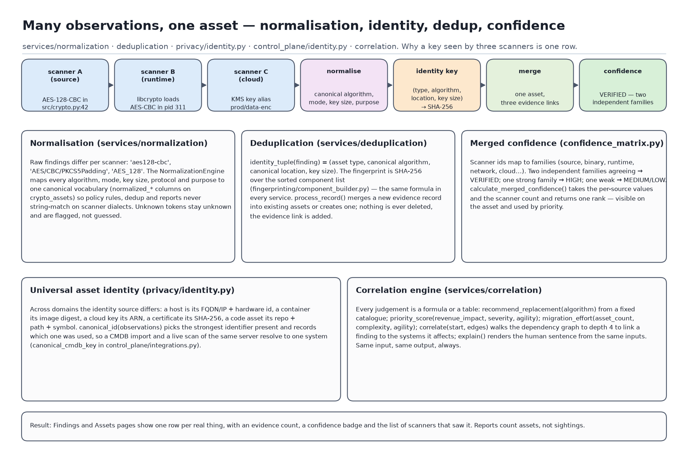
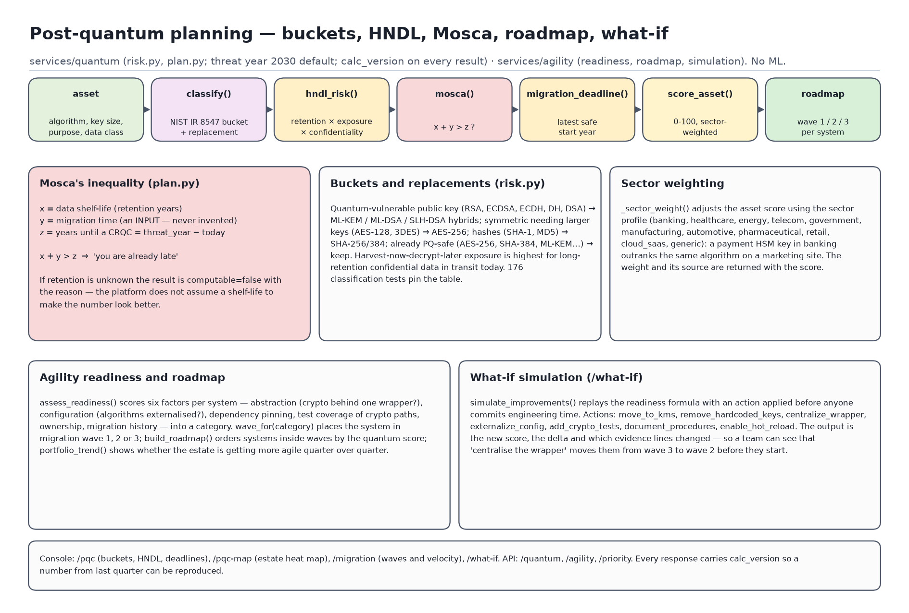
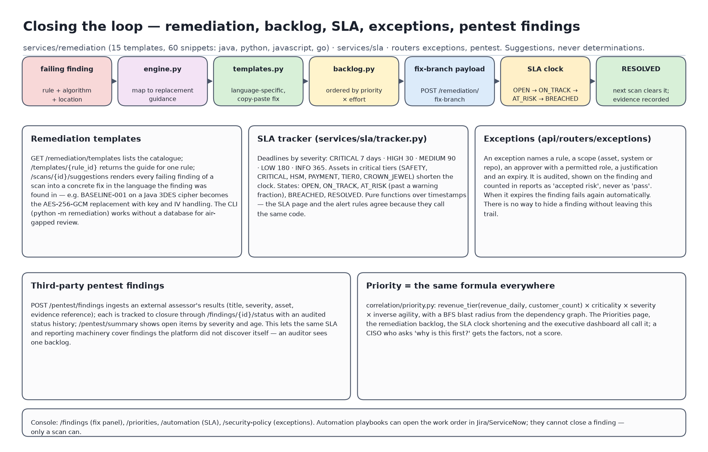
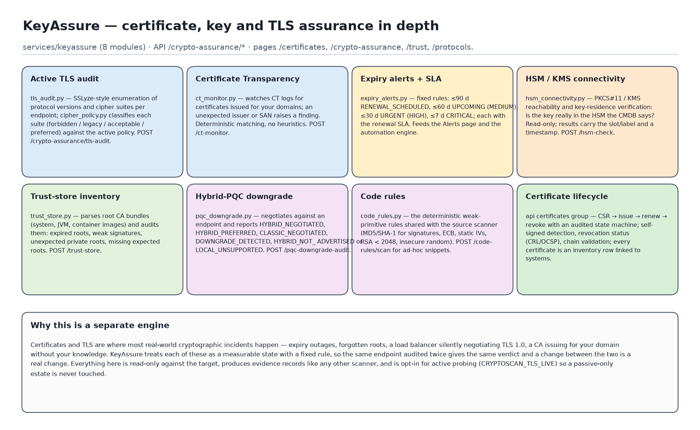
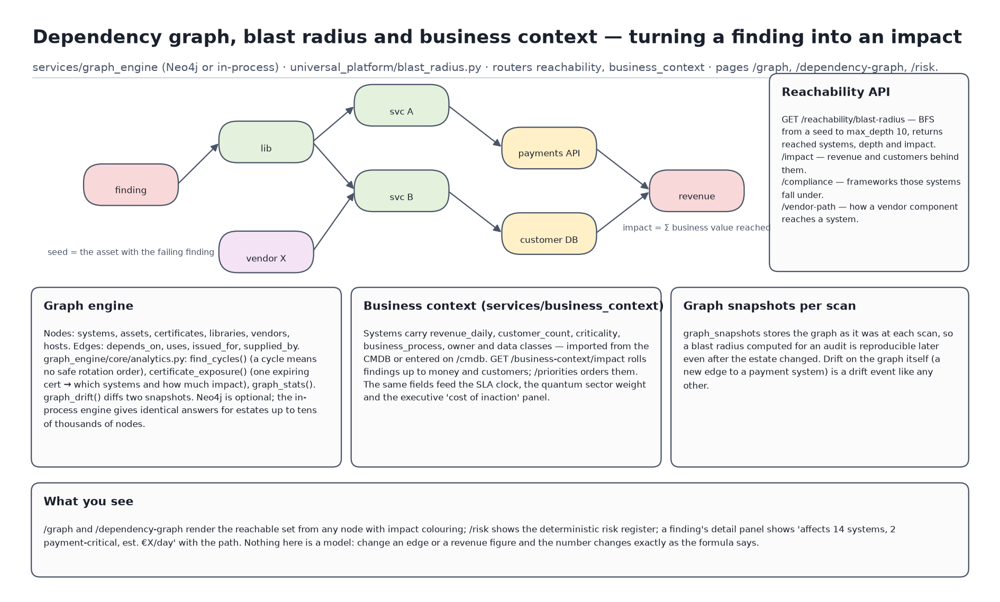
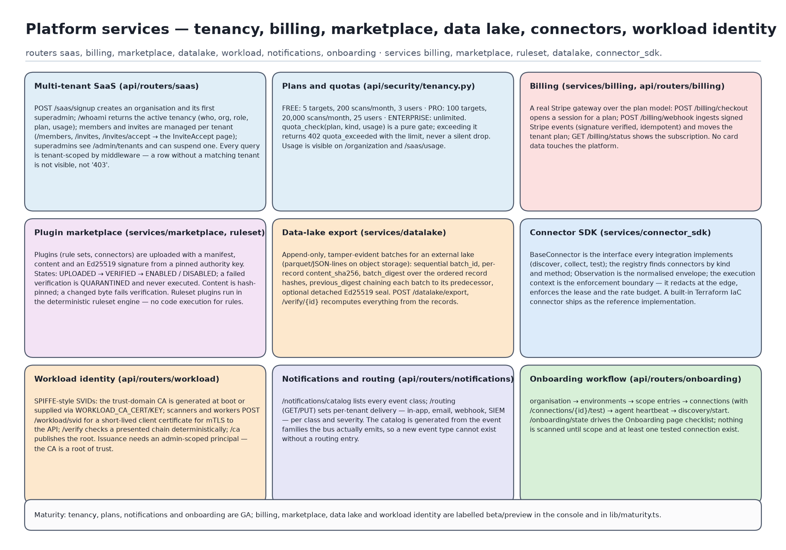
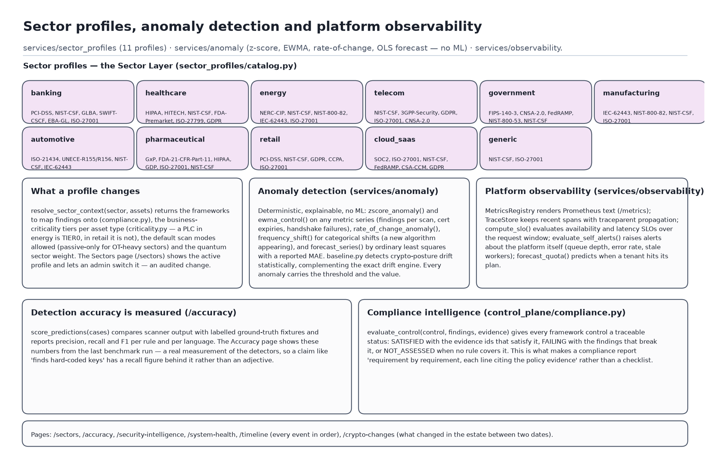

# 8. The engines behind the pages

_The earlier chapters follow the loop — collect, evidence, inventory, assess,
gate, prove. This chapter explains the engines that sit underneath every stage
and are easy to miss from the console: how a scan is allowed to start, what the
platform is allowed to keep, how many sightings become one asset, how the
post-quantum numbers are derived, how a finding is closed, the certificate and
TLS engine, the dependency graph, the multi-tenant platform services, and the
sector, anomaly and observability layers. Every module path is real; every
number is read from the code._

| Section | Engine | Where in the repo |
|---|---|---|
| 8.1 | Unified scanner gate, orchestrator, rate budgets, vault leases, scan modes | `services/privacy/gate.py`, `control_plane/orchestrator.py`, `privacy/ratelimit.py`, `services/vaultlease`, `sector_profiles/scan_modes.py` |
| 8.2 | Privacy and data controls | `services/privacy` (classify, redact, engine, policy, state, triggers, profiles) |
| 8.3 | Normalisation, identity, deduplication, confidence, correlation | `services/normalization`, `services/deduplication`, `privacy/identity.py`, `control_plane/identity.py`, `services/correlation` |
| 8.4 | Post-quantum planning and crypto agility | `services/quantum`, `services/agility` |
| 8.5 | Remediation, SLA, exceptions, pentest findings | `services/remediation`, `services/sla`, routers `exceptions`, `pentest`, `remediation` |
| 8.6 | KeyAssure — certificate, key and TLS assurance | `services/keyassure`, router `crypto_assurance`, `certificates` |
| 8.7 | Dependency graph, blast radius, business context | `services/graph_engine`, `universal_platform/blast_radius.py`, routers `reachability`, `business_context` |
| 8.8 | Platform services — tenancy, billing, marketplace, data lake, connector SDK, workload identity | routers `saas`, `billing`, `marketplace`, `datalake`, `workload`, `notifications`, `onboarding` |
| 8.9 | Sector profiles, anomaly detection, observability, accuracy | `services/sector_profiles`, `services/anomaly`, `services/observability`, `control_plane/benchmark.py` |

---

## 8.1 Starting a scan safely — the gate and the orchestrator



_Figure 22 — the fail-closed chain every scan request passes, the four
rate-limit layers, the orchestrator and the credential lease._

**The unified scanner gate** (`services/privacy/gate.py`) is the only way a
scan starts. Every request passes, in order:

```
WHO → TENANT → AUTHORIZATION → SCOPE → PRIVACY POLICY → SCAN POLICY
    → RATE LIMIT → TARGET SAFETY → CREDENTIAL → START SCAN
    (any failure → DENY SCAN + AUDIT LOG)
```

The gate is **pure**: it has no database and no network. It receives the
already-resolved request (concrete targets, credentials), the policy bundle
and the rate-limit state, and returns a `GateDecision` that lists every check,
the first denying reason and a structured audit record. That is what makes it
unit-testable, identical in every worker, and impossible to bypass by calling
a scanner directly — the worker refuses a job without a recorded decision.

**Four rate-limit layers** (`privacy/ratelimit.py`, class `Limits`):

| Layer | Budget | Defaults |
|---|---|---|
| 1 — user / API | per identity | 100 requests/min · 10 heavy/min · 5 exports/min |
| 2 — scanner | per scanner | 50 concurrent · 20 rps · 300 rpm · 100 connections · 5 s timeout · 2 retries |
| 3 — target multiplier | applied to the scanner budget | production 0.5× · HSM 0.1× · dev 1.0× |
| 4 — global | tenant / environment / infra | 20 active scans per tenant · 5 concurrent scanners per environment · 100 targets per scanner · 10,000 global scanner workers |

`0`/`None` means unlimited — but never for the safety layer.

**The orchestrator** (`control_plane/orchestrator.py`) pops the next due,
highest-priority event that the safe-scan policy permits and leases it to a
worker. It honours an **emergency stop** (`emergency_engaged()` — the latest
stop/disengage event wins, evaluated in time order), the per-scan safe policy,
the concurrency cap and cancellation requests. `scanner_for_event()` selects
the scanner deterministically from the event type and domain.

**Vault leases** (`services/vaultlease`). Scanner credentials are leased, never
stored. A lease names a secret *reference*, a component and a scope, with a
short TTL. Denials are explicit codes: `CREDENTIAL_NOT_ACTIVE`,
`CREDENTIAL_EXPIRED`, `ROTATION_OVERDUE`, `COMPONENT_NOT_ALLOWED`,
`SCOPE_EXCEEDED`, `TTL_TOO_LONG`, `BAD_SECRET_REF`, `SECRET_MATERIAL_IN_REF`
(a reference that contains the secret itself is refused), `LEASE_EXPIRED`,
`LEASE_ALREADY_RELEASED`.

**Scan modes** (`sector_profiles/scan_modes.py`). Each mode declares
`active_probing`, `depth` (inventory / standard / deep), whether it is ever
`mutating`, and a default interval for continuous mode:

| Mode | Purpose |
|---|---|
| `discovery` | build the asset inventory only — hosts, services, devices, cloud resources |
| `standard` | the default analysis |
| `deep` | full analysis, all collectors |
| `passive` | zero packets — OT networks, production cores |
| `continuous` | periodic with a default interval |
| `targeted` | one asset or one finding |
| `compliance` | framework-driven rule selection |
| `pqc` | quantum-readiness focus |

The gate refuses an active mode on a passive-only target.

**Related entry points.** Estate campaigns (`api/routers/estate.py`) schedule
one CLOUD job per account, not per resource. Live-scan
(`api/routers/live_scan.py`: `/live-scan/status`, `/run`, `/start`, `/stop`)
runs the real scanners on demand or on an interval and streams findings to
every console. Both go through the same gate.

---

## 8.2 Privacy and data controls — what the platform may keep



_Figure 23 — from raw scanner output to the sanctioned record that is hashed._

A scanner necessarily sees secrets. The platform must not retain them. The
pipeline is: raw output → **classify** → **policy** → **redact / mask /
tokenize** → **retention** → `ScrubResult` → evidence. Redaction runs *before*
hashing, so the evidence chain protects the sanctioned record.

**Three data classes** (`privacy/classify.py`, `DataClass`):

| Class | Recognised by | Treatment |
|---|---|---|
| `RESTRICTED` | field names such as password, passwd, secret, token, api_key, private_key, client_secret, authorization, cookie, credential, pem, rsa_private, bearer | never retained in clear — the finding keeps the location and a SHA-256 fingerprint, not the value |
| `SENSITIVE` | pii, person, email, phone, ssn, dob, address, health, patient, iban, card/pan/cvv, name, owner, username, national_id, passport, certificate … | masked or tokenized per policy |
| `PUBLIC` | everything else | retained |

**Verification, confidence and staleness** (`privacy/state.py`). Every asset
carries one of `VERIFIED` (independently confirmed by a strong secondary
source), `PROBABLE`, `UNVERIFIED` (a single weak source), `CONFLICTING`,
`UNKNOWN`, `STALE` (not observed for 3 days; `UNKNOWN` after 30). `Confidence`
is *measured* — score 0..1, quality strong/medium/weak, source reliability,
evidence count, verified flag — "not a number on a sticker".

**Triggers and incremental scanning** (`privacy/triggers.py`). A scan starts
from a schedule, a push/registry/CMDB event, a manual request or a change the
monitor detected. Incremental scans re-examine only what changed since the
last verified snapshot; a full scan is forced when the baseline is older than
policy allows.

**Profiles and the sanctioned contract.** A `ScanProfile` (`profiles.py`)
bundles mode, depth, collectors, allowed targets and the privacy-class ceiling.
A `PolicyBundle` = `PrivacyPolicy` + `ScanPolicy` (`policy.py`) is the
per-organisation contract the gate enforces; changing it is an audited admin
action. This is what an auditor asks for when they want to know "what were you
allowed to look at?"

**In practice.** A hard-coded AWS key in source becomes a finding with file,
line, key-id prefix and fingerprint — never the key. A private key on disk
becomes a `restricted-material` finding with location only. Exports and
evidence packs are built from the scrubbed shape, so nothing a regulator
receives contains a secret. The **Connector SDK** enforces the same rule at
the boundary: `connector_sdk/context.py` redacts observations before they leave
the connector.

---

## 8.3 Many observations, one asset



_Figure 24 — why a key seen by three scanners is one row._

**Normalisation** (`services/normalization`). Scanners speak different
dialects: `aes128-cbc`, `AES/CBC/PKCS5Padding`, `AES_128`. The
`NormalizationEngine` maps every algorithm, mode, key size, protocol and
purpose to one canonical vocabulary — the `normalized_*` columns on
`crypto_assets` — so policy rules, dedup and reports never string-match on a
scanner's spelling. Unknown tokens stay unknown and are flagged, not guessed.

**Deduplication** (`services/deduplication`). `identity_tuple(finding)` =
(asset type, canonical algorithm, canonical location, key size); the
fingerprint is SHA-256 over the sorted component list
(`fingerprinting/component_builder.py`) — the same formula in every service.
`process_record()` merges a new evidence record into existing assets or
creates one. Nothing is deleted; the evidence link is added.

**Merged confidence** (`deduplication/confidence/confidence_matrix.py`).
Scanner ids map to families (source, binary, runtime, network, cloud …). Two
independent families agreeing → `VERIFIED`; one strong family → `HIGH`; one
weak → `MEDIUM` / `LOW`. `calculate_merged_confidence()` returns one rank from
the per-source values and the scanner count; it is shown on the asset and used
by priority.

**Universal asset identity** (`privacy/identity.py`,
`control_plane/identity.py`). The identity source differs by domain — a host is
FQDN/IP + hardware id, a container its image digest, a cloud key its ARN, a
certificate its SHA-256, a code asset repo + path + symbol. `canonical_id()`
picks the strongest identifier present and records which one was used, so a
CMDB import and a live scan of the same server resolve to one system
(`canonical_cmdb_key` in `control_plane/integrations.py`).

**Correlation engine** (`services/correlation`). Every judgement is a formula
or a table: `recommend_replacement(algorithm)` from a fixed catalogue;
`priority_score(revenue_impact, severity, agility)`;
`migration_effort(asset_count, complexity, agility)`; `correlate(start,
edges)` walks the dependency graph to depth 4; `explain()` renders the
sentence a human reads from the same inputs.

**Result.** Findings and Assets show one row per real thing with an evidence
count, a confidence badge and the scanners that saw it. Reports count assets,
not sightings.

---

## 8.4 Post-quantum planning and crypto agility



_Figure 25 — classification, HNDL exposure, Mosca's inequality, deadline,
score, roadmap, what-if._

**The pipeline** (`services/quantum/risk.py`, `plan.py`): asset →
`classify()` → `hndl_risk()` → `mosca()` → `migration_deadline()` →
`score_asset()` → roadmap. `QUANTUM_THREAT_YEAR = 2030` is the default and
`CALC_VERSION` is stamped on every result so a number from last quarter can be
reproduced.

**Mosca's inequality** (`plan.py::mosca`):

```
x = data shelf-life (retention years)
y = migration time  — always an INPUT the caller estimates; never invented
z = years until a CRQC = threat_year − today

x + y > z  →  "you are already late"
```

If retention is unknown the result is `computable = false` with the reason
"no retention data — shelf-life (x) unknown". The platform does not assume a
shelf-life to make the number look better.

**Buckets and replacements** (`risk.py::classify`, `recommended_replacement`):

| Bucket | Examples | Replacement |
|---|---|---|
| quantum-vulnerable public key | RSA, ECDSA, ECDH, DH, DSA | ML-KEM / ML-DSA / SLH-DSA hybrids |
| symmetric needing larger keys | AES-128, 3DES | AES-256 |
| hash | SHA-1, MD5 | SHA-256 / SHA-384 |
| already PQ-safe | AES-256, SHA-384, ML-KEM … | keep |

Harvest-now-decrypt-later exposure is highest for long-retention confidential
data in transit today. 176 classification tests pin the table.
`_sector_weight()` adjusts the score by sector profile — a payment HSM key in
banking outranks the same algorithm on a marketing site — and returns the
weight and its source with the score.

**Agility** (`services/agility`). `assess_readiness()` scores six factors per
system — abstraction, configuration, dependency pinning, test coverage of
crypto paths, ownership, migration history — into a category; `wave_for()`
places the system in migration wave 1, 2 or 3; `build_roadmap()` orders
systems inside waves by quantum score; `portfolio_trend()` shows whether the
estate is getting more agile over time.

**What-if** (`agility/simulation.py`, page `/what-if`).
`simulate_improvements()` replays the readiness formula with an action applied
before anyone commits engineering time. Actions: `move_to_kms`,
`remove_hardcoded_keys`, `centralize_wrapper`, `externalize_config`,
`add_crypto_tests`, `document_procedures`, `enable_hot_reload`. The output is
the new score, the delta and which evidence lines changed.

Console: `/pqc`, `/pqc-map`, `/migration`, `/what-if`. API: `/quantum`,
`/agility`, `/priority`.

---

## 8.5 Closing the loop — remediation, SLA, exceptions, pentest



_Figure 26 — from a failing finding to RESOLVED, with the clocks and the
escape hatches._

**Remediation templates** (`services/remediation`): 15 templates, 60 snippets,
in Java, Python, JavaScript and Go. `GET /remediation/templates` lists the
catalogue; `/templates/{rule_id}` returns one guide;
`/scans/{scan_id}/suggestions` renders every failing finding of a scan into a
concrete fix in the language it was found in — BASELINE-001 on a Java 3DES
cipher becomes the AES-256-GCM replacement with key and IV handling;
`POST /remediation/fix-branch` produces the payload for a fix branch.
`backlog.py` orders suggestions by priority × effort. The CLI
(`python -m remediation`) needs no database, for air-gapped review. Output is
a suggestion and a work order — never a compliance determination.

**SLA tracker** (`services/sla/tracker.py`). Deadlines by severity:

| Severity | Days |
|---|---|
| CRITICAL | 7 |
| HIGH | 30 |
| MEDIUM | 90 |
| LOW | 180 |
| INFO | 365 |

Assets in critical tiers (`SAFETY`, `CRITICAL`, `HSM`, `PAYMENT`, `TIER0`,
`CROWN_JEWEL`) shorten the clock. States: `OPEN`, `ON_TRACK`, `AT_RISK`,
`BREACHED`, `RESOLVED`. Pure functions over timestamps, so the SLA page and
the alert rules always agree.

**Exceptions** (`api/routers/exceptions`). An exception names a rule, a scope
(asset, system or repository), an approver with a permitted role, a
justification and an expiry. It is audited, shown on the finding and counted
in reports as *accepted risk*, never as *pass*. When it expires the finding
fails again automatically.

**Pentest findings** (`api/routers/pentest`). `POST /pentest/findings` ingests
a third-party assessor's results; `/findings/{id}/status` tracks each to
closure with an audited history; `/pentest/summary` shows open items by
severity and age. The same SLA and reporting machinery therefore covers
findings the platform did not discover itself — an auditor sees one backlog.

**Priority is one formula everywhere** (`correlation/priority.py`):
`revenue_tier(revenue_daily, customer_count)` × criticality × severity ×
inverse agility, with a BFS blast radius. Priorities page, remediation
backlog, SLA shortening and the executive dashboard all call it.

---

## 8.6 KeyAssure — certificate, key and TLS assurance



_Figure 27 — the eight assurance modules and the certificate lifecycle._

| Module | What it does | API |
|---|---|---|
| `tls_audit.py` + `cipher_policy.py` | SSLyze-style enumeration of protocol versions and cipher suites; each suite classified forbidden / legacy / acceptable / preferred against the active policy | `POST /crypto-assurance/tls-audit` |
| `ct_monitor.py` | Certificate Transparency log monitoring for your domains; an unexpected issuer or SAN raises a finding | `POST /ct-monitor` |
| `expiry_alerts.py` | fixed rules: ≤ 90 d `RENEWAL_SCHEDULED`, ≤ 60 d `UPCOMING` (MEDIUM), ≤ 30 d `URGENT` (HIGH), ≤ 7 d `CRITICAL`, each with a renewal SLA | `POST /expiry-alerts` |
| `hsm_connectivity.py` | PKCS#11 / KMS reachability and key-residence verification — is the key really in the HSM the CMDB says? | `POST /hsm-check` |
| `trust_store.py` | parses and audits root CA bundles (system, JVM, images): expired roots, weak signatures, unexpected private roots, missing expected roots | `POST /trust-store` |
| `pqc_downgrade.py` | hybrid-PQC TLS negotiation check: `HYBRID_NEGOTIATED`, `HYBRID_PREFERRED`, `CLASSIC_NEGOTIATED`, `DOWNGRADE_DETECTED`, `HYBRID_NOT_ADVERTISED`, `LOCAL_UNSUPPORTED` | `POST /pqc-downgrade-audit` |
| `code_rules.py` | the deterministic weak-primitive rules shared with the source scanner, for ad-hoc snippets | `POST /code-rules/scan` |
| certificates group | CSR → issue → renew → revoke with an audited state machine; self-signed detection; CRL/OCSP revocation; chain validation | `/certificates` |

Certificates and TLS are where most real cryptographic incidents happen —
expiry outages, forgotten roots, a load balancer silently negotiating TLS 1.0,
a CA issuing for your domain without your knowledge. KeyAssure treats each as a
measurable state with a fixed rule, so the same endpoint audited twice gives
the same verdict, and a change between the two is a real change. Everything is
read-only against the target, produces evidence records like any other
scanner, and active probing is opt-in (`CRYPTOSCAN_TLS_LIVE`). Pages:
`/certificates`, `/crypto-assurance`, `/trust`, `/protocols`.

---

## 8.7 Dependency graph, blast radius and business context



_Figure 28 — a finding becomes an impact by walking the graph to the
business value it reaches._

**Graph engine** (`services/graph_engine`; Neo4j when configured, in-process
otherwise — identical answers). Nodes: systems, assets, certificates,
libraries, vendors, hosts. Edges: depends_on, uses, issued_for, supplied_by.
`core/analytics.py`: `find_cycles()` (a cycle means no safe rotation order),
`certificate_exposure()` (one expiring certificate → which systems and how
much impact), `graph_stats()`; `core/drift.py::graph_drift()` diffs two
snapshots. `graph_snapshots` stores the graph as it was at each scan, so a
blast radius computed for an audit is reproducible after the estate changes.

**Blast radius** (`universal_platform/blast_radius.py`): BFS from a seed to
`max_depth` 10, returning reached systems, depth and summed impact.

**Reachability API** (`api/routers/reachability`): `GET /blast-radius`,
`/impact` (revenue and customers behind the reached systems), `/compliance`
(frameworks those systems fall under), `/vendor-path` (how a vendor component
reaches a system).

**Business context** (`services/business_context`, `api/routers/business_context`).
Systems carry `revenue_daily`, `customer_count`, criticality,
`business_process`, owner and data classes — imported from the CMDB or
entered on `/cmdb`. `/business-context/impact` rolls findings up to money and
customers; `/priorities` orders them. The same fields feed the SLA clock, the
quantum sector weight and the executive *cost of inaction* panel.

Pages: `/graph`, `/dependency-graph`, `/risk`. A finding's detail shows
"affects 14 systems, 2 payment-critical" with the path. Change an edge or a
revenue figure and the number changes exactly as the formula says.

---

## 8.8 Platform services — tenancy, billing, marketplace, data lake, connectors, workload identity



_Figure 29 — the parts that make CryptoScan a product rather than a scanner._

**Multi-tenant SaaS** (`api/routers/saas`). `POST /saas/signup` creates an
organisation and its first superadmin; `GET /whoami` returns the active
tenancy (who, org, role, plan, usage); `/members`, `/invites`,
`/invites/accept` (the InviteAccept page) manage people; superadmins see
`/admin/tenants` and can suspend one. Every query is tenant-scoped by
middleware — a row without a matching tenant is not visible, not "403".

**Plans and quotas** (`api/security/tenancy.py`, `PLANS`):

| Plan | Targets | Scans / month | Users |
|---|---|---|---|
| FREE | 5 | 200 | 3 |
| PRO | 100 | 20,000 | 25 |
| ENTERPRISE | unlimited | unlimited | unlimited |

`quota_check(plan, kind, usage)` is a pure gate; exceeding it returns
`402 quota_exceeded` with the limit, never a silent drop. Usage is on
`/organization` and `/saas/usage`.

**Billing** (`services/billing/stripe_gateway.py`, `api/routers/billing`). A
real Stripe gateway over the plan model: `POST /billing/checkout` opens a
session for a plan; `POST /billing/webhook` ingests signed Stripe events
(signature verified, idempotent) and moves the tenant plan;
`GET /billing/status` shows the subscription. No card data touches the
platform.

**Plugin marketplace** (`services/marketplace`, `services/ruleset`). Plugins
are uploaded with a manifest, content and an Ed25519 signature from a pinned
authority key (`GET /marketplace/trusted-keys`). States: `UPLOADED` →
`VERIFIED` → `ENABLED` / `DISABLED`; a failed verification is `QUARANTINED`
and never executed. Content is hash-pinned; a changed byte fails
verification. Ruleset plugins run in the deterministic ruleset engine — no
code execution for rules. Admin-gated, because plugins are a privileged
surface.

**Data-lake export** (`services/datalake`). Append-only, tamper-evident
batches for an external lake (parquet / JSON-lines on object storage):
sequential `batch_id`, per-record `content_sha256`, `batch_digest` over the
ordered record hashes, `previous_digest` chaining each batch to its
predecessor, optional detached Ed25519 seal. `POST /datalake/export`,
`GET /batches`, `GET /batches/{id}`, `POST /verify/{id}` recomputes everything
from the records.

**Connector SDK** (`services/connector_sdk`). `BaseConnector` is the interface
every integration implements; the registry finds connectors by kind and
method; `Observation` is the normalised envelope; the execution context is the
enforcement boundary — it redacts at the edge and enforces the lease and the
rate budget. A built-in Terraform IaC connector is the reference
implementation.

**Workload identity** (`api/routers/workload`). SPIFFE-style SVIDs: the
trust-domain CA is generated at boot or supplied via `WORKLOAD_CA_CERT` /
`WORKLOAD_CA_KEY`; scanners and workers `POST /workload/svid` for a
short-lived client certificate for mTLS to the API; `POST /verify` checks a
presented chain; `GET /ca` publishes the root. Issuance needs an admin-scoped
principal.

**Notifications** (`api/routers/notifications`). `/notifications/catalog`
lists every event class; `/routing` (GET/PUT) sets per-tenant delivery —
in-app, email, webhook, SIEM — per class and severity.

**Onboarding** (`api/routers/onboarding`). organisation → environments →
scope entries → connections (with `/connections/{id}/test`) → agent heartbeat
→ `discovery/start`. `/onboarding/state` drives the Onboarding page; nothing
is scanned until scope and at least one tested connection exist.

Maturity: tenancy, plans, notifications and onboarding are GA; billing,
marketplace, data lake and workload identity are labelled beta/preview in the
console (`lib/maturity.ts`).

---

## 8.9 Sector profiles, anomaly detection, observability, accuracy



_Figure 30 — the sector layer, the statistical layer and the platform's view
of itself._

**Sector profiles** (`sector_profiles/catalog.py`) — eleven profiles, each
with its compliance frameworks, criticality tiers per asset type, allowed scan
modes and quantum weight:

| Sector | Frameworks |
|---|---|
| banking | PCI-DSS, NIST-CSF, GLBA, SWIFT-CSCF, EBA-GL, ISO-27001 |
| healthcare | HIPAA, HITECH, NIST-CSF, FDA-Premarket, ISO-27799, GDPR |
| energy | NERC-CIP, NIST-CSF, NIST-800-82, IEC-62443, ISO-27001 |
| telecom | NIST-CSF, 3GPP-Security, GDPR, ISO-27001, CNSA-2.0 |
| government | FIPS-140-3, CNSA-2.0, FedRAMP, NIST-800-53, NIST-CSF |
| manufacturing | IEC-62443, NIST-800-82, NIST-CSF, ISO-27001 |
| automotive | ISO-21434, UNECE-R155/R156, NIST-CSF, IEC-62443 |
| pharmaceutical | GxP, FDA-21-CFR-Part-11, HIPAA, GDP, ISO-27001, NIST-CSF |
| retail | PCI-DSS, NIST-CSF, GDPR, CCPA, ISO-27001 |
| cloud_saas | SOC2, ISO-27001, NIST-CSF, FedRAMP, CSA-CCM, GDPR |
| generic | NIST-CSF, ISO-27001 |

`resolve_sector_context(sector, assets)` returns the frameworks to map
findings onto (`compliance.py`), the criticality tiers (`criticality.py` — a
PLC in energy is TIER0, in retail it is not), the allowed scan modes
(passive-only for OT-heavy sectors) and the quantum weight. Switching the
profile on `/sectors` is an audited change.

**Anomaly detection** (`services/anomaly`) — deterministic and explainable,
no ML: `zscore_anomaly()`, `ewma_control()`, `rate_of_change_anomaly()`,
`frequency_shift()` (a new algorithm appearing in the mix), and
`forecast_series()` by ordinary least squares with a reported MAE.
`baseline.py` detects crypto-posture drift statistically, complementing the
exact drift engine. Every anomaly carries the threshold and the value.

**Platform observability** (`services/observability/metrics.py`).
`MetricsRegistry` renders Prometheus text for `/metrics`; `TraceStore` keeps
recent spans with `traceparent` propagation; `compute_slo()` evaluates
availability and latency SLOs over the request window; `evaluate_self_alerts()`
raises alerts about the platform itself (queue depth, error rate, stale
workers); `forecast_quota()` predicts when a tenant hits its plan.

**Detection accuracy is measured** (`control_plane/benchmark.py`, page
`/accuracy`). `score_predictions(cases)` compares scanner output with labelled
ground-truth fixtures and reports precision, recall and F1 per rule and per
language — so "finds hard-coded keys" has a recall figure behind it.

**Compliance intelligence** (`control_plane/compliance.py`).
`evaluate_control(control, findings, evidence)` gives every framework control
a traceable status — satisfied with the evidence ids that satisfy it, failing
with the findings that break it, or not assessed when no rule covers it. That
is what makes a compliance report "requirement by requirement, each line
citing the evidence".

Pages: `/sectors`, `/accuracy`, `/security-intelligence`, `/system-health`,
`/timeline` (every event in order), `/crypto-changes` (what changed between
two dates).

---

Next: [9. End to end — one finding, every subsystem](09-end-to-end.md).
