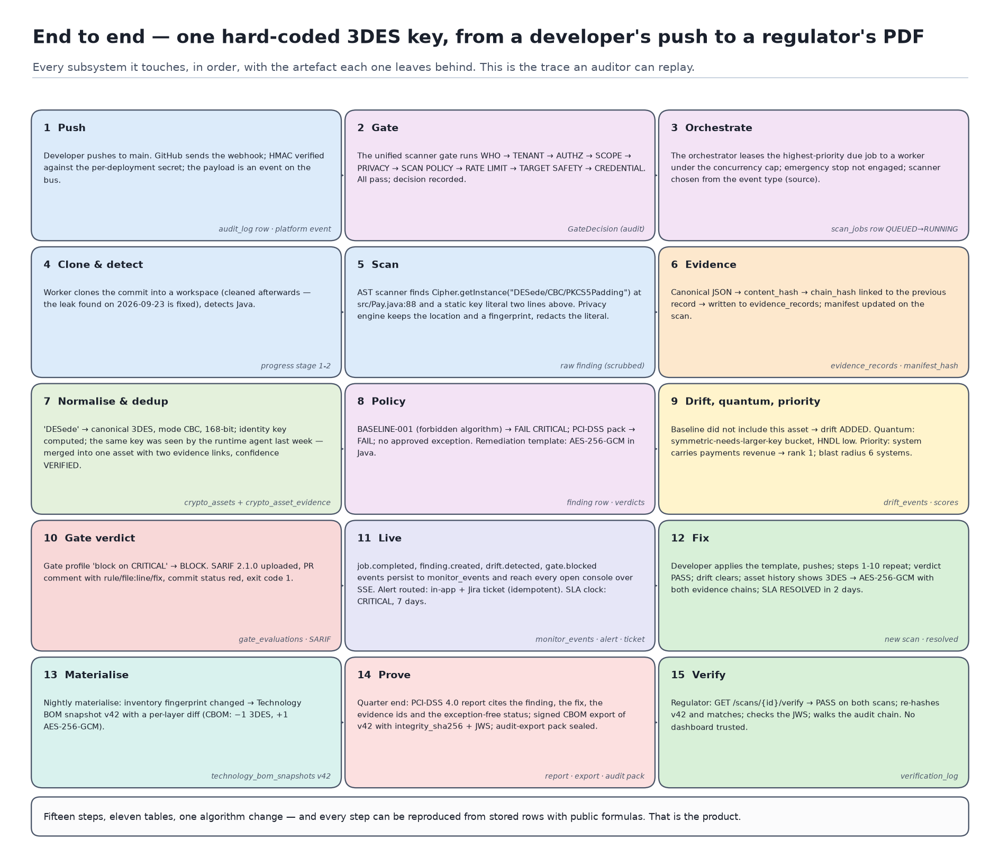

# 9. End to end — one hard-coded 3DES key, from push to regulator

_Chapter 5 traced the fourteen pipeline stages of one job. This chapter goes
wider: one real-world defect followed through **every** subsystem it touches —
gate, orchestrator, scanner, privacy, evidence, dedup, policy, drift, quantum,
priority, CI gate, live delivery, alerting, SLA, remediation, Technology BOM,
reporting and verification — with the artefact each step leaves behind. It is
the trace an auditor can replay._



_Figure 31 — fifteen steps, eleven tables, one algorithm change._

## The scenario

A payments service written in Java. A developer, under time pressure, adds

```java
private static final byte[] KEY = "0123456789abcdef01234567".getBytes();
Cipher c = Cipher.getInstance("DESede/CBC/PKCS5Padding");   // src/Pay.java:88
```

and pushes to `main`. The organisation runs the `banking` sector profile with
the `baseline` and `pci_dss` rule packs, a CI gate profile of *block on
CRITICAL*, and a baseline approved last month.

## The trace

| # | Step | What happens | Subsystem | Artefact left behind |
|---|---|---|---|---|
| 1 | **Push** | GitHub sends the push webhook. The HMAC is verified against the per-deployment secret (the production guard refuses the demo secret). The payload becomes an event on the bus. | `api/routers/webhooks`, eventstream | `audit_log` row · platform event |
| 2 | **Gate** | The unified scanner gate runs WHO → TENANT → AUTHORIZATION → SCOPE (the repo is in the approved scope) → PRIVACY POLICY → SCAN POLICY (`standard` mode) → RATE LIMIT (layer 1–4 budgets) → TARGET SAFETY (dev repo, factor 1.0) → CREDENTIAL (a vault lease for the Git token, TTL 15 min). All pass. | `privacy/gate.py`, `vaultlease` | `GateDecision` in the audit log |
| 3 | **Orchestrate** | The orchestrator pops the highest-priority due event under the tenant's concurrency cap; emergency stop not engaged; `scanner_for_event()` selects the source scanner. A `scan_jobs` row goes QUEUED → RUNNING. | `control_plane/orchestrator.py`, worker | `scan_jobs` row, `job.started` event |
| 4 | **Clone & detect** | The worker clones the commit into a workspace (removed afterwards — the leak found on 2026-09-23 is fixed with a regression test) and detects Java. Progress stages 1–2 stream to the Activity page. | `worker/pipeline/pipeline_runner.py` | progress in `scan_jobs.progress` |
| 5 | **Scan** | The Java AST scanner finds `Cipher.getInstance("DESede/CBC/PKCS5Padding")` at `src/Pay.java:88` and a static key literal two lines above. The privacy engine classifies the literal `RESTRICTED`, keeps the location and a SHA-256 fingerprint, and redacts the value. | `services/scanner`, `privacy/engine.py` | raw finding (scrubbed) |
| 6 | **Evidence** | Canonical JSON → `content_hash` → `chain_hash` = SHA-256(content_hash ‖ previous chain_hash) → `evidence_records`; the scan's `manifest_hash` is updated. | `services/evidence` | `evidence_records` rows, `scans.manifest_hash` |
| 7 | **Normalise & dedup** | `DESede` → canonical **3DES**, mode CBC, 168-bit, purpose encryption. The identity key resolves to an asset the runtime agent already reported last week (`libcrypto` loading 3DES in the same service). The two observations merge into one `crypto_assets` row with two `crypto_asset_evidence` links; two independent scanner families agree → confidence `VERIFIED`. | `normalization`, `deduplication` | `crypto_assets`, `crypto_asset_evidence` |
| 8 | **Policy** | `BASELINE-001` (forbidden algorithm list contains 3DES) → **FAIL CRITICAL**; the `pci_dss` pack's forbidden-legacy rule → FAIL; no approved exception in scope. The remediation engine attaches the Java template: AES-256-GCM with key from KMS and a random 96-bit IV. | `services/policy`, `remediation` | finding row with verdicts and evidence link |
| 9 | **Drift, quantum, priority** | The approved baseline did not contain this asset → `drift_events` ADDED, severity CRITICAL. Quantum: bucket *symmetric needing larger keys*, HNDL low (data at rest, short retention). Priority: the system carries payments revenue and criticality TIER0 → rank 1; BFS blast radius reaches 6 systems including the customer database. | `drift`, `quantum`, `correlation/priority`, `graph_engine` | `drift_events`, scores, graph snapshot |
| 10 | **Gate verdict** | Gate profile *block on CRITICAL* → **BLOCK**. SARIF 2.1.0 uploaded to GitHub code scanning; PR comment names `BASELINE-001`, `src/Pay.java:88` and the fix; commit status red; `scripts/ci_gate.py` exits `1`. | `devsecops`, `api ci group` | `gate_evaluations` row, SARIF artefact |
| 11 | **Live** | `job.completed`, `finding.created`, `drift.detected`, `gate.blocked` persist to `monitor_events`, cross the DB tailer and Redis federation, and reach every open console over SSE. Notification routing sends in-app + a Jira ticket (idempotent `correlation_id`). The SLA clock starts: CRITICAL, 7 days. | `eventstream`, `notifications`, `connectors`, `sla` | `monitor_events`, alert, ticket, SLA state OPEN |
| 12 | **Fix** | The developer applies the template and pushes. Steps 1–10 repeat; verdict PASS; the drift event clears; the asset's history shows 3DES → AES-256-GCM with both evidence chains intact; the SLA resolves in 2 days. Only a scan can resolve a finding — a playbook cannot. | same | new scan, `verification_log`, SLA `RESOLVED` |
| 13 | **Materialise** | The nightly materialise finds the inventory fingerprint changed → Technology BOM snapshot **v42** with a per-layer diff (CBOM: −1 3DES component, +1 AES-256-GCM). v41 is untouched. | `cbom/technology_bom.py` | `technology_bom_snapshots` v42 |
| 14 | **Prove** | Quarter end: the PCI-DSS 4.0 report's requirement line cites the finding, the fix scan, the evidence ids and the absence of exceptions; a signed CBOM export of v42 carries `integrity_sha256` and a JWS; the audit-export pack is sealed with its manifest. | `reporting`, `cbom/export_service`, `governance` | report, export, audit pack |
| 15 | **Verify** | The regulator runs `GET /scans/{id}/verify` on both scans → PASS, `chain_intact = true`; re-hashes v42 and matches `integrity_sha256`; checks the JWS against the published key; walks the audit-log chain to the export event. No dashboard was trusted. | `evidence/verification`, `governance` | `verification_log` rows |

## What this shows

- **Every step is a stored row plus a public formula.** There is no point in
  the trace where the answer depends on a model, a cache or a person's memory.
- **Secrets never enter the record.** The key literal was redacted in step 5,
  before hashing in step 6; nothing downstream — evidence pack, export, Jira
  ticket, report — contains it.
- **One asset, not three sightings.** Source scan and runtime agent merged in
  step 7; the report in step 14 counts one 3DES component removed.
- **Blocking happens where it can actually block.** Step 10 is a CLI exit code
  in the pipeline, not an API a build can ignore.
- **Immutability is what makes step 15 possible.** v42 is the same bytes the
  regulator re-hashes; the evidence rows are the same bytes the chain was built
  from.

## Try it yourself

```bash
deploy/staging/staging-up.sh up              # PostgreSQL 16 + Redis + api + worker + monitor
python scripts/ci_gate.py --repo <url> --profile block-critical   # step 10, exit code 1
curl -s $API/api/v1/scans/$SCAN/verify | jq .chain_intact          # step 15
python scripts/soak.py --cycles 3            # repeats steps 1–15 and records the evidence
```

The tables touched, in order: `audit_log`, `scan_jobs`, `evidence_records`,
`scans`, `crypto_assets`, `crypto_asset_evidence`, `drift_events`,
`gate_evaluations`, `monitor_events`, `technology_bom_snapshots`,
`verification_log` — the eleven on the poster. Their relationships are in
[figure 21](04-dataflow.md#the-data-model).
