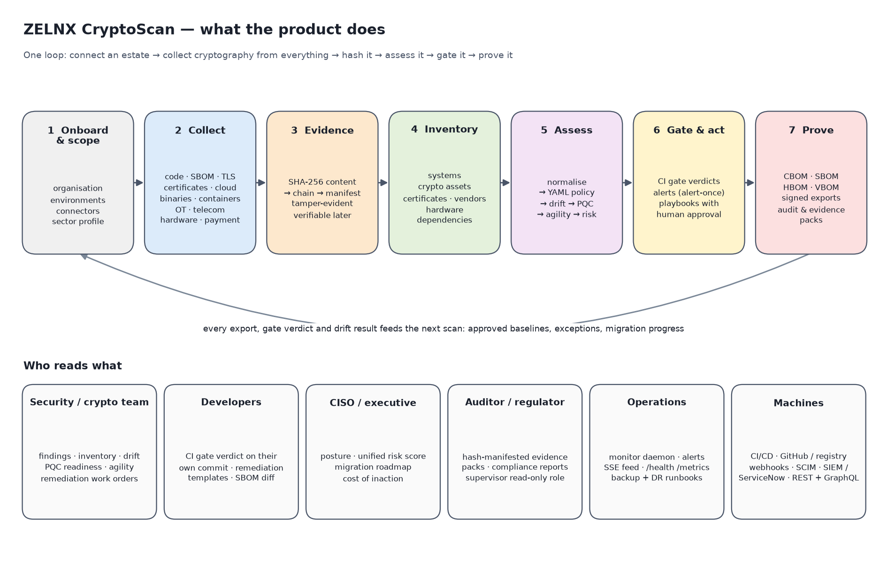

# ZELNX CryptoScan — the product, end to end

_This folder is the complete description of the product: what it is, what it
does, how it is built, how data moves through it, and how ready it is. Every
diagram is rendered from `scripts/gen_docs_diagrams.py` so it can be
regenerated when the code changes; every number is counted from the
repository, not from a plan. Version 1.0.0, 2026-09-23._

## Read in this order

| # | Document | What it answers |
|---|---|---|
| 1 | [What it is](01-what-it-is.md) | The problem, who it is for, what it refuses to do, how to think about it in one page |
| 2 | [Features, end to end](02-features.md) | Every capability grouped by the loop stage it belongs to, with the page, endpoint and service that implements it |
| 3 | [Architecture](03-architecture.md) | The layers, the runtime processes, the stores, the security model — with diagrams |
| 4 | [Data flow](04-dataflow.md) | How a finding becomes evidence, inventory, BOM, export and a live event — with diagrams |
| 5 | [A scan, step by step](05-scan-walkthrough.md) | One job traced through all fourteen pipeline stages, with the rows it writes and how to verify it afterwards |
| 6 | [Scope, maturity and readiness](06-scope-and-readiness.md) | Which of the 71 surfaces are GA / beta / preview, how production-ready the whole thing is, and what is still open |
| 7 | [Glossary](07-glossary.md) | CBOM, HBOM, VBOM, evidence chain, drift, baseline, gate, PQC, HNDL … |

## The product in five sentences

**CryptoScan** discovers every use of cryptography across an organisation's
estate — source code, dependencies, binaries and firmware, TLS endpoints,
certificates, cloud key services, containers, OT/ICS networks, telecom cores,
hardware security modules and payment systems — and turns it into one
inventory. Every finding is recorded in a **SHA-256 evidence chain** so it can
be re-verified later without trusting the server. The inventory is assessed
against **deterministic YAML policy packs** (PCI-DSS, NIST SP 800-131A, CNSA
2.0, FIPS, HIPAA, UAE, a baseline), watched for **drift** against approved
baselines, scored for **post-quantum readiness** and **crypto agility**, and
enforced in **CI as a gate**. What comes out is a versioned **Technology BOM**
(SBOM · CBOM · HBOM · VBOM), signed exports in six formats, and hash-manifested
**audit and evidence packs** a regulator can check. Policy is never decided by
AI, unknowns are reported as unknown with the reason, and nothing on any page
is fabricated: it is empty until a real scan produces evidence.

## Measured today

| | |
|---|---|
| Backend services | 51 packages under `services/` |
| REST surface | 642 paths / 86 tag groups, plus GraphQL and SSE/WebSocket ([reference](../api-reference/rest-api.md)) |
| Console | 71 pages, 6 sidebar sections, English + Arabic |
| Scanners | 6 first-class languages (Python, Java, C#, JS/TS, Go, Rust) + Kotlin, PHP, Ruby, config/IaC; 10 lockfile formats; ELF/PE/Mach-O/archive/firmware parsing; TLS; AWS/Azure/GCP; containers; OT; telecom; hardware; payment |
| Policy packs | baseline · PCI-DSS · NIST · CNSA 2.0 · FIPS · HIPAA · UAE (`services/policy/rule_definitions`) |
| Export formats | json · csv · cyclonedx · cyclonedx-xml · spdx · xml · pdf — each with content hash + HMAC + RFC 7515 JWS |
| Database | PostgreSQL 15/16 in production (SQLite for development), 60 Alembic migrations, 102 tables |
| Identity | local + TOTP MFA, OIDC (relay / auth-code / PKCE), SAML 2.0, LDAP/AD, SCIM 2.0, API keys; 9 RBAC roles |
| Tests | 4,808 backend test functions, hermetic and parallel (~8 min); frontend vitest suite; live PostgreSQL migration test |
| Readiness | ~80 % overall, core path ~92 % — [PRODUCTION-READINESS.md](../PRODUCTION-READINESS.md) |

## Where the rest of the documentation lives

This folder is the narrative. The detailed references it points to are the
existing ones: [user guide](../user-guide/), [admin guide](../admin-guide/),
[architecture decisions](../decisions/), [API reference](../api-reference/rest-api.md),
[runbooks](../runbooks/), [security](../security/), and the
[soak evidence](../soak-evidence/README.md). The index is [docs/README.md](../README.md).

Regenerate the diagrams: `python scripts/gen_docs_diagrams.py` (matplotlib only, no browser or Graphviz).
